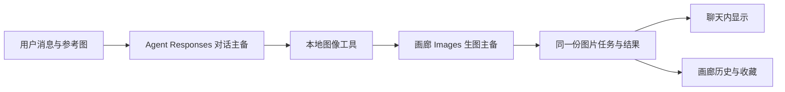

# Chat to image 桌面化开发大纲与进度

更新日期：2026-10-12（Asia/Hong_Kong）。

**执行状态：Windows x64 独立安装器 0.1.0 已生成，包含 Python、WebView2 离线组件及 45 条内置图文示例；首次安装、真实 WebView2 启动、覆盖安装与卸载保留检查均通过。安装包排除个人配置与作品。**

本文件是本次改造唯一的任务清单、进度及验收入口。项目根记为 `<PROJECT_ROOT>`，下列文件路径均相对项目根。各节已经用户确认的开发范围恢复后沿用，不重新索要同范围授权；新增待确认方案按对应章节状态执行。

## 一、全局目标与用户任务

在现有项目上完成一个可本地使用的 Windows 桌面生图工具，参考 Codex 的布局和视觉风格，保留生成、编辑和作品管理能力；按用户最新要求精简设置。画廊与 Codex 独立调用共用 Images 配置，Agent 使用独立 Responses 配置。

| 用户任务 | 最终应能完成的操作 |
| --- | --- |
| 打开工具 | 双击 `run-app.cmd`，进入独立 UI；运行状态和错误在 UI 显示，没有持续存在的 CMD 窗口 |
| 生成和编辑图片 | 输入提示词、设置参数、添加参考图、蒙版修改、查看状态和结果、保存及复用图片 |
| 管理全部设置 | API 按画廊和 Agent 分组；生成、外观与交互、Agent 使用习惯、数据导入导出均有入口 |
| 管理两组 API | 画廊 Images 和 Agent Responses 各五个配置位，分别编辑、指定主用、启停、排序；看到实际使用方案与切换原因 |
| 关闭窗口后继续使用 Codex | UI 所属服务和任务随窗口关闭；Codex 独立生图入口及它发起的进程保持独立可用 |

### 已确认的范围与规则

- 视觉：中性色、清晰边界与留白、左侧导航、中间图片工作区、底部提示词与附件、可展开参数，支持深浅主题。
- 复用现有 React 生图、参考图、蒙版、收藏、历史和 Agent。设置页只提供 Images / Responses 两组，移除混合模式、自定义服务商编辑和配置 URL 分享入口；历史服务商数据保留。
- UI 和 Codex 共用本机加密配置；桌面保存设置后直接生效，不要求浏览器刷新同步。
- 画廊与 Agent 分别提供五个主备位。池外 Images / Responses 可在各组配置列表管理，其他历史记录不得因分组直接截断或删除。
- 画廊主备支持 OpenAI 兼容同步 Images，与 Codex 共用；Agent 主备支持 Responses 对话与标题，可文字流式返回；Agent 图像工具复用画廊 Images 主备。画廊流式和特殊模式仍走原通道，不参与画廊主备。
- 明确拒绝受理（鉴权、余额、限流等可识别错误）才允许同一任务切备用。超时、断线或结果不明，不自动重复提交当前生图。画廊保留失败冷却；Agent 每次请求重新按主备顺序选择。
- 仅清理由本 UI 创建并持有的服务和子进程，不按名称批量杀 Python、浏览器或 Codex 进程。
- 保留已有 API 与用户数据。旧浏览器历史通过既有导出/导入入口迁移，不直接抓取浏览器凭据数据库。
- 本地私人使用；不增加发布、云账户、跨设备密钥云同步、常驻多 Agent 或与需求无关的服务。
- 开发阶段不生成 ZIP。新增 UI 不代表已经注册 MCP；现有 Codex 调用事实仍以独立 Python 接口为准。

## 二、只使用必要技能

| 技能 | 具体用途 | 使用阶段 |
| --- | --- | --- |
| `agent-skills:planning-and-task-breakdown` | 拆分依赖、每步操作和验收，维护本文件的实际进度 | 本次规划、恢复时及必要的顺序调整 |
| `ui-ux-pro-max` | 指导 Codex 风格布局、设置表单、生图操作、深浅主题及键盘可用性 | 步骤 3、4、5、7 |
| `writing-for-agents` | 校准项目入口与已有默认生图 Skill 的配置读取指引，避免换机沿用过期流程 | 收尾（只更新本次受影响内容） |
| `stop-that-shit` | 沿用已有功能；新增机制须对应实际缺口；避免重复验证与范围扩张 | 方案选择、边界变化、收尾 |

规划与实施沿用已读取的三个主流程技能；收尾按需增加文档指引专项，不叠加开发流程。恢复时安装未变可复用；变化时重新核实。此前已读取的其他开发技能不再叠加为固定流程。

默认由一名主力顺序实现，不新增模型切换要求。进程回收和凭据访问边界完成后，按全局规则进行一次作者与审查者分离的针对性审查；不扩大为全仓审计，不递归分派。

## 三、采用的方案及必要性

| 方案 | 现有缺口 | 采用理由与边界 |
| --- | --- | --- |
| 复用 React 页面和组件 | 现有入口布局不满足此次桌面交互目标 | 改布局及交互，保留高级功能和已有数据模型 |
| `pywebview` 桌面窗口 | 单独浏览器标签页无法可靠归属并管理窗口对应的本地后台 | 用已有 Python 承载 WebView 窗口；依赖声明在 `requirements-desktop.txt`，不再引入另一套桌面框架 |
| 本机加密设置 | 原有浏览器同步只有当前一套配置，不能满足五套共享主备 | 使用现有 Windows DPAPI，加密保存桌面设置；凭据、运行状态和浏览器 profile 都按设备和项目隔离 |
| 共用独立生图入口 | UI 和 Codex 各自重试会产生不同切换行为 | 标准 Images 路径复用 `scripts/playground_image.py`；UI 只管理自己启动的任务，Codex 不依赖 UI 服务 |
| 稳定的本机网页来源 | 每次换访问来源会导致浏览器历史存储割裂 | 桌面端记住自身来源；占用时明确报错，不能静默换来源后宣称数据丢失 |

上述方案已实现；实际运行证据及限制见第四节。

## 四、目前做到哪里

### 本次 Agent 对话调整（2026-10-03）

- **目标**：Agent API 配置支持多个对话模型，聊天中可选；移除图像工具模型与中间图像数设置及请求覆盖；两组接口仅作备注；Agent 输入区采用专用对话布局。
- **步骤**：① 模型列表保存与主备按所选模型路由；② API 表单精简；③ 对话输入区接通模型、图片附件、联网、发送/停止；④ 定向回归与网页模拟，更新说明并本地提交。
- **设计**：沿用项目中性色与边框，Agent 以多行消息为主体，底部工具和模型栏，不显示尺寸/质量/数量绘图参数。复用已有富文本编辑和图片引用能力；两组配置不混用。明确选择模型时只使用声明支持该模型的主备方案，避免静默改模型。
- **范围**：不增加依赖，不引入新接口或自动拉取服务商模型目录；填写服务支持的模型 ID。必要技能仅前端界面及 `stop-that-shit`。
- **实现完成**：Agent 每个方案可填写多个模型，输入区可选模型、添加图片、联网、开启图像工具、发送/停止；原编辑器与 @ 引用复用。普通聊天默认关闭图像工具（按已提出的推荐项实施，可随时在输入区打开）。已移除 Agent 图像工具模型和中间图像字段及实际请求参数；接口类型仅为备注。纯文字消息隐藏图片收藏/下载；调整快捷回复后的自动滚动和输入区遮挡判断。
- **AI 已验证**：TypeScript / Vite 构建通过；五组相关前端用例 244 项通过，模型导入识别变动后针对 apiProfiles 的 77 项复验通过；桌面隔离 16 项通过，补充模型列表/选择/图像开关加密往返断言后该用例复验通过。浏览器实际填写两个模型、保存、复制主备、选择模型、发送普通聊天及开启联网，模拟主用 401 → 备用保持所选模型；接口收到的 model/tools 与选择一致，未调用真实服务。
- **待用户验证**：重开原生桌面体验；服务商是否支持所填模型、看图、联网与可选图像工具依赖真实配置，本轮未调用收费服务。
- **下一交付**：本轮范围已完成，按后续实际使用反馈定向调整。

### 本次 API 分组调整（2026-10-03）

- **已确认目标**：画廊固定 Images、Agent 固定 Responses，两组分别配置五套主备、启停与顺序；Agent 行为设置并入习惯配置。
- **步骤**：① 分离配置选中项与主备池，保留已有配置；② 设置页按组显示适用字段，移除混合模式和独立 Agent 选项卡；③ 接通 Agent 对话、标题及批量图片的主备切换，明确拒绝才重试；④ 验证配置互不干扰、真实页面操作及模拟失败路径，构建、更新说明、提交。
- **实现完成**：两组各五套，连接/模型/主用/启停/顺序独立；保留保存按钮；协议固定、仅展示适用字段。Agent 四项行为设置并入习惯配置，移除独立 Agent 设置页、混合/共用模式、自定义服务商编辑及配置 URL 分享。旧数据保留，缺失的 Responses 配置不从画廊复制 Key。
- **AI 已验证**：最终 TypeScript / Vite 构建通过。配置/工作区/状态/Agent 主备相关前端共 244 项定向用例通过（最终受影响的 store、workspaceSettings、agentRouting 为 150 项，其他 94 项复用本轮有效结果）；桌面隔离验证 16 项通过。覆盖两组五槽、停用/切主用、加密保存与 CLI 只读画廊、明确拒绝转备用、超时/网络/流式受理后失败不重发、标题及批量切换。浏览器实际创建两组方案、保存刷新保留、核对固定协议和 Agent 使用习惯；模拟 Agent 主用 401 → 备用成功，图片任务正确显示备用方案。
- **独立审查**：发现并修复预置导入/恢复可能重新启用 hybrid 的入口；最终工作区规范化强制 Responses native，新增定向回归。只读复核确认该绕过关闭。
- **待用户体验**：重开 `run-app.cmd` 查看本轮设置布局；真实服务兼容、原生窗口点按与新设备均未冒充通过。本轮未调用收费接口。
- **下一交付**：本轮范围已完成，后续按用户实际使用反馈定向处理；不新增模型、依赖、服务或主备持久冷却机制。
- **验收边界**：使用本机模拟接口，保留超时/断线/响应处理中失败不重复提交；不触碰真实付费服务，不删除历史或密钥。保留确有用途的流式、超时、图片编辑与数据管理。
- **必要技能**：复用前端界面技能，使用 `stop-that-shit` 约束清理范围；不增加依赖、进程或协议。

### 本次界面修正（2026-10-03）

- **范围**：修复单 API 无法操作启用开关，增加明确保存按钮；历史与收藏隐藏生图输入框，保留批量操作和返回创作的路径。
- **步骤与状态**：① 前后端允许主用/单方案启停，规范化与路由保持一致，已实现；② 设置页增加保存按钮、等待桌面落盘及成功/失败反馈，已实现；③ 历史与收藏隐藏输入框，复用/编辑回到创作且保留内容，已实现；④ 定向验证、更新说明及最终构建，已完成。
- **必要技能**：本轮小修使用 `agent-skills:frontend-ui-engineering`，沿用既有界面风格与组件，不增加依赖或额外流程。
- **AI 已验证**：前端配置与状态回归共 210 项通过；隔离桌面测试 15 项通过，覆盖单方案停用/启用、加密保存、无可用方案不请求、主用停用后的备用规则。最终 TypeScript / Vite 构建成功。浏览器已验证开关、显式保存当前输入、刷新保留、历史/收藏无输入框、模拟生成后复用及编辑输出返回创作、历史多选工具保留，控制台无错误。
- **边界**：浏览器使用纯静态服务与本机模拟 API，未读取或修改用户真实密钥，未调用收费图片服务；本轮原生窗口点按体验待用户重开确认。

### 可用能力

- `run-app.cmd` 已切换到无控制台桌面入口，显示独立窗口；首次依赖安装及启动失败使用窗口反馈。
- Codex 风格侧栏、创作模板、历史/收藏/Agent 入口、可展开生成参数、深浅主题已接通；原有高级设置、参考图和蒙版组件继续使用。
- 桌面设置由 Windows 当前用户加密保存。首存之前安装自动保存监听；加载时阻止编辑覆盖，保存失败提示重试。桌面 localStorage 不持久化完整设置。
- 画廊与 Agent 各五套主备位，支持新建、引用已有、主用、启停、排序和移出池保留配置。同步 Images 路径共用 CLI；Agent Responses 独立路由，显示切换原因与每张结果的实际方案。
- 界面所属任务由所持有 Popen 句柄回收；超时不阻断其他任务清理。原生窗口的服务在退出路径关闭；独立 Codex 调用不依赖窗口。
- 项目整体位于用户指定的新工作目录，源码、构建、Git 和本大纲均已迁移。使用与换机步骤见 `README_使用说明.md`。

### 验证证据与限制

| 范围 | 证据 |
| --- | --- |
| 构建 | 最终 TypeScript / Vite 构建成功；本机缓存路径解决网络盘与 Windows 路径重定向问题。保留上游 bundle 大小警告，未扩展性能改造 |
| 前端回归 | 原有 570 项通过；一个路径重定向失败的套件修正构建路径后 6 项通过。新增主备规范化 3 项通过；最终相关配置/持久化共 99 项定向复验通过 |
| 本机后端 | 新桌面 13 项、既有 CLI 16 项、同步 10 项、桥接脚本 4 项通过；均使用隔离目录和模拟服务，不含真实收费请求 |
| 主备及边界 | 覆盖主用成功、401 后备用、缺 Key/空地址跳过、禁用备用、全部拒绝、关闭切换、断线/503/坏响应不重复提交、批量部分成功、编辑与蒙版请求、DPAPI 加密、外站拒绝及超时清理 |
| 并行调用隔离 | 模拟 UI 任务与独立 CLI 同时执行，停止 UI 所属任务后，独立任务继续完成且能再次调用 |
| 网页实际操作 | 在隔离的浏览器页面创建五套方案、选择主用、排序、停用、刷新保留和浅色主题；用本机模拟 API 完成文生图、参考图编辑、画笔蒙版保存及局部编辑，并查看结果详情 |
| 原生桌面 | 从 `run-app.cmd` 打开窗口；用户确认“正常显示。已关闭”。AI 随后确认所属进程和监听端口退出，桌面保存配置仍可供 CLI 预检查读取 |
| 独立审查 | 对进程清理、凭据边界和保存竞态做一次只读独立审查；已修复清理中断和首存订阅竞态。地址使用正常接口路径，凭据仅放 Key 字段，不猜测阻断供应商路径 |
| 尚未宣称通过 | 本轮未调用真实收费图片服务；原生 UI 的三种生图流程由网页实际操作 + 宿主/CLI 集成检查覆盖，未逐条在原生窗口点按；浏览器下载事件未捕获到，原生保存对话框待实机确认；新电脑尚未验收 |

前序真实出图仅证明改造前的服务可用。本轮没有把它记为新桌面的付费生成验证。

## 五、逐步开发任务

实施依赖：**1 → 2 → 3 → 4 → 5 → 6 → 7 → 8 → 9**。下文保留各步骤的任务与验收定义，实际完成情况以上表和第四节为准。

| 步骤 | 全局任务中的作用 | 当前状态 | 复杂度 / 损失风险 |
| --- | --- | --- | --- |
| 1 | 恢复现场并打通构建 | 完成；最终构建通过 | 中 / 低 |
| 2 | 启动独立桌面窗口 | 完成；用户确认显示与关闭 | 中 / 中 |
| 3 | 建立 Codex 风格主界面 | 完成；网页已实测 | 中 / 低 |
| 4 | 接通全部设置与加密保存 | 完成；加密共享与保存失败提示接通 | 中 / 高 |
| 5 | 实现五套主备配置 UI | 完成；五方案网页操作与规则检查通过 | 中 / 中 |
| 6 | 打通共用生图与主备切换 | 完成；主备及失败行为模拟检查通过 | 中 / 高 |
| 7 | 完整优化生图和编辑操作 | 完成；三种生图网页模拟流程通过，原生保存对话框待体验 | 中 / 中 |
| 8 | 完成关闭窗口与 Codex 隔离 | 完成；隔离检查、独立审查及真实关闭核对已完成 | 中 / 高 |
| 9 | 从实际入口验收并交付 | 完成本轮可执行验收、说明和迁移；限制见第四节 | 中 / 中 |

### 步骤 1：恢复现场并打通构建

- **要做什么**：重新确认项目规则、Git 状态和初稿；保留未知改动。定位现有网络映射盘构建失败的具体原因，必要时在本机临时目录构建，再回写构建产物。先不扩展业务代码。
- **主要文件**：构建配置、`package.json`、必要的构建入口；不手工编辑 `dist/`。
- **完成标准**：现有前端能从源码构建；构建输入与输出位置明确；不复制凭据到构建目录。
- **验证与检查点**：记录一次实际构建结果。若失败，针对原因修复，不能继续用旧 `dist/` 冒充新 UI。

### 步骤 2：启动独立桌面窗口

- **要做什么**：接通 `run-app.cmd` → 无控制台启动器 → 桌面宿主 → 当前构建页面。界面显示首次依赖初始化、启动失败及本地服务状态；正常启动不保留 CMD。保留浏览器方式作为既有入口，不自动运行无关后台。
- **主要文件**：`run-app.cmd`、`requirements-desktop.txt`、`scripts/desktop_app.pyw`、`scripts/desktop_host.py`、`scripts/serve_app.py`。
- **完成标准**：双击可打开真实窗口；重复启动有明确反馈；依赖或端口问题可见且不会误杀其他进程。
- **验证与检查点**：从实际启动入口打开、关闭、重开；观察真实进程和端口，不仅验证函数返回。

### 步骤 3：建立 Codex 风格主界面

- **要做什么**：增加左侧导航（新建、历史、收藏、设置），重新组织顶部信息、中间图片区和底部输入区；采用中性配色、适当留白和统一按钮层级；接通深浅主题。
- **主要文件**：`src/App.tsx`、主布局组件、`src/index.css`、主题配置及必要的类型定义。
- **完成标准**：各导航进入真实功能；内容与固定输入区不遮挡；深浅主题下文字、焦点和控件清楚可用。
- **验证与检查点**：查看空状态与有图片状态的实际界面，检查窗口缩放及键盘导航。此步不把所有高级设置重写一遍。

### 步骤 4：接通全部设置与加密保存

- **要做什么**：将现有 API、生成、Agent、交互、数据管理设置纳入新布局；接通桌面加载与保存接口；保存后让独立入口立即读取同一份配置。处理首次导入已有同步 API，并保留旧数据导入入口。
- **主要文件**：设置组件、前端桌面桥接模块、`src/store.ts`、`src/lib/apiProfiles.ts`、`scripts/desktop_config.py`。
- **完成标准**：保存并重启后设置仍在；Key 不在日志、URL或版本控制中出现；桌面模式不额外将明文 Key 写进网页持久存储；加载失败不能伪装成空配置成功。
- **验证与检查点**：真实保存、关闭、重开，检查设置一致性及 Codex 预检查；确认完整高级设置入口可达。

### 步骤 5：实现五套主备配置 UI

- **要做什么**：提供五个配置位，支持名称、地址、Key、模型和现有高级参数编辑；选择主用、启停、调整备用顺序；显示当前方案及可用状态。保留主备池外的既有高级配置。
- **主要文件**：五方案面板、现有 API 设置组件、`src/types.ts`、配置规范化模块及 `scripts/desktop_config.py`。
- **完成标准**：最多五个主备位，主用引用有效；空配置、禁用、删除、导入及特殊供应商有明确处理；重启后顺序和主用选择不变。
- **验证与检查点**：实际编辑五方案并重开；验证不会因上限或重新排序丢失其他配置。五套配置不要求全部填写才能使用。

### 步骤 6：打通共用生图与主备切换

- **要做什么**：前端标准 Images 请求接入独立 Python 生图路径，共用已保存主备池；实现拒绝受理时有序切换、结果不明时停止重发，反馈实际配置和切换原因；保留批量已生成结果。
- **主要文件**：`scripts/playground_image.py`、`scripts/desktop_config.py`、桌面宿主生图方法、`src/lib/api.ts` 及前端桥接模块。
- **完成标准**：UI 和 Codex 使用相同主备规则；鉴权/额度/限流等明确拒绝能切备用；超时、断线、收到结果后的解析或保存错误不能重复生成；实际使用方案可追溯。
- **验证与检查点**：先用本机模拟 API 验证主用成功、主用拒绝后备用成功、全部失败、结果不明和批量部分成功；随后使用实际入口核验。不得无授权用真实 Key 制造收费故障测试。
- **已覆盖的初稿问题**：空配置和无效地址是否挡住可用备用；禁用主用如何处理；逐张批量是否重复尝试已失败配置；共享状态并发写入是否影响路由；实际使用方案能否正确写入任务详情。

### 步骤 7：完整优化生图和编辑操作

- **要做什么**：接通底部提示词、参考图拖放和移除、蒙版入口、参数展开；清楚显示准备、生成、成功和失败；结果可放大、保存、复用。原有历史、收藏与 Agent 入口保持可用。
- **主要文件**：`InputBar`、参数面板、任务列表/卡片、必要的结果详情组件；蒙版与图像存储优先复用。
- **完成标准**：文生图、参考图编辑和蒙版编辑均从 UI 完成；参数发送正确；失败原因可见；部分成功的图片仍能保存。
- **验证与检查点**：分别走完这三条用户流程，检查文件保存、结果显示及任务详情；复用已覆盖的底层证据，不机械重跑全部检查。

### 步骤 8：完成关闭窗口与 Codex 隔离

- **要做什么**：完善 UI 所属服务及子进程的关闭处理，核实互斥、来源和进程归属；关闭时处理 UI 正在执行的任务；Codex 直接调用保持独立。对进程回收及凭据边界做一次独立审查。
- **主要文件**：桌面宿主、无控制台启动器、启动批处理及必要的桥接收尾逻辑。
- **完成标准**：关闭 UI 后它的服务端口和子进程退出；无关浏览器/Python/Codex 进程不受影响；UI 关闭期间 Codex 任务可继续，关闭后也可新建 Codex 生图任务。
- **验证与检查点**：通过受控模拟任务验证 UI 和独立 CLI 同时运行、关闭窗口和随后再调用；不能仅凭进程清理代码存在而宣称通过。

### 步骤 9：实际入口验收、文档与交付

- **要做什么**：从 `run-app.cmd` 连贯完成启动、配置、生成/编辑、主备切换、关闭、Codex 调用；更新现役使用说明中实际改变的行为，并清理本会话无用临时文件。
- **主要文件**：现役使用说明、`docs/codex-image-interface.md`、必要的项目入口说明和本文件。
- **完成标准**：全局五项用户任务全部接通；关键进程与凭据边界有证据；分别列出实现完成、AI 已验证及待用户体验确认的事项。
- **验证与检查点**：只做最终改动相关的构建与回归，记录真实/模拟/受限范围；如浏览器或设备验证受限，明确具体缺口，不能虚报完成。
- **交付方式**：提供启动入口与说明链接。只对独立、完整、已验证的本任务改动做本地提交，不自动 push，不把其他人的修改一起提交。

## 六、下一次工作的起点

- 第八节实现和本机模拟验证已完成；后续从该节验收边界及用户新需求继续。
- 本轮实现已接通，代码与验证范围以上述表格为准；后续无需从旧初稿重新开始。
- 普通使用从 `run-app.cmd` 启动；需要继续开发时先读本文件并核对 Git 差异。
- 剩余设备体验确认：原生文件保存对话框及新电脑运行。若发现问题，只验证相关路径，不重复已充分通过的检查。
- API 与历史按设备保存；不能仅复制项目就声称已迁移凭据和 WebView 历史。

## 七、项目迁移与换机接续

项目迁移已完成，后续桌面开发也在迁移后的目录进行。项目已在用户指定的新工作目录下以原项目目录名整体保存，包含源码、Git 历史、当前构建文件、依赖目录及本开发大纲。旧目录已移走，后续使用当前 `<PROJECT_ROOT>`，不沿用旧位置。

### 新电脑如何继续

1. 在新电脑现场确认 `<PROJECT_ROOT>`，用 Codex 打开项目目录。
2. 读取 `AGENTS.md` → `PROGRESS.md` → 本文件，核对实际 Git 差异。不要将“源码存在”理解成“功能已完成”。
3. 检查 PowerShell 7+、Python、Node/npm 及项目声明的依赖；现机已安装的用户级组件不会随项目目录转移。已有 `node_modules/` 保留，但新机需按实际平台判断能否复用。
4. 查看第四节的现有能力与证据，按新任务继续；无需重复原来的初始化开发。
5. `run-app.cmd` 已启动新版桌面。新设备在桌面设置中重新填写 API，历史通过数据导入恢复；详见根目录使用说明。
6. Windows 用户加密凭据、浏览器历史、Codex 用户级 Skill、环境变量及本机安装依赖不等于项目文件，不会自动跨电脑可用。新设备须现场配置；用户级及项目内的 `generate-playground-image` 技能已于 2026-10-05 按用户要求卸载；项目生图脚本与个人配置保留。
7. 若旧电脑曾保存 API，不能直接在另一 Windows 用户或设备解密使用。禁止为了迁移把 Key 写入项目文件、Git 或本大纲。

### 迁移核验结果

- 迁移前后 20,957 个文件的相对路径与大小一致。
- 除依赖目录和 Git 内部目录外，对 279 个文件进行了 SHA-256 核对，内容一致；后续只更新本大纲的迁移记录并提交本次两份文档。
- Git 原 HEAD 保持一致，既有已修改文件与未跟踪源码完整保留；没有将未完成业务代码冒充已完成提交。
- 本机的项目定位环境变量已更新。原已加密的同步配置仅在当前 Windows 用户的本机配置目录中为新项目位置保留，没有解密导出或放入项目。新电脑仍须重新配置凭据。
- 迁移核验只证明文件搬迁完整；后续桌面 UI、五套配置与主备切换的实现和证据见第四节。

## 八、模型管理、对话生图与界面优化（已实现并完成本机模拟验证）

### 目标与实施前审查结果

让用户完成三个连贯任务：① 填好 API 后获取模型并勾选常用模型；② 在 Agent 里讨论需求、生成图片和继续修改；③ 在聊天与画廊间复用同一份作品和参数。沿用 Codex 风格、两组各五套主备、桌面加密配置及独立 Codex 调用。

| 已核实的现状 | 建议调整 | 用户收益 |
| --- | --- | --- |
| `SettingsModal.tsx` 中 Agent 模型为手填文本列表，画廊为单模型 ID；桌面桥没有模型发现方法 | 每个方案增加“获取模型”、搜索、启用多选、明确的默认模型选择，并保留手动添加 | 不必记模型 ID，也不会把服务商全部模型塞进聊天下拉框 |
| `agentApi.ts` 现役 native 路径使用 Responses 内置图像工具，未复用画廊 Images 主备 | Agent 通过函数工具调用现有画廊生成/编辑流程 | 对话模型与图像服务可以来自不同供应商，画廊配置只维护一份 |
| `AgentComposerControls.tsx` 的模型和工具选择写入全局设置；联网设置在习惯页重复 | 习惯页保存新对话默认值；输入区设置只作用于当前对话并随对话记忆 | 在不同对话使用不同模型，互不覆盖 |
| `Header.tsx` 与 `WorkspaceSidebar.tsx` 有重复导航及设置入口；API 页有主备槽和当前配置两层选择 | 宽窗口统一左侧导航；窄窗口保留可达入口；API 用一份方案列表控制右侧编辑区 | 减少切换与选错配置，避免精简后丢失小窗口入口 |
| 已有参考图、蒙版、历史、收藏、参数和图片引用 | 复用这些能力，补齐聊天任务卡及双向跳转 | 连续改图不必下载再上传，也不重复存作品 |

以上为实施前审查基线。当前实现及验证证据见本节执行记录，原有桌面能力证据见第四节。

### 推荐交互与配置归属

**API 设置**保留“画廊 / Agent”两组。每组显示五个主备位，选择一个方案后在右侧编辑名称、地址、Key、模型；主用、启停、备用顺序仍可直接操作。池外已有配置收进“更多已存配置”，不删除数据。底部保留保存按钮和保存结果。Images / Responses 只作说明，不做可切换接口控件。

**模型管理**将供应商返回目录与用户启用列表分开。点击“获取模型”后可搜索、多勾选和指定一个默认模型；画廊也可启用多个图像模型，在创作参数中单选本次模型。Agent 配置只出现对话模型。刷新不自动勾选全部模型、不清除原选择；返回列表不含的原选项标记“本次未返回”。不提供模型目录的服务继续允许手填。

- 复用 Python 桌面桥获取兼容 `/models` 列表，遵循已有 API 地址规则，不另起服务或引入 SDK。请求使用当前方案已保存的配置；有未保存更改时提供“保存并获取”，避免取到旧地址的列表。纯浏览器入口沿用已有请求路径，跨域限制明确提示，不新增代理服务。
- 获取列表只证明目录请求成功，不等于模型支持 Responses、看图、联网或工具调用。能力有供应商明确信息时展示，否则标记未确认；不只按名称过滤未知模型，也不自动进行收费探测。
- 缓存最近一次列表并显示更新时间；更改地址或凭据后标记需刷新，获取失败保留原启用列表与默认值。
- 聊天模型选择支持搜索，仅显示当前主备池已启用方案声明的已选模型。显式选择模型时，只在支持相同模型 ID 的方案间切换；“自动”使用各方案默认模型并显示实际使用结果。画廊选择模型沿用同一原则，不能备用切换时悄悄换成其他模型。

**Agent 对话**保留独立消息输入区，包含模型、附件、联网、图像工具、发送/停止。图像工具使用画廊当前默认参数；用户明确要求的尺寸、数量等只覆盖本次任务，并在任务卡显示实际参数，不把整套绘图表单搬进输入框。新对话从习惯配置取默认值；模型、联网和图像工具开关随后按对话保存，运行期间锁定当前请求选项。

- 图像工具开启后，Agent 根据明确生图/改图请求调用生成或编辑工具；本地复用画廊流程。无需重新配置 Agent 图像模型，不恢复旧混合模式选项卡。批量请求复用已有批量处理并保留部分成功结果。
- 结果以任务卡显示：提示词摘要、参考图、参数、实际方案、真实阶段和失败原因；不伪造百分比。提供“继续修改”“在画廊打开”“收藏”“下载”；画廊提供“发送到 Agent”，提示词提供“带入画廊”。收藏和历史继续不显示输入框。
- 图片引用复用现有 ID，避免重复保存。没有看图能力的对话模型不发送图片内容或宣称已理解图片；仍可按用户描述将图片引用交给编辑工具。不能调用工具的模型显示明确提示，并提供手动“按此提示词生图”。
- 对话主备和生图主备分别处理失败；图像工具执行结果关联调用 ID，后续对话失败不能自动重做已提交的生图。沿用明确拒绝才切备用、超时或结果不明不自动重发的规则。
- “停止”终止本地后续处理及本界面持有的任务；已被供应商受理的远端任务不能虚报撤销成功。独立 Codex 任务维持原有进程归属。

### 界面保留、合并与后置

| 处理 | 内容 |
| --- | --- |
| 保留 | 两组五套主备、保存按钮、参考图/蒙版、历史/收藏、导入导出、深浅主题、独立 Agent 输入区、Codex 调用入口 |
| 合并 | 桌面重复导航与设置入口；五槽与配置选择统一；联网及图像开关区分新对话默认和当前对话；图片状态与作品操作共用现有数据 |
| 精简 | 桌面窗口隐藏“安装为应用”；图像生成参数只在画廊与任务详情出现；设置只展示当前组有用字段 |
| 折叠 | 代理、超时、流式与特殊模式等确有用途的高级配置；明确这些模式是否参与同步 Images 主备，不能把现有例外包装成全部支持 |
| 后置 | 模型收藏、自定义参数预设等便利功能，先完成搜索、已选模型和既有参数复用；暂不引入新的管理界面 |

本轮不新增节点工作流、知识库、多 Agent 框架、云同步、计费面板或新常驻服务。现有未使用的旧分支仅在新流程接通、确认无调用且保留历史数据读取之后，局部清理；不开展全仓重构。

### 逐步交付与验收

| 步骤 / 状态 | 每一步做什么 | 依赖与主要位置 | 完成判据 | 复杂度 / 损失风险 |
| --- | --- | --- | --- | --- |
| 0 / 用户已确认 | 核实代码现状、参考官方资料、写入本大纲 | 当前源码、现有状态与下列资料 | 用户能审核范围、交互、边界及顺序；没有把方案写成已实现 | 低 / 低 |
| 1 / 已实现并模拟验证 | 接通模型目录读取、缓存与失败反馈；两组模型搜索/多选/默认；保存和聊天/画廊模型选择连通 | `src/lib/desktop.ts`、桌面宿主、配置规范化、API 设置、输入栏 | 获取成功可选多个并保存，重开仍在；目录失败仍可手填且旧选择不丢；选定模型主备不静默换模型 | 中 / 中 |
| 2 / 已实现并模拟验证 | 接通 Agent 生成和编辑工具到画廊；引用图片与蒙版；同一任务回显聊天和历史；隔离聊天重试与生图执行 | 步骤 1；`src/lib/agentApi.ts`、已有图像 API、store action、图片存储、任务组件 | 从 Agent 完成文生图、参考图改图、蒙版修改；看到正确实际方案和参数；聊天失败不重复出图，批量部分成功不丢 | 高 / 中 |
| 3 / 已实现并模拟验证 | 当前对话记住模型与工具；新对话默认归入习惯配置；统一导航/API 选择；增加双向跳转、继续修改和任务卡 | 步骤 2；Agent 对话状态、输入组件、Header、Sidebar、SettingsModal | 两段对话选项互不覆盖；历史/收藏无输入框；宽窄窗口入口可达；一份作品能连续编辑与双向打开 | 中 / 低 |
| 4 / 本机验证及说明完成，真实服务/原生体验待验 | 从桌面入口走完新流程，检查针对性失败分支，更新使用说明与本节状态，独立完整改动本地提交 | 前三步最终代码 | 分别记录实现、模拟验证、真实服务/设备待验；原有保存、主备、关闭窗口与 Codex 隔离不回退 | 中 / 中 |

验证限定于本次流程：模型目录成功/拒绝/不支持、配置保存、单 API 与主备、聊天工具执行、失败后不重复生图、图片复用、窗口布局。优先本机模拟服务；本轮使用假 Key 完成下述验证，真实供应商兼容性留待后续实际使用验证。涉及凭据读取或进程回收边界的改动时按项目规则增加独立审查，普通界面由主力自查。

### 采用的参考与必要技能

- [Open WebUI：聊天内生成和编辑图片](https://github.com/open-webui/docs/blob/main/docs/features/chat-conversations/image-generation-and-editing/usage.md)：借鉴聊天模型与图像引擎分离、按对话启用工具、结果继续编辑；不引入其账号权限体系。
- [LibreChat：Image Generation & Editing](https://github.com/librechat-ai/docs/blob/main/content/docs/features/image_gen.mdx)：借鉴图片 ID 引用和对话中的生成/编辑工具；不引入其完整 Agent/MCP 框架。
- [Cherry Studio：供应商与模型文档](https://github.com/cherryhq/cherry-studio/blob/main/docs/references/provider-model/README.md)：借鉴模型目录元数据与用户配置分离；本轮未核验其具体复选框 UI，不将其作为已实测界面证据。

本轮沿用 `agent-skills:planning-and-task-breakdown` 组织任务、`anysearch` 查阅上述官方材料、`stop-that-shit` 限定改造；实施使用 `agent-skills:frontend-ui-engineering`，真实浏览器流程使用 `browser-skill`。不新增依赖、技能或常驻服务。凭据及进程边界由独立只读审查者复核。

### 本轮执行记录与验收边界

- 步骤 1：两组模型目录获取、搜索、多勾选、手动添加、独立默认、失败保留和指定模型路由已接通，已独立提交。
- 步骤 2：Agent 函数工具调用画廊执行器，支持生成、引用改图、蒙版和批量；共用任务/图片存储。相同调用 ID 不重复提交，聊天失败续写保留图片，批量部分成功保留。停止只回收宿主登记的对应任务。
- 步骤 3：每段对话记住模型与工具开关；新对话默认归习惯配置。统一导航和 API 选择，删除重复控件，增加任务双向跳转、继续/蒙版修改、回复手动生图。补齐编辑工具任务顺序和恢复上下文；修复发送后输入框残留文字。
- 步骤 4：更新使用说明及 CLI 参数说明，构建产物已更新；边界独立审查发现的“停用模型后仍可能提交”已修复并复核通过。未新增依赖，未调用真实收费服务，未改用户真实 API。

| 证据 | 范围及结果 |
| --- | --- |
| 模型/配置定向检查 | `modelCatalog`、`apiProfiles` 共 80 项通过，涵盖目录拒绝/不支持、默认值、能力及启用项保存 |
| Agent 调用/路由 | `store`、`agentApi`、`agentRouting` 共 167 项通过；覆盖同调用不重做、引用蒙版、聊天重试、独立模型、手动生图 |
| 上下文/任务回显/偏好 | 最终相关 5 文件共 183 项通过；手动任务状态调整后 `store` 135 项增量复验通过 |
| 桌面与 CLI | `test_desktop.py` 20 项、`test_playground_image.py` 16 项通过，均为隔离配置+本机模拟；模型移除检查调整后单项复验通过 |
| 构建 | TypeScript / Vite 通过，现有大分块提示保留 |
| 浏览器真实操作+模拟接口 | 获取目录→多选→独立默认→保存→聊天选择 chat-b→调用 Images→同份历史→带图回 Agent；401 后备用 200，所选模型不变；刷新后对话/模型保留；回复直接生图成功；新对话使用 chat-a 默认值，原对话保留 chat-b，发送后输入框清空 |
| 视觉与入口 | 深色宽屏及窄屏设置/历史、浅色聊天布局已查看；导航可达，历史与收藏无输入框。本轮原生 WebView 完整手动体验待实际验收 |
| 独立边界复核 | 模型在候选刷新前/读取凭据前停用均阻止网络提交；无剩余 P1/P2 问题。停止目标任务不影响另一 UI 任务或独立 CLI |

浏览器控制台同时出现扩展连接错误、字体防跟踪提示和预期模拟 401，不能宣称控制台零错误；上述操作均取得实际结果。测试图是固定模拟 PNG，只证明流程，不代表真实模型画质或服务商兼容性。真实服务生图/联网能力、原生文件保存及新机体验未在本轮验证。

**下一交付：** 按用户实际服务使用反馈处理具体兼容或体验问题；换机按第七节恢复，不再重做本轮已完成实现。不生成 ZIP、不自动推送。

## 九、画廊入口、Agent 对话与动态 API 管理（已实现，定向验证完成）

### 范围与当前事实

用户已授权开工，按本节范围实施并定向验证。用户最新补充：不设固定槽位，按需自行添加；沿用画廊与 Agent 独立分组，各组默认上限 10 套，停用条目也计入配置总数。

- 开工前定位到新对话默认关闭图像工具、旧对话会恢复关闭值；现已让新旧对话默认启用画廊函数工具。标记不支持工具的模型仍明确提示，聊天续写的内部防重复禁用保留。
- 原 Agent 输入区复用画廊悬浮容器并靠留底补偿。现为页头、独立消息滚动区和布局内输入区，删除重复常驻标签，输入容器不做宽度动画。
- 固定五槽已由 `ApiProfileList.tsx` 动态列表替换；添加、复制、配置导入及桌面保存统一按每组 10 套限制。配置规范化保留历史数据及顺序，超限保存明确拒绝，不截断。
- 已查阅本机 DeepSeek Harness 安装包的 `@deepseek-ai/dsh-client-ui-settings-models` 文档及编译界面代码：采用服务商行列表、展开编辑卡、单一添加入口、可搜索模型多选、添加所选和显式保存；推理强度不在供应商层配置。本轮未实际操作其原生设置页面，不宣称像素级复刻。

### 1. 画廊入口

- 左侧“新建图像”改名“画廊”，同步操作说明和提示文案；“生成历史”“我的收藏”保留。
- 移除画廊输入区的生图模型选择器。图像模型在 API 配置中指定，画廊与 Agent 生图统一使用画廊当前主用/备用方案的默认模型。
- 清理旧 `galleryModel` 临时选择对新请求的影响，保留历史任务实际模型记录。CLI 的显式模型参数仍可使用，原有同模型主备过滤规则保留。

### 2. 推理强度随对话模型选择

- 从 Agent API 编辑页移除推理强度；输入区顺序为“模型 → 推理强度 → 联网”，附件和发送独立放置。
- 强度按当前对话保存，发送时真正传入 Responses 请求；更换模型后保留受支持值，否则恢复“默认”。不把全部强度值套给所有模型。
- 优先展示模型已知支持的强度；能力未知时初始使用“默认”（不发送覆盖），允许用户手动选择现有强度选项，接口拒绝时准确反馈。明确不支持的模型隐藏或禁用并说明原因。
- 遇到备用方案不支持显式强度时给出明确反馈，不静默改变用户选择。旧供应商强度不再强制覆盖对话选项。

### 3. Agent 默认可生图

- 移除输入区“画廊生图”开关，以及习惯配置中对应默认开关。旧对话保存的关闭值不再阻止该能力。
- 画廊 API 配好后，Agent 默认具备生图/编辑工具；用户明确要求生成或修改图片时调用，普通讨论、提示词建议、引用他人请求以及明确“不要生成”不触发生图。
- 不采用关键词命中直接提交的方式。通过对话工具调用及清晰指令表达意图，再由本地画廊执行器完成请求。
- 排查实际链路：是否挂载工具 → 服务是否接受 → 模型是否返回调用 → 本地任务是否创建 → Images 是否受理 → 结果是否显示。区分缺配置、不支持工具、接口拒绝、超时、结果解析失败。
- 已确认不支持工具调用的模型提示限制，并保留回复下“按此提示词生图”的直接画廊入口；不能把仅返回提示词、声称已生成或空回复显示为生图成功。
- 复用已有图片引用、蒙版、部分成功保存及去重；聊天续写不重复提交已开始的生图任务。结果仍关联同一份画廊历史。

### 4. Agent 页面结构

按用户所指当前 Codex 对话区的交互思路设计为“页头 / 消息滚动区 / 底部输入区”三行布局：

- 主区域占满窗口可用高度。消息区独立滚动；底部输入区占据布局空间，不悬浮覆盖消息，不用巨大底部空白补偿。
- 消息正文与输入区共用居中内容列，宽屏正文约 760–880px，窄屏自动收缩。用户消息靠右采用轻背景，Agent 正文左对齐，不包多余大气泡。
- 正文使用清楚的字号、段落间距、列表缩进和代码块；图片任务卡在消息流内出现。重复的“Agent”“第几轮”“图片理解”等常驻标签精简。
- 输入框随内容增高，到上限后内部滚动；默认约两行。附件预览在框内上方，模型与强度在底部工具栏，发送/停止在右侧。
- 工具执行显示“准备 / 生成中 / 完成 / 失败”的实际状态；过程可折叠，结果始终可见。滚动到底部按钮只在离开最新消息时出现。
- 收藏和生成历史继续不显示聊天/生图输入区。

### 5. 动态 API 列表，参考 DeepSeek Harness 模型设置

- 保留“画廊 Images / Agent Responses”用途分组；协议只作备注说明。
- 删除五个槽位及空槽占位卡。展示用户实际添加的配置行，提供一个“添加 API 配置”入口；每组最多 10 套，同一服务商允许多个地址或账号方案。显示“已添加 X / 10”，达到上限后禁用添加并说明原因；删除后恢复可添加。复制和导入遵守同一上限，超限明确提示、不静默截断已有数据。
- 配置行展示名称、主用/备用、启用状态、默认模型及已选模型数；配置完整与最近调用结果分开，不能把填有 Key 写成“连接正常”。
- 点击配置行在列表内展开编辑卡，避免现在左主备大卡片、右长表单的重复布局。编辑区包含名称、地址、Key、模型管理；确有用途的高级参数折叠。
- “获取模型”使用当前编辑草稿获取目录，不先改动正在使用的保存配置；结果进入搜索多选列表，支持“全选当前筛选结果 / 清空选择 / 添加所选”。模型 ID 保留原值，已选项和独立默认值明确显示；不支持目录时可手动添加。
- 编辑使用明确的“保存 / 取消”；失败保留草稿并在卡片内显示原因。切换编辑对象时保留未保存草稿或明确提示，不静默丢弃。
- 每组独立指定主用、启停、调整备用顺序和自动切换。取消“池外配置”第二套选择入口，统一在同一列表管理；不参与自动切换的特殊模式标明“独立使用”。
- 保留明确拒绝才切备用、结果不明不重发，以及独立 Codex 进程。旧五套配置按原主备顺序完整接入动态列表，历史/凭据不丢失。

### 实施顺序与验收

| 顺序 | 交付 | 完成判据 | 当前状态 |
| --- | --- | --- | --- |
| 1 | 动态配置列表与保存流程 | 每组可添加到 10 套，第 11 套被明确阻止；无空槽，删除后能再添加；复制/导入边界一致，主备及旧数据保留 | 已实现，桌面模拟验证通过 |
| 2 | 画廊入口与模型归属 | 名称为画廊，无模型切换器；使用配置默认模型；历史保留实际模型，CLI 指定模型不受误改 | 已实现，定向验证通过 |
| 3 | Agent 工具默认可用及故障定位 | 新旧对话明确生图/改图请求实际调用 Images；普通讨论不触发；缺配置/不支持/失败有准确反馈；续写不重复生图 | 已实现，定向验证通过 |
| 4 | Agent 页面布局及推理强度 | 模型后为强度选择，按对话记忆并进入请求；长消息不被输入区遮挡，长文本/附件/图片在宽窄窗口可用 | 已实现，定向验证通过 |
| 5 | 定向验证与说明 | 从桌面入口检查配置和对话主流程，记录模拟与真实服务证据的区别，更新原使用说明、本节及本地提交 | 已实现，定向验证通过 |

必要技能：沿用 `frontend-ui-engineering` 处理界面、`stop-that-shit` 控制范围；本轮使用 `incremental-implementation` 接通逐步交付，`debugging-and-error-recovery` 定位默认开关与布局问题。`browser-skill` 会话受限后改用现有 WebView2 作隔离检查。复用 React、Zustand、现有桌面桥和存储，不新增服务框架、依赖或多 Agent 系统。本节下列证据为本轮最终实现的定向验证；真实供应商结果和人工视觉体验仍需实际使用确认。

### 本轮交付与证据（2026-10-03）

- 已交付：画廊更名并取消输入区模型覆盖；动态 API 行列表、展开编辑卡、每组 10 套上限、独立主备、草稿获取目录及多选、明确保存/取消；Agent 默认画廊函数工具、按对话保存推理强度；布局内输入区和独立消息滚动。
- 凭据仍由本机用户加密；获取目录的草稿仅在内存中传给桌面桥，不先写入保存配置。保存失败保留草稿与上次有效设置；保存期间用 inert 与 disabled 锁住原生/自定义控件，关闭和取消同样阻止。
- 本机 Codex 商店版虚拟化 LOCALAPPDATA 导致构建缓存父子路径不一致。本轮仅将构建缓存改到用户目录下 `.cache/gpt-image-playground/<project-hash>`，配置、图片及桌面数据位置未改；复用原依赖，没有新增依赖或框架。

| 证据 | 结果与范围 |
| --- | --- |
| 配置 / 模型 / Agent 定向检查 | 7 个文件 257 项通过；最终新增空响应反馈后，Agent、对话状态、输入构造与新配置规则 4 个文件 40 项增量检查通过；恢复续写复用当前对话偏好后，store 135 项增量复验通过。旧五套检查已更新为十套 |
| 桌面与独立 CLI | `test_desktop.py` 21 项、`test_playground_image.py` 16 项通过，隔离假配置和本机模拟。CLI 显式模型与关闭隔离保留 |
| 原生 WebView2 API 设置流程 | 实际构建页面及 DesktopApi：两组添加至 10、超限按钮禁用、复制边界、删除后可添加、取消草稿；草稿模型目录不落盘，添加所选后点击保存才写入桌面配置 |
| 保存失败 / 等待中的编辑保护 | 原生桥模拟保存失败，上次配置不变、草稿保留；重试成功保存。保存等待时 fieldset 的 inert 和 disabled 生效 |
| 原生 WebView2 Agent 流程 | 假 Key、本机模拟 Responses 返回函数调用，再通过真实 DesktopApi 和独立 Images 脚本完成任务，聊天与历史出现同份图片；无需开启开关。high 强度实际进入 Responses。模拟普通讨论未新增 Images 请求 |
| 宽窄布局 | 实际 WebView2：宽屏与约 404px 窄屏消息区下沿等于输入区上沿，消息区可独立滚动，页面无横向溢出；模型弹层保持内容宽度。历史及收藏隐藏输入区 |
| 构建 | 最终 TypeScript / Vite 通过，dist 已更新；既有大分块及 Browserslist 提示保留 |
| 独立边界审查 | 草稿模型获取、10 套限制、导入前置拒绝、进程归属通过。发现保存等待覆盖草稿，已修复并增量复核，无剩余 P1/P2 |

浏览器技能会话连续失效，一次会话导航被自动审批审查拒绝（仅返回 blocked by policy）；本轮改用项目自身的隔离 WebView2，不操作用户已登录浏览器。原生界面已完成 DOM 操作和布局几何检查，未作截图视觉验收。模拟 PNG 仅证明流程，未调用真实收费服务、未改真实 API；供应商实际工具兼容性、联网和画质及人工视觉体验待实际使用确认。未自动推送，未生成 ZIP。

**下一交付：** 使用真实服务反馈处理具体兼容问题；本节授权功能已完成。迁移位置沿用当前项目目录，换机继续参考第七节和使用说明。

## 十、参考图 JPEG 校验误判修复（2026-10-03）

- 问题与证据：从本机桌面 IndexedDB 的临时副本读取失败任务，实际参考图为 4096×3072 JPEG，像素解码通过；其结束标记后带附加数据。旧检查要求整个文件以结束标记结尾，导致上传前报图片容器错误。用户另发的 PNG 与任务保存的字节不同，不能用于排除任务内参考图问题。
- 实现完成：JPEG 检查改为沿图片段及扫描数据定位结束标记，允许附加数据，仍要求尺寸、扫描段与真实结束标记。参考图、蒙版与输出图片检查失败分别说明阶段；参考图和蒙版错误明确尚未提交请求。原始图片和历史记录保留，不新增依赖、不自动重发请求。
- AI 已验证：实际失败参考图通过修正后的 CLI 本地预检查，尺寸 2160×1440、数量 2，提交请求数为 0；另一张 2364×1773 JPEG 仍通过图片格式检查。诊断期间复制数据库读取，未修改用户历史、凭据或配置。未运行自动化测试，未调用真实收费生图服务。
- 待用户验证：重新打开桌面工具并重新运行原任务，确认真实供应商接受该参考图并生成结果。此前三条 HTTP 400 任务属于不同错误，未保留原始服务响应，不能据本次修复宣称已解决。
- 技能与范围：复用调试技能定位真实任务，浏览器技能查看供应商入口；供应商页面未登录，未获取后台日志。范围判断使用 stop-that-shit，将修复限于已复现的 JPEG 误判和阶段提示，不扩展供应商鉴权或日志系统。

**当前状态：** JPEG 本地误判已修复，真实出图待实际操作确认；下一步按新的准确错误提示处理具体供应商返回。

## 十一、生成参数常驻与 Agent 配置联动（2026-10-03）

用户确认范围：画廊生成参数不折叠；Agent 输入框下增加图像生成参数；从 Agent 发起生图时使用其下方配置。沿用前端界面技能与现有参数控件、对话存储及画廊执行器，不新增依赖。

| 步骤 | 工作内容 | 当前状态 |
| --- | --- | --- |
| 1 | 移除画廊桌面参数折叠开关，移动端参数也不随输入区折叠 | 已实现 |
| 2 | Agent 输入框下常驻尺寸、质量、格式、透明背景、压缩、审核、每次张数；参数按对话保存，运行时锁定 | 已实现 |
| 3 | 自动生图、改图、回复下的手动生图及重新回复读取对话参数，“带入画廊”同时带入这组参数；模型参数不覆盖控件选择，批量结果完整保留 | 已实现 |
| 4 | 构建、代码检查、更新说明及本地提交 | 已完成，最终 TypeScript / Vite 构建通过 |

- 参数归属：画廊保持原有独立参数；新对话以当前画廊参数初始化，已有对话保存独立配置。重启、导入和对话切换保留已保存配置；旧对话没有图像参数时采用默认值。复用既有参数清洗逻辑，提取到 `src/lib/taskParams.ts`。
- 多图处理：每个工具调用的提示词按“每次张数”交给画廊执行器，保持原张数上限；直接使用执行器保存的全部结果，不再将任务重写为第一张图。部分失败向 Agent 返回已生成张数及错误，不自动重发。
- AI 已验证：最终 TypeScript / Vite 构建通过并更新 `dist/`，差异检查通过；静态代码检查覆盖参数持久化、自动调用、手动生图、带入画廊和多图结果路径。未新增或运行自动化测试，未调用真实生图接口，未进行界面操作验收。
- 待用户验证：重新打开工具，确认参数区展示及切换对话；用真实服务确认 Agent 自动调用、“按此提示词生图”和“带入画廊”遵循所选参数及张数。

**当前交付：** 参数界面与执行链路已实现，构建及静态检查完成，使用说明已同步更新；真实出图和界面体验待实际操作确认。

## 十二、代码审查与本机三端配置共享（2026-10-03）

用户已确认：同一台电脑的桌面、浏览器网页和 Codex 共用配置。用户数据只保存在当前电脑；复制工具不携带配置、密钥、作品和历史，新电脑没有数据时自行创建用户目录。

- 目标：核实当前项目与基线，修复有证据的功能缺陷，统一本机配置读取、保存及主备执行。
- 用户任务：① 桌面或本地网页填写并保存全部配置；② 其他已打开入口读取新配置，Codex 独立调用立即使用；③ 同时修改时防止旧页面覆盖新配置，失败保留草稿；④ 复制工具到新电脑后启动空白工作区并自动建立用户目录。
- 方案：复用本地 Python 服务、现有 DPAPI 加密文件、React 与桌面生图执行器；网页使用同源受保护接口，保存采用配置版本检查。作品和历史继续保存在本机 WebView/浏览器存储；CLI 默认输出改为本机用户目录，明确指定的导出位置仍由用户选择。
- 范围：审查当前真实主流程及相关失败路径，不新增云同步、数据共享服务器、依赖、发布或交付包。保留用户已有数据，不读取或修改真实密钥。
- 步骤：基线检查 → 配置入口与覆盖保护 → 三端接通和功能修复 → 隔离验证、针对性独立审查、说明与本地提交。
- 验收：三端读取同一配置；主备和两个 API 分组保持一致；非法访问及过期保存被拒绝；无数据首次运行建立本机目录；默认不在工具目录产生用户文件；构建和必要回归通过，区分模拟与真实服务证据。
- 实现完成：桌面原生桥和本地网页同源接口共用现有 DPAPI 配置；网页也复用标准 Images 执行器、主备和模型目录。配置保存串行执行，相同内容不重复加密写入；同版本的并发保存只能有一方成功。其他打开的入口每 5 秒检查配置版本，更新本机状态时不再反向重复保存。旧草稿拒绝覆盖，旧单配置桥不能覆盖已有共享记录。
- 修复完成：先加载共享设置再恢复历史任务，避免异步任务使用默认空配置；设置或历史加载失败时阻止自动保存和生图。启动网页服务自动建立本机目录；CLI 默认输出进入本机项目数据区。桌面和本地网页的浏览器持久化不保存完整 API 设置，保留已有历史、作品与配置。
- 审查发现：前端基线 625 项中有 6 处仍断言旧固定五槽、旧混合模式或模型覆盖图像参数；按已确认功能校准预期，保留具体断言。补充 Agent 对话参数、多图和部分失败回归；未发现这些新增用例中的丢图或重复提交。
- 独立审查修复：延迟返回的共享配置读取可能在一次本地保存完成后回滚内存设置和版本。已在读取前捕获版本，并在响应返回时丢弃已过期快照；新增回归在修复前准确失败、修复后通过。
- 停服修复：网页生成期间 `--stay-open` 的 Ctrl+C 原先直接终止父服务，会留下生图子进程。已改为通过所属启动管道要求服务正常退出，先停止其持有任务，再等待请求线程清理临时文件；生成子进程不继承控制管道。独立 CLI 和复用服务不受影响；启动器正常结束产生的 EOF 保持后台服务。控制管道损坏或停止超时会给出明确反馈。

| AI 已验证的证据 | 结果和边界 |
| --- | --- |
| 构建 | 最终 TypeScript / Vite 通过，`dist/` 已由构建更新；保留现有大分块提示 |
| 前端回归 | 41 文件、631 项完整回归通过；追加多图及保密用例后，受影响的 store / desktop 共 145 项定向复验通过；独立审查修复后，desktop 同步模块 7 项复验通过，其他未变用例复用有效证据 |
| Python 回归 | 前序 52 项完整回归通过；独立审查修复后的桌面 21 项、共享配置 20 项完整定向回归通过，未变 CLI 检查复用有效证据 |
| 旧桥回归 | 4 项通过；旧桥不再注入新页面，只保留现有兼容测试和受保护入口 |
| 真实本机 HTTP + 模拟供应商 | 网页全配置保存、原生 API 读取和修改、CLI 独立生图、网页两张图片生成、两 API 分组和停用项保持、DPAPI 非明文保存、非法 Origin / Host / token 拒绝均通过 |
| 覆盖保护 | 两个 HTTP 客户端以同版本并发保存，结果为 200 / 409；旧保存不能覆盖。临时移除版本检查后，回归准确检测到错误的 200，原源码已逐字节恢复并复验通过 |
| 数据目录 | 无共享数据首次运行创建本机目录；默认 CLI 图片位于隔离用户目录，工作目录没有默认 outputs；桌面和本地网页持久化均不包含测试 Key |
| 网页停服 | 真实服务进程与阻塞模拟供应商验证：停止所属服务后网页批量不再提交下一张，独立 CLI 仍能完成；隔离 TEMP/TMP 中的任务文件清空；同步脚本实际入口在隔离配置下完成，启动器 EOF 后服务仍响应。损坏管道的模拟检查保留明确停止错误，不强制终止父服务 |

未新增依赖、未调用真实收费服务、未读取或修改真实 API 密钥、未生成 ZIP、未推送。项目生图 Skill 及其当前用户级入口已同步指向共享配置和本机默认输出。本轮测试服务及所属进程已停止，隔离测试目录按测试生命周期清理，确认归属本轮的遗留任务目录已移入回收站；构建缓存保留供后续构建使用。

- 待用户验证：浏览器控制工具没有可用浏览器，原生窗口和实际界面点击未执行；真实供应商兼容、联网和画质仍需实际配置验收。
- 独立审查：用户指定的 `gpt-6.1-sol`、高推理强度已完成只读审查并复核必要修复，无剩余必修问题。范围为密钥访问、配置保存竞争、跨入口同步、默认数据目录和进程归属；未递归委派或扩大全仓审计。
- 下一交付：本节授权范围已完成。重开 `run-app.cmd` 或使用 `run-sync.cmd`；原生交互和真实供应商待实际使用反馈，不再重复已充分通过的模拟验证。

## 十三、修复桌面启动并调整配置位置（2026-10-04）

- 用户确认：仅共享配置放回项目文件夹。历史、作品、浏览器档案、运行数据和默认 CLI 输出保留本机目录。
- 已复现根因：启动入口的 Python 没有 tkinter，旧启动器在捕获错误之前导入它，直接退出；旧 pip 参数只允许 wheel，但 pywebview 的 proxy_tools 依赖没有 wheel，导致安装失败；真实 WebView2 中 pywebview.api 空对象先出现，方法稍后绑定，前端过早读取设置。
- 实现完成：去除 tkinter，使用 Windows 原生错误提示；在本机用户目录建立专用 Python 虚拟环境，安装项目已声明组件，不修改 Agent 的 Python 环境。初始化锁防止同时创建运行环境，并在启动窗口前释放。安装参数改为优先 wheel；前端等待 load_settings 方法和 pywebviewready，避免空桥误判。
- 配置位置：共享设置及旧网页同步快照位于项目 user-config/，继续用当前 Windows 用户 DPAPI 加密，排除 Git。桌面、网页和 Codex 读取同一目录；配置锁按实际目录标识，同版本并发保存不能互相覆盖。来源、WebView 历史、日志、主备运行状态和默认输出沿用本机目录；旧版网页服务拒绝复用，需重新启动。
- 旧数据：只核实已知旧共享配置文件的存在性，当前电脑未找到可迁移文件，未读取或复制真实 Key，未执行配置迁移。新配置文件夹已建立；用户在设置页保存后创建加密文件。原有历史和作品不搬移、不删除。

| AI 已验证证据 | 结果与边界 |
| --- | --- |
| 启动导入与路径回归 | 2 项通过；导入不要求 tkinter、不自动安装；配置在项目内，运行数据仍在本机 |
| 前端桥回归 | 新用例修复前准确失败，修复后 desktop 8 项通过，覆盖空 api 对象先出现的时序 |
| 配置位置回归 | CLI 16 项、桌面 21 项、同步 20 项、旧桥 4 项通过；使用隔离配置与模拟供应商，不触碰真实配置；最终配置目录锁的同版本并发保存增量复验通过 |
| 专用运行环境 | 真实创建 venv、安装声明的组件及导入 webview 通过；没有新增框架或第三方依赖 |
| 构建 | 最终 TypeScript / Vite 成功，dist 已由构建更新；既有大分块和 Browserslist 提示保留 |
| 原生入口 | 真实 desktop_app.pyw 与 WebView2 成功进入工作区，无设置加载错误；配置隔离，不调用供应商 |
| 完整 run-app.cmd 链路 | 使用实际 Windows 用户 PATH 的 Python 入口、真实 cmd 文件及原生桥成功进入工作区；诊断仅读页面就绪布尔值，随后关闭自身窗口和服务 |
| 独立审查 | 用户指定 gpt-6.1-sol / high 只读增量复核通过，无剩余有证据的必修问题；未递归委派 |

- 验证边界：真实收费生图、服务商兼容及人工界面体验未执行。换机不附带 user-config/；加密配置不能保证跨电脑解密。首次依赖准备尚无进度窗口，失败有原生提示。
- 收尾：临时诊断脚本和隔离配置随 TemporaryDirectory 清理，自身窗口和服务已结束。专用运行环境和构建缓存保留供正常使用；用户原有 Thumbs.db 未处理。现行使用说明、项目入口和图片 Skill 已校准。
- 下一交付：本节范围已实现并从真实启动入口验证；按实际服务或界面反馈定向处理，不扩展迁移历史或跨设备同步。

## 十四、工具更名并移除关于选项卡（2026-10-04）

- 用户要求：工具名称统一为 Chat to image，包括导出功能等所有面向用户的名称；取消关于选项卡。
- 范围与步骤：统一桌面窗口、网页标题、侧栏、安装名称、图标标题、备份 ZIP 文件名、CLI 提示和项目元数据 → 删除关于导航、页面及类型 → 同步现行说明与默认图片 Skill → 构建、实际界面与导出验证、本地提交。
- 数据边界：数据库名称、持久化键、运行目录、锁、同步协议、环境变量和脚本入口保留原标识，确保已有历史、配置和 Codex 调用继续可用；模型 ID、上游链接与许可归属不作为本工具名称改写。
- 实现完成：用户可见名称与 npm 根包名已同步；备份文件名前缀使用 chat-to-image-backup，分片和旧备份导入格式保持兼容。关于导航、内容和 SettingsTab 类型已移除；设置页仅保留 API 配置、习惯配置、数据管理。配置位置文案同步为项目 user-config/。

| AI 已验证证据 | 结果与边界 |
| --- | --- |
| 最终构建 | TypeScript / Vite 成功，dist 已更新；现有大分块和 Browserslist 提示保留 |
| 前端既有回归 | exportZip / store 共 144 项通过，覆盖导出结构、导入和状态逻辑；未新增镜像式品牌测试 |
| CLI / 旧桥回归 | CLI 16 项、旧桥 4 项通过，仅使用临时数据与本机模拟供应商 |
| 隔离原生桌面 | 真实桌面窗口、文档标题、侧栏和首页品牌均为 Chat to image；设置中无关于入口，三个保留页面可访问 |
| 实际备份导出 | 点击真实导出按钮，得到 chat-to-image-backup_日期时间.zip，ZIP 能打开且包含有效 manifest.json；下载拦截在测试内存，不保存用户备份 |
| 宽窄品牌显示 | 实际 WebView2 1360px / 980px 窗口内品牌区域均无横向溢出 |
| 名称与数据边界 | npm 根包名及 lock 一致，manifest 长短名称一致，最终 HTML 标题正确；数据库、持久化键和配置路径没有改动 |
| 独立审查 | 沿用用户指定 gpt-6.1-sol / high 只读增量复核，无品牌遗漏或必修回归，不再扩展测试 |

- 说明与清理：现行使用说明、项目入口及当前用户默认图片 Skill 的名称已同步；临时 WebView 档案、隔离配置和诊断脚本随 TemporaryDirectory 清理，自身窗口与服务已关闭。
- 验证边界：未读取或修改真实用户配置，未移动历史或作品，未调用真实收费服务；人工视觉体验待实际使用。没有新增依赖、推送或生成 ZIP 交付包。
- 下一交付：重开 run-app.cmd 使用新名称；本节功能与真实界面、导出验收已完成，按使用反馈定向处理。

## 十五、恢复 Agent 发送按钮（2026-10-04）

- 用户确认的现象：Agent 对话输入区按钮变成了“配置 API”。
- 根因与修复：AgentComposerControls 按配置可用性改写按钮文案和无障碍名称。非运行状态现固定“↑ 发送”与“发送消息”，配置缺失或所选模型不可用的说明放在提示和原状态区；点击仍进入 Agent 配置。配置有效时发送、空输入禁用和运行时停止行为保持原值，不复制画廊 Key、不修改用户设置。
- AI 已验证：临时实际组件渲染检查修复前准确失败、修复后通过；最终 TypeScript / Vite 构建成功，dist 已更新。隔离真实 WebView2 中先以假配置进入 Agent，再清空测试 Key；按钮仍可见并显示发送，点击打开设置通过。gpt-6.1-sol / high 对这一行显示修复独立只读复核通过，无必修问题。
- 验证说明：早期隔离脚本未等待共享设置加载即触发导航，被原有 Agent 配置检查拦截；已修正测试就绪条件。测试输出明确启用 UTF-8，临时诊断未加入产品源码。
- 原生发送/停止：有效假配置时空消息禁用，输入测试消息后启用；点击后通过模拟 fetch 发起对话并显示停止，点击停止后恢复发送。模拟允许现有的新对话标题请求；未请求真实服务。立即关闭测试窗口时产生部分字体资源连接中止日志，功能断言已通过。
- 收尾与边界：临时组件检查及其构建缓存副本已清理；隔离 WebView 档案、假配置和诊断脚本随 TemporaryDirectory 清理，自身窗口与服务已关闭。未读取真实对话、配置或 Key，未调用收费服务，没有新增机制、依赖、推送或交付包。
- 下一交付：本次发送入口已修复并验证；重开工具使用，服务商实际回复按现有配置决定。

## 十六、换电脑或账户后的加密配置恢复（2026-10-04）

- 用户反馈：启动页停在“无法加载设置”；用户确认配置保存后换过电脑或 Windows 账户。
- 已核实根因：现有配置的 JSON、版本和 Base64 均有效，当前环境 DPAPI 解密失败；当前环境的新加密往返正常，未找到旧配置所需的本机主密钥。未回显配置内容、Key 或加密内容，真实配置未被重置。
- 实现完成：共享配置解密失败返回明确状态；首次加载保持自动保存和生图关闭，历史加载与共享配置加载错误分开提示。桌面、网页显示“保留旧配置并重新配置”，仅用户点击后执行。恢复在现有配置锁内检查版本并再次核实解密失败，原文件原字节移入 user-config 内 UUID 备份，写入空 Key 配置；写入失败回滚。可读取配置、过期请求、非法来源均不能执行恢复。
- AI 已验证：最终 TypeScript / Vite 构建通过并更新 dist；桌面 22 项、配置同步 21 项、前端 desktop 10 项、旧桥 4 项通过。新增隔离用例覆盖解密失败不覆盖、过期恢复拒绝、加密写入失败回滚、原文备份、空 Key 新配置、网页来源保护与前端自动保存阻止。
- 实际界面：隔离 WebView2 点击真实恢复按钮，重新加载进入工作区，原配置字节保留，新配置无旧 Key，测试对话与本机存储标记保留。早期测试等待条件误把覆盖层后的状态当就绪，已修正后通过；窗口关闭后的档案清理曾短暂遇到浏览器文件占用，功能断言已通过。
- 独立审查：沿用用户指定 gpt-6.1-sol / high，只读增量审查通过，无必修问题。未递归委派、未引入依赖、未推送或打包。
- 收尾：自身窗口与服务已结束；隔离配置和 WebView 档案已清理，曾占用的测试档案目录已移入回收站。未留下诊断脚本；真实配置修改时间及文件大小保持原值，用户遗留 Thumbs.db 未处理。
- 待用户验证：重开 run-app.cmd，在提示页点击恢复，然后重新填写并保存 API。真实 Key 无法由当前环境解密，未代填、未调用收费服务；真实配置及历史未修改。
- 下一交付：本次启动阻断已有可操作恢复流程，按用户实际配置后的反馈继续处理。

## 十七、取消进入 Agent 的配置确认弹窗（2026-10-04）

- 用户要求：取消“Agent API 配置不完整”弹窗，未配置也无需弹出。
- 实现完成：进入 Agent 直接切换页面，保留画廊草稿、恢复 Agent 草稿，不再以 API 配置阻止进入或自动弹设置。输入区的配置提示、发送按钮及实际发送时的配置校验保持可用；使用说明已同步。
- AI 已验证：新增未配置进入与双草稿保留回归，修复前准确失败；最终 store 140 项通过，TypeScript / Vite 构建成功并更新 dist。隔离真实 WebView2 无 API Key 时点击 Agent 对话，成功进入且无该弹窗、发送按钮可见。用户指定 gpt-6.1-sol / high 独立增量复核通过，无必修问题。
- 收尾与边界：真实用户配置和历史未修改，未调用收费服务。自身窗口与服务已关闭，临时配置与 WebView 档案已清理；无新增依赖、推送或交付包，用户遗留 Thumbs.db 未处理。
- 下一交付：重开工具即可使用；本次范围已完成，按实际使用反馈继续处理。

## 十八、画廊双栏生图工作台（2026-10-04）

- 用户已确认参考图与规划并要求开工：左侧生图工作台、右侧生成结果；“查看我的资产”使用“查看我的收藏”，生成后留在工作台。
- 范围：复用现有输入、上传、蒙版、生成、主备及收藏；左栏纵向参数、常驻生成按钮、收藏抽屉和现有创作模板入口；右栏空白/运行/成功/失败结果、图片操作和窄屏上下布局。模型延续 API 默认值，个人提示词库管理不在首版范围；数据和共享配置规则沿用使用说明。
- 步骤：迁移画廊布局与输入 → 参数及收藏/结果操作接通 → 构建、定向回归和界面验证 → 独立审查、说明、本地提交。
- 验收：生成不跳历史，双栏独立滚动，提示词和参考图可用，尺寸/比例联动，收藏可浏览及复用，结果可查看/下载/收藏/继续编辑，Agent 与历史操作保留，窄屏无横向溢出。
- 用户补充已落实：格式、压缩和审核直接展开，格式与审核使用选项按钮；画廊、历史与收藏预置三组不同案例。开发期间保留个人配置，开发完毕由用户自行删除；构建不清除 user-config/ 或个人数据。
- 实现完成：双栏工作台复用既有上传、蒙版与提交；生成留在右栏，纵向参数、模板/收藏抽屉和单张操作已接通，窄屏上下排列且生成按钮固定到底部。三组内置离线示例共四张 PNG，含方图、双图和竖图；一次添加到本机历史与现有收藏夹，明确标注，删除后不自动补回；复用使用当前 API，不误报旧方案缺失。示例加载独立进行，不阻塞正常启动。

| AI 已验证 | 结果与边界 |
| --- | --- |
| 最终构建与前端回归 | TypeScript / Vite 通过并更新 dist；42 个文件、646 项测试通过，新增示例一次添加/删除不补回/不覆盖个人任务/失败重试及当前方案复用回归 |
| 画廊生成 | 配置名 playwright 的 MCP 接管 Edge；隔离假配置、模拟本机供应商验证上传事件、生成中、两张成功、HTTP 400 失败和重试，始终保留工作台 |
| 参数与布局 | 实际 DOM 检查模板填入，自定义 2:1 → 2K → 16:9 保持 2560x1440；JPEG 禁透明、PNG 清压缩、审核按钮选择通过；画廊无折叠和下拉。1440 / 980 / 430px 无横向溢出，深浅主题样式及抽屉焦点循环通过；窄屏生成按钮固定位置已定向复核 |
| 示例与收藏 | 实际画廊、历史及收藏各显示三组示例，旧模拟任务保留；收藏搜索、放大在抽屉上层、Escape、加入参考图、复用尺寸与两张参数通过；四张内置 PNG 已本地查看 |
| 图片与导航 | 蒙版入口可打开/取消；下载处理生成有效 chat-to-image.png（浏览器下载被测试拦截，仅核对 Blob）；Agent 的发送按钮可见，历史可进入；持久化模拟部分失败持续显示“成功 2 张，失败 2 张”与详情提示 |
| 独立审查 | 用户指定 gpt-6.1-sol / high 只读增量审查，已修复遮罩层级、档位推断、部分失败提示与启动阻塞，无剩余必修问题；未递归委派 |

- 验证限制：Playwright 截图与部分鼠标/文件上传动作超时，未替换成其他浏览器入口；功能验证使用实际页面的 DOM 事件、文件输入事件及模拟供应商，不能作为人工视觉/鼠标体验验收。真实付费服务、实际剪贴板权限与 Windows 文件选择器待用户使用时验证，未读取或修改真实 Key、配置、作品或历史。
- 收尾：使用说明和项目开发数据保护规则已同步；不新增依赖、不推送、不打包。测试来源的 IndexedDB / localStorage / 缓存已清空，本任务服务与 MCP 子进程已结束，专用临时目录和确定属于本轮的 MCP 输出移入回收站；MCP 中已无本轮标签页，用户原有 Thumbs.db 保留。最终构建页面再次确认三组示例、430px 无横向溢出和生成按钮可见。
- 下一交付：重开 run-app.cmd 试用新画廊及三组示例；当前实现完成，人工界面体验与真实供应商按使用反馈定向处理。

## 十九、移除原项目作者信息和外部入口（2026-10-04）

- 实现完成：标题改为普通文字，操作指南删除原作者链接，取消原仓库更新检查及生成后赞助弹窗；相关触发和持久化字段已移除。README、预置推广参数、许可证中的作者名称和链接已清理；现有工作流查询当前仓库，Docker 示例改为构建项目内的镜像。
- AI 已验证：TypeScript / Vite 构建通过；store / persistedState 共 160 项通过。Playwright MCP 接管 Edge，在独立临时本机来源检查最终构建：标题无外链、操作指南正常、无作者文案、无原仓库更新请求。最终产物未检出原作者名称；已删除构建目录内不属于当前构建的旧资源。
- 独立审查：沿用用户指定 gpt-6.1-sol / high，发现并修正 Dockerfile 路径与本机镜像更新说明，其余调用和旧数据恢复复核通过。
- 数据边界：未读取或修改真实个人配置、作品、历史；未调用收费服务，未升级版本、新增依赖、推送或打包。重开 run-app.cmd 使用最新界面。
- 收尾：隔离本机网页来源的数据库、网页存储、缓存和 Service Worker 已清理，测试标签页及自身临时服务/MCP 进程已关闭；本轮证据临时文件和临时目录已清理，用户原有 Thumbs.db 保留。

## 二十、审核关闭能力与开源路线（2026-10-04）

- 用户要求增加审核关闭选项，随后要求查找开源方案。通过 Playwright MCP 实际读取 OpenAI 和 Diffusers 官方资料，独立审查者已对原文与现代码复核；结论与来源统一记录在 [审核方案说明](../docs/image-moderation-options.md)。
- 已核实：官方 GPT Image 仅支持 auto / low，客户端无法关闭远程审核；Diffusers 的旧 Stable Diffusion 输出检查器支持 safety_checker=None，新模型如 Qwen-Image 不带该检查器。
- 待用户选择：保留当前 GPT 模型使用低审核，或接入本地开源模型。后者改变模型并需要本地运行环境、模型文件及设备资源，选路前不下载部署、不增加假关闭按钮。当前审核参数及真实用户配置保持原值。
- 下一交付：按用户选定路线核实设备与模型资源后，接通该路线实际支持的参数；未知第三方接口不作关闭承诺。本次未运行任何开源模型，不能宣称画质、速度或设备可用性已验证。

## 二十一、画廊按服务商选择模型（2026-10-04）

- 用户要求：模型可下拉选择已配置的模型，区分不同服务商提供的同名模型。本要求更新此前画廊只展示默认模型的约束，其他参数继续直接展开。
- 实现完成：模型选项按配置名称和服务商主机名分组，用配置 ID 与模型 ID 共同绑定；重复配置名和主机名显示配置序号。选择后切换对应方案及主用，保留方案默认模型，随共享设置保存。只提供完整、启用的 Images 配置及其已启用模型；未配置时提示进入 API 配置。
- 主备与隔离：自动模式保留各方案默认模型切换；明确选择只尝试同名已启用模型。任务保存显式选择标记及模型快照，后续界面选择不改变已提交请求。Agent 生图使用方案默认模型；历史复用与重试沿用当前配置规则，不增加旧模型自动恢复流程。
- AI 已验证：最终 TypeScript / Vite 构建通过并更新 dist；相关前端 7 个文件、241 项通过，最终 Agent 隔离断言的 store 144 项通过。桌面原有 22 项及新增异默认模型主备测试通过；CLI 16 项、共享配置 21 项、桥 4 项通过。新增测试覆盖同名服务商、正确地址/Key/模型、默认值保留、禁用和缺配置、显式/自动请求及任务选择快照。
- 实际界面：配置名 playwright 的 MCP 接管 Edge，使用独立临时本机来源与假桌面桥；两服务商同名模型分别选取后，模拟生成收到正确配置 ID 和模型。重开保存选项、自动模式不锁定模型、停用/移除模型、缺配置提示、430px 无横向溢出、可访问标签及键盘选择均通过。最终自动选项展示真正的方案默认模型。
- 独立审查：用户指定 gpt-6.1-sol / high，只读增量复核；发现并修复默认生图主备被误锁定和自动选项文案问题，最终无剩余必修问题。
- 边界与收尾：真实个人配置、作品及历史未读取或修改，未调用收费服务；浏览器模拟请求不代表真实服务商能力已验证。测试来源的数据库、网页存储与缓存已清理，测试标签页及自身 HTTP 服务已关闭，所属临时日志已移入回收站；用户遗留 Thumbs.db 保留。未新增依赖、推送或打包。
- 下一交付：重开 run-app.cmd，在画廊模型下拉框选择服务商和模型；真实供应商响应及人工体验按使用反馈处理。

## 二十二、参照 DSH Desktop 精简模型选择（2026-10-04）

- 用户要求：原下拉选择过于冗杂，参考其桌面快捷方式对应的 DSH Desktop。已只读核实安装版 `@deepseek-ai/dsh-client-ui-model-selection` 模块：紧凑触发器、服务商分组、模型超过四个时搜索、当前项勾选、键盘浏览。参考其模型列表交互，画廊直接打开列表。
- 实现完成：收起仅显示模型名与简短配置名称；重复配置名称显示地址消歧。展开使用独立浮层，服务商名称及地址只在分组标题显示，模型行仅显示模型名与当前勾选；超过四个已启用模型显示搜索，支持模型及服务商查询，空结果明确提示。上下方向键与 Enter 选择，Escape 恢复触发器焦点，Tab、点击外部或滚动参数区关闭，菜单内部仍可滚动。
- 原有能力保持：自动模式、模型与配置 ID 绑定、选择保存、主备路由、Agent 默认模型规则继续使用第二十一节实现。未更改请求、凭据和持久化流程，未新增依赖。
- AI 已验证：最终 TypeScript / Vite 构建通过并更新 dist；服务商选择、工作区设置和请求的 63 项相关回归通过。Playwright MCP 实际 Edge 使用独立本机来源和假桌面桥，验证同名模型分别列出、服务乙请求准确使用对应配置和模型、保存后重开、服务商搜索、键盘选择、无匹配、Escape 与焦点恢复、小列表无搜索、四十项列表搜索与滚动、430px 面板完整可见且无横向溢出。
- 最终增量验证：中文候选确认模拟 Enter / keyCode 229，不改变选择且菜单保持打开；实际鼠标滚动左侧参数区使触发器进入标题附近后，菜单关闭。菜单内部滚动保持打开，Tab 关闭；最终深浅主题的面板和次要文字颜色已核实，已查看暗色截图核对布局。过程中部分鼠标或滚动等待超时，重新定位测试标签页并置前后，实际鼠标与最终页面验证通过。
- 独立审查：沿用用户指定 gpt-6.1-sol / high，只读复核，补齐输入法确认键保护和滚动关闭处理；最终无剩余必修问题。
- 收尾：隔离来源的数据库、网页存储、缓存及测试标签页已清理，自身测试服务关闭，所属临时截图与日志移入回收站。真实个人配置、作品和历史未读取或修改，DSH Desktop 程序及配置未改动；未请求付费接口、推送或打包，用户遗留 Thumbs.db 保留。
- 下一交付：重开 run-app.cmd，在画廊点击模型即可使用新的选择面板；真实供应商能力仍按原配置决定。

## 二十三、统一对话创作工作区（2026-10-05，已完成）

用户要求合并 Agent 对话与提示词输入；生成结果区只显示当前生成结果及信息，其下独立放置输入区，右侧增加最近生成历史。用户已明确选择：默认采用对话式创作，可以讨论提示词，明确要求生成或修改时才出图。用户已明确要求开始执行以下完整方案；本节替代此前独立画廊、Agent 页面及左侧提示词输入的布局约束。

### 首版布局与五项用户任务

桌面布局为：左侧应用导航与会话入口、生成参数栏；中间上方当前结果，下方对话记录与统一输入框；右侧最近生成历史。深浅主题沿用现有设计。对话区可展开、收起；窄屏将参数与历史改为抽屉，保留当前结果和输入入口。

| 用户任务 | 首版行为与验收 | 复杂度 / 损失风险 |
| --- | --- | --- |
| 从想法到提示词 | 合并画廊与 Agent 为“创作”入口，一个输入框保留附件、@ 引用、对话模型、推理强度和联网；“只优化提示词”进入明确的纯文字请求，不触发生图。旧会话仍可打开、新建、切换；模板填入草稿，不自动提交 | 中 / 中 |
| 生成并查看本轮结果 | 当前结果只展示当前会话分支最近一轮生图的任务集合，包含同轮批量和连续工具调用的结果；纯文字讨论保留最近结果，新生图任务建立后切换到新一轮，失败不回退显示旧图。新会话为空，不混入全局最新任务或内置示例 | 中 / 中 |
| 查看生成信息 | 展示真实阶段、已完成/目标张数、耗时、实际模型/方案、尺寸和错误；实际发送提示词及完整参数沿用任务详情。没有服务端进度时不编造百分比；部分成功保留图片与失败说明 | 中 / 中 |
| 连续修改和复用 | 结果提供继续修改、蒙版编辑、下载和收藏；继续修改明确附上目标图并聚焦输入框。输入区显示引用缩略图，可移除，避免“这张图”指错。生图模型和参数在左栏，对话模型在输入区；按当前对话保存图像参数 | 中 / 中 |
| 随时查看近期作品 | 右栏显示最近任务缩略图、状态和简短提示词，默认最新在上；点击打开预览，可加入当前输入的参考图或复用提示词/参数。浏览历史不覆盖当前生成结果、不自动切换会话、不提交请求；全部历史、收藏与原有管理操作继续可用 | 中 / 中 |

### 对比与采用范围

下列来源在本轮通过 smart-search 搜索并读取官方正文，属于文档核实；没有登录这些产品进行完整体验测试。OpenAI 的旧开发者页面实际返回当前 ChatGPT 桌面文档，因此只借鉴已核实的图像交互，不宣称逐像素复刻用户当前 Codex 界面。

| 参考 | 已核实的做法 | 本项目采用的优化 |
| --- | --- | --- |
| [OpenAI 桌面图像交互](https://learn.chatgpt.com/docs/image-generation) | 在同一输入框请求生成/编辑，附参考图；放大查看、Focused/Canvas 两种查看方式、对图片给出具体修改反馈 | 统一输入、当前图聚焦、引用目标清楚，保留现有蒙版；本轮不增加无限画布或第二套图片批注系统 |
| [Midjourney Image Prompts](https://docs.midjourney.com/hc/en-us/articles/32040250122381-Image-Prompts) | 从图片面板选择或拖入多张参考图，输入栏可移除或固定参考图 | 历史与当前结果可直接加入参考，输入框旁显示附件；复用现有拖放与 @ 引用。专有风格权重、角色参考参数不照搬到 Images API |
| [Leonardo Flow State](https://leonardo.ai/fast-track-your-creativity-with-flow-state) | 从提示词探索方向，选择结果后用 More Like This 继续迭代，并转作参考图 | 提供“基于这张继续修改”和“只优化提示词”便捷入口；采用用户主动提交的多图与迭代，不增加自动连续付费出图 |

本项目现有优势是本机作品存储、两组独立 API 与明确拒绝才切备用、共享加密配置、实际参数追踪、现成蒙版和图片复用；当前主要缺口是创作入口分散、结果与全局历史混排、跨区引用目标不够直观。优化聚焦这些已有功能的衔接。

### 实施边界与步骤

- 复用 `AgentConversation` / `AgentRound.outputTaskIds` 和任务上的会话、轮次关联，按当前分支定位当前结果；复用现有图片存储、执行器、设置草稿和主备规则，不建立第二份历史或新的服务。旧数据不删除，既有直接生图能力保留为明确的“直接生成”次入口，避免只有 Images 配置的用户失去入口。
- 对话输入和图像参数分开组合现有 `InputBar`，`AgentWorkspace` 的消息区在新布局内复用；`GalleryResults` 改为当前轮结果，最近历史独立展示。左侧生图模型选择必须同步到实际 Agent 图像请求，不能只改变显示；明确选择仍按同名模型主备路由。
- 采用 `ui-ux-pro-max` 的加载反馈与按需加载建议、OpenAI Docs 的官方交互资料、smart-search 的官方页面搜索，使用 `visualize` 提供布局预览；`ponytail` 与 `stop-that-shit` 用于复用与范围判断。默认一名主力；不增加依赖、付费模型部署、升级版本、推送或交付 ZIP。
- 顺序：统一创作入口与布局 → 当前轮结果和右侧历史 → 引用、连续修改、参数及直接生图接通 → 网络盘构建、定向回归、隔离界面验收、更新说明并本地提交。
- 必须验证：文字讨论不生成；新一轮/切换会话/切换分支不串图；同轮多图、部分失败、停止及失败续写不重复提交；历史预览不改当前结果；引用和蒙版指向正确图片；所选生图模型/参数实际送出；旧会话与历史保留；窄屏和键盘可用。涉及图像路由时运行项目要求的 Python 与配置同步回归，其他路径复用有效证据。
- 实现完成：统一“创作”入口、当前轮结果、下方对话与输入、右侧最近 20 个任务、窄屏抽屉均已接通；旧对话与历史沿用原存储。加入参考、明确目标图继续修改、蒙版、提示词库、纯文字优化、直接生成及所选图像模型已连接实际请求。直接生成创建独立轮次；运行中锁定提交与参数，停止终止对应本地任务。提交后清空草稿，历史复用只填入草稿并使用当前图像服务；移除与这两项行为不符的旧画廊设置开关。

| AI 已验证 | 结果与边界 |
| --- | --- |
| 最终构建与前端回归 | 网络盘 TypeScript / Vite 构建通过并更新 dist；最终完整前端测试 44 个文件、664 项全部通过。此前 311 项定向回归及 store 150 项复核通过，完整测试进一步核对其余模块。覆盖分支/会话结果隔离、同轮多任务、失败不退回旧图、模型选择、重复提交、停止、文字优化及重生成禁生图、异常工具/图片拒绝、手动生图新轮次、透明背景等 |
| 项目要求的接口检查 | desktop 23、playground_image 16、playground_sync 21、Node bridge 4 项通过；这些模块此后未修改，复用有效证据 |
| 实际页面与模拟服务 | Codex 应用内浏览器使用独立本机来源、假配置及模拟 API。文字讨论与纯优化没有 Images 请求，优化请求 tools 为空；明确选择 image-selected、两张参数实际送出。纯文字保留当前图片，同轮两任务共四张，新轮 HTTP 400 显示错误并不退回旧图；新会话结果为空，参数隔离 |
| 参考、预览与蒙版 | 历史加入参考不改当前结果；放大历史后当前结果保持，Escape 关闭。蒙版打开正确图片并可取消；附图直接修改实际请求 images/edits，携带参考图。下载及收藏沿用既有实现，本轮未另做 Windows 文件落盘验收 |
| 布局与键盘 | 1280×720 桌面与 430×900 窄屏无横向溢出，输入入口可见；窄屏参数/历史抽屉可用，模型菜单 Escape 恢复焦点并保留抽屉。最终深浅主题均已查看截图，旧设置开关已从最终页面移除 |

- 验证限制：上述 API 为隔离模拟，返回内置示例图，不能证明真实服务商的生图质量或全部能力；本轮未调用收费接口，未使用真实 Key。Windows 桌面设备体验、真实供应商响应及实际文件选择/下载仍按用户使用反馈定向验证。
- 收尾：使用说明、操作指南与本节已同步，未新增依赖、升版、推送或打包。隔离来源的数据库、网页存储、缓存和 Service Worker 已清理，测试标签已关闭、视口恢复，自身 HTTP 服务已结束，所属临时目录已移入回收站；保留交付截图及布局预览。真实 user-config/、个人作品和历史未读取或修改，用户遗留 Thumbs.db 保留。
- 下一交付：重开 run-app.cmd，在“创作”中讨论或使用“直接生成”，从结果继续修改、从右侧历史加入参考或复用。当前范围已完成，按真实使用反馈继续处理。

检索入口：`smart-search zhipu-search` 分别查询 `site:developers.openai.com codex app image generation`、`Midjourney official editor edit prompt image history reuse`、`Leonardo AI official image generation flow state history prompt enhance`，并用 `smart-search fetch <上述官方页面 URL> --format markdown` 读取正文。所有比较仅采用已读取官方正文支持的行为。

## 二十四、审查后的可靠性与创作体验改进（2026-10-05，已完成）

用户要求根据上一轮设计与代码审查制定修改方案，随后明确要求开始执行。沿用第二十三节已确认的对话式创作、当前轮结果和右侧历史规则；以下完成声明以节末实际进度为准。

### 目标、范围与顺序

打开工具后，用户能够完成五项任务：可靠地生成/停止/重试；舒适地讨论并查看图片；从历史准确复用目标图；保存和调用个人提示词；积累会话后仍可靠保存和流畅操作。

| 顺序与交付 | 修改方法 | 完成标准 | 复杂度 / 损失风险 |
| --- | --- | --- | --- |
| 1. 可靠生成、停止和重试 | 在现有任务入口统一取消控制、轮次关联与数据库提交判定 | 请求发出前停止则零请求；重试结果进入当前对话；保存失败有反馈且不挂在运行中 | 中 / 高：涉及收费请求与作品保存 |
| 2. 对话与图片空间 | 保留三栏，加入展开对话/聚焦图片，调整文字大小和高度分配 | 长回复可读、图片可看细节、输入入口始终可达，深浅主题与窄屏可用 | 中 / 低 |
| 3. 一致的历史复用 | 分开加入参考、当前对话修改、打开原对话，支持选择具体图片及撤销草稿替换 | 不串会话、不静默覆盖新草稿、不因浏览或复用自动发请求 | 中 / 中：涉及草稿与引用目标 |
| 4. 个人提示词库 | 在已有抽屉增加保存、编辑、搜索、删除，接通本机持久化及备份 | 保存后重开仍在；调用只填草稿；导入导出保留个人条目 | 中 / 中：新增个人文本数据 |
| 5. 保存效率与旧代码收敛 | 会话增量写入、合并流式保存、侧栏精确订阅；删除确认不可达的旧布局 | 未改会话不重写，结束内容完整保存，删除的会话不被排队写回，现役操作保留 | 中 / 中：涉及持久化与旧入口 |

按 1 → 2 → 3 → 4 → 5 顺序完成，每步先接通完整用户流程再进入下一步。阶段 1 是可靠性前置交付；阶段 2、3 完成主要体验优化；阶段 4 是此次新增个人库能力，阶段 5 收敛受影响路径。

### 1. 修复任务与保存边界

- **证据**：上一轮用模拟 API 和延迟写入隔离复现了“停止后新发请求”与“重试完成但当前结果仍显示原失败”。`src/lib/db.ts` 的通用封装在 request success 时返回，未等 transaction complete；这是代码确认的问题，未宣称发生真实数据丢失。原有 664 项测试未覆盖这些窗口。
- **保存边界先行**：修改 `dbTransaction`，请求成功仅保留返回值，事务 `oncomplete` 才 resolve，`onerror/onabort` reject；复用同文件现有事务实现，不改数据库 schema。核对本次任务/图片/会话写入调用者对失败的处理。
- **取消控制提前**：开始显示运行轮次时即登记控制器；任务持久化、附件读取等异步步骤结束后，以及实际发 API 前，检查取消信号和任务状态。停止后不启动新请求；请求已受理时只陈述本地停止或供应商实际确认的取消结果，不假称远端收费已撤销。
- **共享提交边界**：核对 `submitTask`、`generateImageFromAgentMessage`、图片工具执行和 `retryTask` 的所有调用者，复用现有执行器及轮次状态工具。只有确实重复的提交/收尾流程才提取共享函数，避免建立新的队列框架。初始保存失败时结束运行状态、保留可恢复草稿并显示错误；结果保存失败不得触发再次生图。
- **明确重试行为**：手动重试在当前创作会话创建新的直接生图轮次，无当前会话则新建；复制原提示词、参数、参考图和蒙版，使用当前选择的 Images 配置并显示实际方案，原任务保留。当前会话运行中不可重复提交。从历史重试也不悄悄跳回旧会话；需要原上下文时通过阶段 3 的“打开原对话”进入。仅补发失败的文字回复继续沿用已有禁生图路径。
- **验收**：慢写入时停止，模拟 API 调用为 0；请求开始后停止，不重发且状态收敛；保存失败退出运行状态且草稿可恢复；详情/历史重试后当前结果指向新任务；原失败与已生成图片保留；重复点击只提交一次；事务 request success 后 abort 必须报失败，commit 后才能报成功。
- **涉及位置**：`src/store.ts`、`src/lib/db.ts`、`src/lib/agentConversationState.ts`、`src/lib/creationResults.ts`、详情和历史重试入口，及对应现有测试。

### 2. 改善讨论和看图的空间

- 保留左侧参数、中间当前结果/对话/输入、右侧历史。默认无图时展开讨论，有图时合理分配结果和对话空间；用户可手动“展开对话”“聚焦图片”“恢复默认”，本次打开期间保留选择，流式返回时不强行切换布局或抢焦点。
- 移除主图固定 `20vh`、对话约 `12vh` 的过小上限，改为按可用高度分配并保留独立滚动；图片按原比例完整显示，沿用现有放大入口。输入框固定在中心工作区底部，长内容不得遮挡发送/停止。
- 对话正文以 14–16px 为起点，常用辅助信息至少 12px，沿用现有颜色体系改善对比度；按钮有可见焦点和明确名称。窄屏继续使用参数/历史抽屉，新增布局按钮可用键盘操作。
- 验收覆盖 1280×720 桌面、较大窗口和 430px 窄屏：长回复、竖图、多图、运行与失败状态；无横向溢出、图片不裁切、输入及当前焦点不被遮挡。用户最终视觉偏好单独记录，不把模拟截图等同于真实设备体验。
- 涉及 `CreationWorkspace.tsx`、`creation.css`、`GalleryResults.tsx` 和嵌入式对话区；先用原生 CSS 与按钮完成，不引入分隔条组件库。

### 3. 统一图片引用与草稿操作

| 动作 | 统一语义 |
| --- | --- |
| 加入当前参考 | 选择具体一张或多张输出，追加到当前草稿附件；保留文字、参数和已有附件，不切会话 |
| 在当前对话修改 / 蒙版修改 | 先成功读入选中图，再替换为明确的编辑目标并聚焦输入；需要蒙版时打开该图的编辑器；不自动提交 |
| 复用提示词与参数 | 恢复该任务的提示词、参数、输入参考图与有效蒙版，保留当前 Images 配置；填入当前草稿 |
| 打开原对话 | 仅这个动作切换到任务原会话，沿用会话草稿保存/恢复；原会话不存在时明确提示，不猜测其他会话 |

- 统一 `workspaceTransfer.ts`、`GalleryResults`、`RecentHistory`、`TaskWorkspaceActions` 和详情入口的文案及调用语义。替换现有草稿后提供一次撤销，恢复原文字、附件、蒙版和参数。
- 异步读图先捕获目标会话和草稿快照，成功后一次应用；读图期间切换会话或编辑草稿，则提示重新应用，不将旧操作写进新草稿。撤销同样只作用于所属会话及未继续编辑的那次替换。
- 验收：多图选第 2 张后实际附件/蒙版就是第 2 张；跨会话慢读图不串写；读图失败原草稿保持；替换及撤销后四类草稿内容一致；打开原会话不会破坏当前草稿；操作本身不调用 API。

### 4. 把示例模板补成个人提示词库

- 复用 `GalleryShelf` 抽屉，分为个人提示词与现有示例；输入区提供“保存提示词”。个人条目支持名称、正文、编辑、搜索和删除，搜索匹配名称与正文；调用只填草稿，并复用阶段 3 的替换/撤销行为。
- 数据仅含 `id/title/content/createdAt/updatedAt`，不保存 API Key、附件二进制或任务运行状态。沿用现有 Zustand 持久化及 `persistedState.ts` 规范化入口，缺字段的旧数据恢复为空个人库；不新建数据库、进程或配置文件。
- 同步接入现有作品备份 `exportZip.ts` 与导入入口：导出包含个人条目；旧备份缺少该字段时保留当前库；相同 ID 且内容一致去重，内容冲突时保留两份并为导入项分配新 ID，避免静默覆盖。字段作为备份可选扩展，不为此升级应用发布版本。
- 验收：新建/编辑/删除及重开保持；空内容不可保存；中文搜索可用；套用不发请求且可撤销；新备份往返保留个人条目，旧备份导入兼容；导入的数据做现有风格的边界校验。
- 简单变量、标签、斜杠快捷调用列为后置选项，先观察个人库使用；本轮完整交付的是可保存、可检索、可备份的文本库。

### 5. 收敛持久化和旧布局代码

- 在现有串行会话保存流程中比较已保存与当前会话，复用 `putAgentConversation`，仅写变更项并删除移除项。以事务提交成功的快照作为下次比较基线，提交失败保留待保存内容并显示可重试提示；排队更新与删除必须按最新状态处理，避免旧快照复活已删会话。
- 流式回复期间短间隔合并保存，完成/停止/失败时请求立即保存最新内容。具体间隔在实施时按实际写入统计选择；保留周期保存，不依赖关闭窗口事件来保证落盘，也不承诺强制结束进程后的零字符损失。
- `WorkspaceSidebar` 改为只订阅实际使用字段。检查调用者后删除不再使用的 `InputBar workbench` 分支、非嵌入式旧布局及对应样式；历史批量操作、当前对话入口仍须保留。移出 `store.ts` 的仅限此次触及且已有清晰边界的逻辑，不以行数驱动全仓拆分。
- 验收：更新一个会话不写其他会话；同一条流式回复的实际写入明显少于增量回调数，最终文本完整；保存失败可见且可再次保存；修改/删除/导入交错后重开结果一致；删除旧分支后生成、历史批量操作和设置入口仍可用。记录实测写入次数，不编造性能提升百分比。

### 对比来源、实施约束与交付

- 复用上一轮已读取的官方材料：[InvokeAI](https://invoke.ai/) 的作品聚焦与连续迭代、[Open WebUI Prompts](https://docs.openwebui.com/features/workspace/prompts/) 的个人提示词复用、[Comfy Router Queue](https://docs.comfy.org/development/comfy-router/queue) 的任务追踪和取消边界、[MDN 事务完成事件](https://developer.mozilla.org/en-US/docs/Web/API/IDBTransaction/complete_event) 的保存语义。借鉴行为，不迁入其平台或专有协议；服务商未提供的进度、任务恢复和取消能力不伪造。
- 技能：`ui-ux-pro-max` 指导布局、操作语义和键盘访问；`ponytail` 与 `stop-that-shit` 用于复用、最小改法和范围控制。沿用当前主力顺序完成；本次规划不新增模型或委派。复杂任务时序与保存修改实施后，按既有规则做聚焦该差异的独立审查。
- 本轮范围不含节点工作流、多层/无限画布、拖拽分隔条、提示词团队权限/版本发布、模型部署或换框架。没有新增依赖、服务或数据库；用户真实 `user-config/`、历史和作品保留，测试只用隔离假配置与模拟接口。
- 实施时每阶段先运行网络盘 `build-app.cmd` 验证编译，再做影响路径的 Vitest 与实际页面操作；最终状态运行一次完整 `npm test`。只有实际修改桌面配置、图像路由或配置同步才追加项目要求的 Python/桥检查，未修改模块复用有效证据。测试重点是上述真实故障窗口和用户流程，不做同义重复测试。
- 每个可独立回退且已验证的交付本地提交一次；不自动 push、升版或打 ZIP。阶段完成后更新本节实际状态及必要使用说明，区分实现完成、AI 隔离验证、真实供应商/设备待验。
- **实现完成**：五阶段全部完成。停止、当前会话重试和事务提交语义已统一；保存失败停止后续生图，旧控制器不能覆盖新轮次。布局支持展开对话/聚焦图片/恢复默认；图片聚焦按结果区可用高度缩放，输入常驻。历史操作统一为追加参考、设置编辑目标、复用草稿、打开原对话，提供替换撤销并防止异步跨会话串写。个人提示词库已接入作品备份及导入冲突保留。会话保存只写变更项并删除移除项，流式约 300 毫秒合并；侧栏精确订阅，旧 workbench 和非嵌入任务卡分支及相关样式已删除。

| AI 已验证 | 结果与边界 |
| --- | --- |
| 构建与完整回归 | 最终 TypeScript / Vite 构建通过并更新 dist；47 个测试文件、684 项通过。覆盖慢保存停止、当前会话重试关联、事务 abort、输出保存失败、草稿跨会话保护、个人库备份，以及排队删除期间更新/清空/恢复同 ID 的数据保护。 |
| 增量保存 | 隔离测试仅修改一个会话时只写该项；100 次流式增量（每次间隔 5 毫秒）产生 2 次数据库提交，最终文字完整；保存失败可显式重试，慢写入与删除/导入交错不复活删除内容。此统计是受控测试，不是实机性能百分比。 |
| 实际界面 | 本轮独立本机网页来源与假配置，验证直接生成、停止、详情重试进入新结果、普通讨论、长回复、双图、竖图、布局切换、历史批量操作栏及设置入口；1440×900 / 1280×720 / 430×900 无横向溢出，输入框可见，图片使用 contain；查看浅色及此前深色截图。 |
| 历史与提示词库 | 实际页面选择第二张历史图，追加参考、替换与撤销草稿；个人库保存/重开/中文搜索/编辑/调用/撤销/删除恢复通过；旧备份保留库、同 ID 内容冲突保留两份、新作品备份往返及仅清配置保留库的回归通过。 |
| 独立增量复核 | 沿用此前指定 gpt-6.1-sol / high 只读审查。两轮发现并修复旧控制器覆盖、单项及批量保存失败后续跑、排队删除写入旧任务快照等问题，修正复核无剩余必修问题；未递归委派。 |

- **待用户验证**：重开 `run-app.cmd` 体验新工作区与个人提示词库；真实供应商响应、实际剪贴板/文件选择器权限与个人视觉偏好待使用反馈。模拟接口不代表真实服务商已验证，强制关闭进程仍可能丢失末尾尚未提交的内容。
- **数据边界与收尾**：未读取或修改真实 `user-config/`、历史或作品，未调用收费 API；专用测试来源的假配置、任务、图片和个人提示词已从产品入口清理，测试标签页及两项本轮 HTTP 服务已关闭，视口恢复，测试脚本/ZIP 已移入回收站；最终隔离界面截图保留为交付证据，用户原有 `docs/images/Thumbs.db` 保留。使用说明已同步；不新增依赖、进程协议或数据库，不升版、不 push、不打包。
- **下一交付**：本轮授权修改已完成，按用户实际使用反馈定向调整体验；节点画布、团队提示词权限、模型部署等后置范围仍不进入本轮。

## 二十五、统一 CLI 与 Agent 连接管理（2026-10-06，已完成）

用户已明确要求“开干”，本节授权范围已实施；第二十四节的既有成果及待用户体验项保留。在“设置与 API → Agent 连接”选择外部 Agent 并连接，随后可在任意工作目录调用本项目生图与编辑，关闭桌面窗口后仍可使用。以 SmartSearch v0.1.24 的独立 CLI 接入及 v0.1.25 的 `agent-guide` 为参考，替代已卸载的 `generate-playground-image` 设计。

### 范围与调用约定

- 复用 `scripts/playground_image.py`、现有配置读取及桌面桥；新增薄 CLI 入口 `chat-to-image.cmd` / `scripts/chat_to_image.py`，不复制生图逻辑。`run-image.cmd` 和桌面现有调用仍有调用者，继续保留。
- 新接入名称为 `chat-to-image-cli`。连接时为所选 Agent 自动生成短 `SKILL.md`，只含触发条件、本机已验证的 Python/CLI 绝对调用路径及 `agent-guide` 引导；完整参数和失败处理由项目内指南提供。这替代旧 Skill 的维护方式，不恢复旧 Skill，也不设置全局“所有生图必须使用本工具”的规则。
- 首版目标为 Windows 上的 Codex、Claude Code、Cursor；各目标独立连接、检查、更新、断开。安装位置在实施时依据现有宿主配置核实，Claude 尊重 `CLAUDE_CONFIG_DIR`。不支持 Skill 的宿主可复制完整 CLI 命令手动调用。
- CLI 执行器不依赖桌面进程；接入绑定当前项目、当前机器的运行时及配置位置。参数和 Skill 不含 Key；机器专属路径只存本机接入文件/现有本机数据目录，不写入仓库指南。不依赖 `PLAYGROUND_PROJECT_ROOT`，也不因本轮开发删除用户已有环境变量。
- 默认使用完整调用路径，避免依赖 Agent 进程的 PATH；移动项目或更换机器后，在新位置重新连接并检查。重名接入属于另一项目或存在个人修改时，显示冲突，不静默接管。连接状态只表示文件及本地入口状态，不能证明 Agent 已加载或真实供应商可用。

| 已提供命令（以 `chat-to-image` 简写入口） | 行为 |
| --- | --- |
| `--version` / `--help` | 读取项目现有版本及命令帮助，无配置写入。 |
| `doctor` | 本地检查运行时、入口、脱敏配置与可用的已保存模型；不提交生图、不证明 Key 有效。 |
| `agent-guide [section]` | 输出随当前程序更新的指南；只读取规定的指南文件。 |
| `generate --prompt-file ...` | 原样复用现有生图、参考图、蒙版、批量、输出目录和 `--dry-run` 能力；生图 `--format` 仍表示图片格式。 |
| `agents status/connect/update/disconnect --target ...` | 管理指定目标；状态只读，连接/更新前检查并备份，断开仅处理本工具拥有的接入文件。 |

管理命令默认输出稳定 JSON，指南/帮助输出文本；错误返回非零退出码。生图沿用现有 JSON、部分成功图片及请求受理信息，禁止因超时或保存失败盲目重发。指南不联网更新，每次由当前 CLI 读取，首版无后台 Skill 自动覆盖。

### 执行顺序与验收

| 步骤 / 用户任务 | 实施位置与依赖 | 完成判据；复杂度 / 损失风险 |
| --- | --- | --- |
| 1. 从任意目录使用 CLI | 新命令入口、现有执行器、`docs/codex-image-interface.md`；无前置依赖 | 中文/空格路径、长提示词、JSON/退出码可用；隔离配置下生成和编辑复用旧行为；中 / 中（重复计费）。 |
| 2. 连接及断开外部 Agent | 新 `scripts/agent_connections.py`、CLI；依赖 1 | 三个目标各自可连接/检查/更新/断开；接入使用实测有效的绝对路径；个人修改、其他项目接入、未知文件受保护，失败可恢复；中 / 高（用户级文件写入）。 |
| 3. 在桌面管理连接 | 新 `src/components/settings/AgentConnectionsTab.tsx`、`SettingsModal.tsx`、设置页签类型、`src/lib/desktop.ts`、`scripts/desktop_host.py`；依赖 2 | 显示目标、状态和操作结果；复用原生桥及来源检查，操作后刷新；首版桌面提供管理，普通网页提供 CLI 使用说明，不开放网页写入全局 Agent 目录；中 / 高（本机写入入口）。 |
| 4. 完成替换并走通实际调用 | 现行 AGENTS/README/接口说明及定向测试；依赖 3 | 移除现行说明中旧 Skill 已安装/默认接管生图的失效描述；从生成的接入信息调用 CLI，关闭 UI 后仍可执行；模拟生成/编辑、失败反馈、断开后文件保护通过；中 / 中。 |

- 关键检查点：步骤 2 完成后检查用户文件边界及失败恢复；步骤 3 完成后从实际桌面入口验证连接管理。沿用当前主力顺序实施，用户级文件写入/断开逻辑按既有规则做独立审查，复用已确认且可用的审查配置；规划阶段不委派。
- 验证：CLI 与连接测试使用临时用户目录、假配置和模拟供应商，覆盖中文路径、跨目录调用、冲突/个人修改、失败恢复及连接状态。修改入口运行 `python -B scripts/test_playground_image.py`；桌面接入运行 `python -B scripts/test_desktop.py` 及新增连接检查。前端改动先用 `build-app.cmd` 构建，再跑相关 Vitest，最终运行一次完整 `npm test`。仅实际修改配置同步时追加项目规定的同步/桥检查。
- 实际 Agent 加载与真实生图分别记录：可用宿主由 AI 验证，无可调用宿主标为待验，不以目录写入代替端到端证据；真实收费调用仅在用户授权后执行。测试不安装到真实全局 Skill 目录，首次正式连接由用户在新增页面选择目标，或按后续明确授权执行。
- 本轮不新增依赖、数据库、常驻服务或 MCP，不做 npm 发布、独立 EXE、跨平台移植、CLI 图片回写桌面历史。全局 PATH 短命令、更多 Agent 和自动更新列为待选能力，不阻塞首版完整交付。
- **实现完成**：统一 CLI、只读动态指南、脱敏 doctor、三类 Agent 的连接/状态/更新/断开和桌面管理页均已接通。配置及生图沿用原执行器，绝对调用命令已验证；连接归属、个人修改、重解析点及写锁保护已实现。更新前备份，断开先复制备份再删除两个受管文件，支持接入与备份跨盘；失败恢复原文件。普通网页不开放全局接入写入。

| AI 已验证 | 结果与边界 |
| --- | --- |
| CLI 与生成 | 新 CLI 2 项及原 playground_image 16 项通过；中文/空格路径、跨目录调用、提示词文件、生成/蒙版编辑和失败不重复提交均使用隔离配置及模拟 API。帮助/指南/doctor 无配置写入，指南越界参数拒绝。 |
| 接入与原生边界 | 新 agent_connections 5 项、desktop 23 项通过；覆盖三目标连接/更新/断开、保留额外个人文件、未知归属/修改/链接拒绝、写入失败恢复及跨盘备份。HTTP 请求新管理方法被白名单拒绝；前端普通网页不发管理请求。 |
| 构建与前端 | 网络盘 TypeScript / Vite 构建通过并更新 dist；desktop 定向 13 项、最终完整前端 47 文件 685 项通过。配置同步本轮未修改，复用已有验证。 |
| 实际页面 | 已构建页面通过隔离适配器调用真实 DesktopApi，验证 Codex 连接/更新/断开、Claude Code 与 Cursor 连接/断开、备份反馈及手动命令复制；1280×900 与 430×900 无横向溢出。普通网页只显示 CLI 指南；当前测试来源未出现页面错误。此证据不是实际 WebView2 或宿主加载验收。 |
| 独立复核 | 沿用已确认 gpt-6.1-sol / high 聚焦接入文件写入及原生边界，修复跨盘断开错误并增加对应检查；最终复核无剩余必修问题。第二个文件删除失败的隔离检查确认恢复两个原文件。 |

- **待用户验证**：重开 `run-app.cmd`，在“设置与 API → Agent 连接”选择目标并连接，再打开新的 Agent 会话，请其使用 Chat to image 生图。真实 Codex/Claude Code/Cursor 加载、供应商响应和 Windows 桌面体验待实际使用；测试未调用收费 API，也未安装到真实全局 Agent 目录。
- **收尾与下一交付**：现行 AGENTS、使用说明与接口指南已同步。测试标签页、视口及本会话服务恢复/关闭，专用测试目录移入回收站，保留界面截图；真实 `user-config/`、作品和用户已有暂存修改保留。新增内容仅本地提交，不新增依赖、常驻服务或 MCP，不 push、升版或打包。当前授权范围已完成，后续按实际使用反馈定向处理。

## 二十六、左侧对话管理（2026-10-06，已完成）

用户要求优化左侧对话显示与控制，支持删除对话。本轮复用现有会话状态、搜索、任务删除和持久化入口，将桌面侧栏与窄屏抽屉统一为一个列表。

- **实现完成**：取消最近六条限制，提供完整滚动列表、标题/正文搜索、数量、更新时间、当前对话高亮和生成中提示。每条常显“···”入口，支持内联改名、取消和删除确认；删除默认保留图片，可选择同时删除关联任务与图片。运行中的对话拒绝删除，关联图片清理失败保留对话并显示重试提示。删除当前对话后切到最近剩余对话并恢复草稿，删除其他对话不改当前草稿。确认框支持键盘循环和关闭后焦点恢复。

| AI 已验证 | 结果与边界 |
| --- | --- |
| 构建及自动检查 | 网络盘 TypeScript / Vite 构建通过并更新 dist；最终前端 48 文件、689 项通过。新增检查覆盖默认保图、删除后草稿、运行中保护、关联图片清理失败及确认框焦点。未改桌面、配置或生图执行器，未重复对应 Python 检查。 |
| 实际页面 | 隔离配置与测试对话中验证完整列表、正文搜索、空结果、改名并刷新保留、删除提示与取消、切换恢复草稿、新建、窄屏抽屉。1440×900 与 430×900 无横向溢出，页面无错误或警告。不可恢复删除由自动检查覆盖，浏览器未执行确认删除；未调用真实 API。 |
| 独立复核 | 沿用已确认的 gpt-6.1-sol / high 对删除和草稿保护做只读审查；修复取消改名及删除后焦点丢失，最终自动检查覆盖焦点恢复。 |

- **待用户验证**：重开 `run-app.cmd` 体验个人对话列表与 Windows 桌面显示；真实数据未用于验证，已有 API 配置、历史和作品保留。
- **对齐修正（2026-10-06）**：对话操作按钮改为居中的三点 SVG，使用 32×32 方形按钮及 8px 右侧留白，避免文字基线偏移和焦点框贴卡片边缘。构建及 689 项检查通过；隔离页面实测桌面和窄屏的图标横纵中心偏差均为 0，焦点框保留在卡片内，页面无错误或警告。仅调整显示，删除和改名行为沿用已有验证。
- **收尾与下一交付**：使用说明同步；隔离测试页、视口和本轮服务关闭/恢复，专用临时目录回收，界面截图保留。只提交本轮修改，保留用户原暂存修改；不新增依赖、不 push、不升版、不打包。本轮范围完成，后续按实际使用反馈定向调整。

## 二十七、紧凑对话输入框（2026-10-06，已完成）

- **实现完成**：按用户截图要求移除输入框底部常驻快捷键说明及重复的创作说明；快捷键移入发送按钮悬停提示。创作输入区默认高度从 64px 降至 42px，缩小卡片留白及两排工具栏间距，统一按钮大小；窄屏自然换行。保留多行自动增高、发送与停止、附件、模型/推理/联网、提示词库与必要的配置/运行提示。
- **AI 已验证**：构建通过并更新 dist，完整前端 48 文件、689 项通过；使用独立目录中的假 API 配置验证已构建页面，未调用 API。桌面空输入框实测 131.5px，430px 窄屏为 168px；普通底部说明不再显示。多行输入增高、清空后收回、窄屏模型菜单及工具栏通过，无横向溢出或页面错误/警告。
- **待用户验证**：重开 `run-app.cmd` 查看 Windows 桌面和个人屏幕缩放下的显示效果。
- **收尾**：使用说明已更新，隔离测试页及服务关闭、视口恢复、临时目录回收；保留界面截图。本轮仅本地提交，用户原暂存修改、真实配置与作品保留，不新增依赖、不升版、不 push、不打包。

## 二十八、生成历史详情布局（2026-10-06，已完成）

- **实现完成**：图片与信息区使用固定网格，横向、竖向和宽幅图片均完整显示且不挤压操作栏；参数区独立纵向滚动。底部操作统一边框、图标和尺寸，长文字自然换成两行并均衡排列，同行按钮同高。来源与参数支持换行，无横向移动条；质量、审核与透明背景使用中文，新增当前图片宽高比，保留请求值与实际值的差异提示。修正简单准确比例被替换成近似比例的显示问题，例如 2880×960 显示 3:1。复用、修改、删除和收藏行为沿用现有实现。
- **AI 已验证**：最终 TypeScript / Vite 构建通过并更新 dist；完整前端 49 文件、692 项通过，比例显示修正后相关 2 文件、12 项通过（含新增 1 项比例检查）。使用隔离假配置与三张测试图验证已构建页面：1280×900、430×900 和 320×640 均无横向溢出；2:3、3:2、3:1 随图片切换，操作栏位置稳定；320px 下长标签显示两行、同排按钮高 50px，纵向滚动后底部操作仍完整可见。测试页面无错误或警告，未调用真实 API、未确认删除。
- **待用户验证**：关闭并重开 `run-app.cmd`，查看个人屏幕缩放与 WebView2 下的体验；真实配置、历史和作品未用于测试。
- **收尾**：使用说明已同步，测试页及服务关闭、视口恢复，专用临时目录回收并保留最终界面截图；仅本地提交本轮改动，保留用户原暂存修改，不新增依赖、不升版、不 push、不打包。

## 二十九、最近生成删除与动态手动命令（2026-10-06，已完成）

- **实现完成**：桌面右侧及窄屏“最近生成”抽屉的每条任务增加删除按钮，复用现有确认框与 `removeTask`，生成中禁用并提示先停止。Agent 连接页从当前运行项目位置生成手动启动命令，只调用 `chat-to-image.cmd`，由启动脚本自动寻找 Python，CLI 默认读取当前项目配置，不在手动命令绑定 Python 路径或配置目录；已有 Agent 连接管理及受管文件保护保持原行为。
- **AI 已验证**：构建通过并更新 dist；完整前端 50 文件、694 项通过，CLI 2 项与连接管理 6 项通过。新增检查覆盖删除需确认、所选任务和生成中禁用；模拟两个项目位置验证手动命令随位置变化，并从其他工作目录实际执行启动命令读取指南。隔离桌面适配器调用真实 DesktopApi，1280×900 与 430×900 验证删除确认/取消、窄屏入口、手动命令显示与复制成功反馈，无相关横向溢出或页面错误/警告；浏览器未确认不可恢复删除，未调用真实 API、未写入真实 Agent 用户目录。独立只读审查未发现新增删除入口必修缺陷。
- **待用户验证**：重开 `run-app.cmd` 使用；换电脑后打开 Agent 连接页复制该电脑生成的命令。实际第二台电脑与 WebView2、系统剪贴板内容待用户体验；本轮未使用真实配置、历史或作品测试。
- **收尾**：说明已同步，隔离测试页与服务关闭、视口恢复，专用临时目录回收，保留界面截图。两项改动分别本地提交，保留用户原暂存修改，不新增依赖、不升版、不 push、不打包。

## 三十、生图参数与最近生成折叠（2026-10-06，已完成）

- **实现完成**：桌面两侧栏支持点击标题独立折叠/展开，折叠后保留 44px 竖排标题入口，将空间交给中间创作区；隐藏内容仍挂载，参数输入与历史图片选择不重置。窄屏入口反映展开状态，抽屉标题可收起，保留原有关闭、Escape 和焦点返回。沿用组件内状态与 CSS 网格，不增加持久化字段或依赖。
- **AI 已验证**：构建通过并更新 dist；完整前端 51 文件、695 项通过，新增检查覆盖独立折叠、参数输入与历史选择保留。隔离本地页面实测 1440×900 下中间区域从 714px 经单栏折叠增至 918px、两栏折叠增至 1070px；Enter/Space 展开后质量“高”及历史第 2 张保留。430×900 验证抽屉标题收起、参数保留与焦点返回，无相关横向溢出或页面错误/警告；未调用 API，真实配置、历史与作品未用于测试。
- **待用户验证**：关闭并重开 `run-app.cmd`，查看 WebView2 与个人屏幕缩放下的折叠体验。
- **收尾**：使用说明已同步，隔离测试页与服务关闭、视口恢复，专用临时目录回收，保留界面截图；仅本地提交本轮修改，保留用户原暂存修改，不新增依赖、不升版、不 push、不打包。

## 三十一、六项优化（2026-10-10，已完成）

用户确认执行上一轮第三部分全部优化方向。范围及验收如下；费用统计和第二部分新增功能不在本轮。

| 项目 | 交付与验收 |
| --- | --- |
| 长对话 | 显示当前分支轮次和图片数量；选择图片开启空白新对话，保留旧对话与草稿，不自动摘要或收费。 |
| API 排错 | 区分本地配置、模型目录、实际生图记录，显示失败原因与下一步；不自动探测收费接口。 |
| 历史性能 | 用隔离合成数据测量渲染与搜索；只保留有收益的优化，保证筛选及批量操作范围正确。 |
| 存储备份 | 展示当前入口、站点存储估算及最近完整导出发起记录；未知明确显示，下载发起不等于落盘。 |
| 代码维护 | 随上述功能提取数据管理等独立模块，不做无关全仓重构。 |
| 状态校准 | 更新本节与使用说明，分清实现、AI 验证、设备待验；原有改动保留。 |

沿用现有依赖和数据模型；构建、定向检查及隔离页面验证后完成本地提交，不 push、不升版、不打包。性能与最终证据在本节补充。

### 实现与验证

- **实现完成**：上下文按当前分支统计，折叠时不加载选图缩略图；携图新对话保留旧草稿、拒绝生成中或读取期间已变化的对话。API 配置、目录和历史结果分开显示，目录错误给出处理建议，未自动发送收费探测。历史每页 60 条，全历史筛选和跨页选择保留。数据管理展示站点估算与全部分片请求下载后的记录，失败不覆盖旧记录；独立为 DataManagementTab，设置主组件减少约 170 行，窄屏标题按钮可换行。现行状态与使用说明已校准。
- **AI 已验证**：TypeScript / Vite 构建成功；最终前端 56 文件、709 项检查通过。新增检查覆盖当前分支图片去重、旧草稿保留、图片缺失、读取期间编辑保护、历史全量搜索及翻页、API 错误建议、记录损坏/存储失败和分片导出中途失败。
- **真实浏览器、隔离数据**：使用本机已有 Playwright 与独立无用户档案的 Edge；验证携图新对话旧草稿保留、0 历史轮次及 1 附件，2000 条历史分页/搜索，模型目录模拟 401 后成功，作品 ZIP 下载事件及完成状态、导出记录更新。1440/430/320 宽度无页面横向溢出；查看上下文与窄屏存储界面截图，页面无脚本错误。模型请求仅发往模拟目录，未调用真实供应商。

| 性能测量（同机隔离数据，各三次） | 优化前 | 优化后 | 结论 |
| --- | --- | --- | --- |
| 2000 条历史真实页面打开，中位数 | 1734 ms | 197 ms | 保留每页 60 条，避免一次渲染全部卡片 |
| 从全部历史搜索单条结果，中位数 | 189 ms | 37 ms | 搜索仍遍历全部历史，减少卡片卸载开销 |
| 2000 条任务与 200 个对话的数据库读取 | 33–40 ms | 30–34 ms | 本轮未改数据库；差异视为测量波动，不引入额外缓存/分页 |
| 组件隔离渲染（简化卡片），中位数 | 204 ms | 11 ms | 回归检查限制首屏卡片数量，时间仅作辅助证据 |

- **环境与限制**：当前终端未找到 npm，直接复用现有依赖到项目本机构建缓存，以 Node 调用同一 TypeScript、Vite 和 Vitest 完成等价检查。网络盘直接 Vitest 无法正确解析 UNC；浏览器控制工具两次超时，改用已有 Playwright。早期页面脚本未等待示例加载完成、未展开 API 卡片导致等待失败，修正测试就绪条件与操作路径后通过。构建仍提示已有的大包与 Browserslist 数据提示，未升级依赖。数据量是合成样本，不代表用户真实历史或整机提升比例。
- **待用户验证**：关闭并重开 run-app.cmd 体验原生 WebView2 和个人屏幕缩放；真实服务商能力及收费调用本轮未验证。用户配置、历史和作品未读取或修改，未新增依赖、后台服务、模型、云同步或费用统计。
- **下一交付**：本轮范围完成，按实际使用反馈定向处理；不重新扩大性能检查或重构。

## 三十二、提示词花园接入（2026-10-10，已完成）

- **用户确认范围**：先接入提示词花园，在工具内浏览、查看正文、一键填入草稿和收藏；收藏保留正文、预览图与来源链接，不自动生图。
- **实现完成**：提示词库增加个人/花园入口，在线读取网站公开数据，支持名称/正文搜索、分类及每页 24 条；完整正文展开，一键使用复用草稿替换及撤销。收藏防重复，个人库编辑、刷新恢复、完整备份保留来源和预览链接；收藏正文可离线使用，预览图联网加载，不作为参考图自动上传。无新增依赖或后台服务。
- **AI 已验证**：最终 TypeScript/Vite 构建通过并更新 dist；完整前端 58 文件、714 项通过，最终翻页调整与备份字段补充后相关 4 文件、12 项通过。隔离 Edge 从真实网站读取 5430 条，验证搜索、分类、翻页回顶部、正文、收藏去重、填入草稿、刷新与编辑后来源保留、屏蔽远端请求后使用收藏、失败重试；1440/320 宽度查看截图，窄屏无横向溢出，无页面脚本错误。使用现有本机构建缓存与 Node 执行等价构建/检查；未安装 npm，已有大包及 Browserslist 提示未扩展处理。
- **限制与待验**：重开 run-app.cmd 查看原生 WebView2 与个人屏幕缩放；未调用收费生图接口。预览图仅保存链接，离线或原站图片失效时不可显示；网站数据结构变化需适配，重开应用重新读取在线列表。用户配置、历史和作品未用于测试。
- **收尾**：使用说明同步，本轮本地提交，不 push、不升版、不打包；保留原有暂存修改。隔离浏览器及临时预览服务关闭，临时检查脚本清理，截图留在 outputs/prompt-garden-check/。

## 三十三、独立提示词库与浏览布局（2026-10-10，已完成）

- **用户要求**：左侧增加独立提示词库选项卡，参考 [Layerive 提示词画廊](https://github.com/newljs/Layerive/blob/main/src/PromptGalleryModal.tsx) 的分类、图片卡片和详情结构，便于选择观察。
- **实现完成**：独立全页统一提示词花园、个人提示词、内置示例，左侧来源/分类及数量，中间搜索、响应式多列卡片、分页。点击卡片打开完整图片与正文详情，支持放大/还原预览；桌面正文独立滚动、底部操作固定，窄屏纵向布局。卡片及详情均可使用/收藏，个人库保留编辑、删除撤销，新建和保存当前草稿。输入区旧入口跳转同一页面，移除旧窄抽屉实现和重复样式。沿用已有收藏数据及草稿撤销，生成中禁止覆盖时详情保留；无新增依赖或数据迁移。
- **AI 已验证**：最终 TypeScript/Vite 构建通过并更新 dist；完整前端 58 文件、715 项通过，最后补充草稿保护检查及预览加载提示后相关 3 文件、8 项通过。隔离 Edge 真实网站数据验证左侧导航、搜索、详情、放大/还原、收藏、使用并返回创作、撤销替换、保存当前草稿、新建/编辑、来源保留、删除撤销、分页、刷新后收藏保留。网站失败时个人/示例可用，恢复后可读取；键盘 Tab/Shift+Tab 限定在详情内、Escape 与关闭后焦点恢复。1600/1024/430/320 宽度无页面横向溢出，查看浅色、深色与窄屏截图，无页面脚本错误。验证脚本最初使用错误的“撤销”按钮名，按实际“撤销替换”修正后通过。
- **验证范围**：通过现有本机构建缓存与 Node 执行同一构建及测试，无安装；构建已有大包提示保留。未调用收费生图接口，真实配置、历史、作品未用于测试。原生 WebView2 与个人屏幕缩放待用户重开 run-app.cmd 体验；网站预览图仍需联网。
- **收尾**：使用说明已更新，本轮仅本地提交，不 push、不升版、不打包；保留原有暂存修改。隔离浏览器与临时服务关闭、临时脚本回收，截图保存在 outputs/prompt-workspace-check/。

## 三十四、提示词来源分组与水仙命名（2026-10-10，已完成）

- **实现完成**：按用户要求将“个人提示词 / 内置提示词”放上方，居中“网络提示词库”的横线下展示“水仙”，网站入口增加简洁标识、在线说明及数量。原“提示词花园”显示名称统一为水仙，内容区标题下展示可点击官网首页 https://prompt.qqsrc.com/；选分类时保留来源名称并显示分类标签。同步空状态、加载/失败提示和使用说明，调整留白、选中样式、深色及窄屏分组。不增加网站管理框架或其他站点，不改收藏数据标识。
- **AI 已验证**：最终 TypeScript/Vite 构建通过并更新 dist；前端 58 文件、716 项通过。隔离 Edge 使用真实网站数据核实分组顺序、分隔符、官网地址、三类来源切换；1440/430/320 宽度下分组顺序保持，页面无横向溢出或脚本错误，查看浅色/深色截图。最后官网地址与箭头的换行微调后重新构建并保存最终桌面/320 截图，未重复扩大全部检查。
- **待用户验证与收尾**：重开 run-app.cmd 查看原生 WebView2；预览图仍需联网，未调用收费生图接口。原配置、作品及暂存修改保留。本轮本地提交，不 push、不升版、不打包；临时服务及浏览器关闭、检查脚本回收，截图位于 outputs/prompt-source-check/。

## 三十五、网络提示词缓存与分类预载（2026-10-10，已完成）

- **确认范围**：网络目录跨重启保留，每个网站库提供刷新、预载与二次确认清除；在全部分类下先提示一次后预载全库，在具体分类只预载该分类，范围不受搜索或当前页影响。移除内置库入口，三个展示示例默认放入个人库；功能建议仅汇报，不擅自实施。
- **实现完成**：复用浏览器 CacheStorage 保存水仙目录、正文和预载图片，普通打开优先读缓存；刷新重新获取三个目录分片，成功后替换，失败保留原目录及图片。分类预载三路并发，显示范围、进度、失败数、全库已存图片及更新时间，跳过已有图片，可取消与重试续补。清除只处理本站缓存，保留个人收藏，清除后记录空状态，避免再次打开立即自动下载。应用缓存更新保留网络提示词缓存。三个示例仅首次进入时加入个人库，标记展示用途，编辑/删除后不重复初始化。
- **本机图片读取**：水仙目录支持跨域，图床未开放跨域读取；复用现有桌面/本机网页连接提供固定图床读取，保留页面来源及会话令牌保护，限定 HTTPS 图床路径、无跳转、支持的图片类型及 32 MB 上限。无新增依赖或服务；普通网页入口提示使用桌面/本机网页预载。
- **AI 已验证**：最终 TypeScript/Vite 构建成功并更新 dist。完整前端 58 文件、725 项通过，最后补充清除失败检查、详情图恢复与范围提示后定向 2 文件、16 项通过。桌面 Python 24 项、本机网页/同步 Python 22 项、网页桥接 Node 4 项及应用缓存生命周期 Node 1 项通过。覆盖缓存重开无目录请求、刷新失败保护、按分类预载、去重续补、取消互斥、配额不足、清除失败重试、确认范围、示例不重复及读取地址/类型/大小/权限边界。新增 Service Worker 检查最初放入前端测试时因前端不含 Node 类型导致编译失败，移至现有 Node 检查方式后通过，未增加依赖或放宽编译。
- **真实浏览器、隔离数据**：Edge 使用两个分类四条模拟记录，通过实际界面及本机 RPC 调用格式验证分类预载、全库确认/取消、进度取消续补、重复跳过、断网重开目录与 Blob 图片、详情预览、刷新失败保留、清除取消/确认、重开不自动下载及个人收藏/已删示例保留。1440/430/320 宽度无横向溢出，截图检查完成，无页面脚本错误；最终调整后重跑主流程通过。另用真实本机读取入口成功读取水仙单张 JPEG（307372 字节），未批量下载真实全库、未调用收费生图接口。
- **限制与待用户验证**：原生 WebView2 与个人屏幕缩放待用户重开 run-app.cmd 体验。缓存按浏览器及入口地址隔离，可能被浏览器回收或清理；完整作品备份不包含网络库缓存。取消会等待当前图片请求结束，退出应用停止预载，重开后可续补。真实用户配置、历史及作品未用于测试。
- **收尾**：使用说明和唯一状态入口同步；临时浏览器/预览服务关闭、检查脚本回收，保留 outputs/prompt-cache-check/ 截图。仅本地提交本轮改动，保留用户原暂存修改，不 push、不升版、不打包。建议后续优先个人分类/标签、可填写变量及预览密度切换，均未实施。

## 三十六、PromptFill 与 YouMind 接入及自动添加评估（2026-10-11，已完成）

- **用户范围**：将 [PromptFill](https://promptfill.tanshilong.com/explore)、[YouMind Nano Banana Pro](https://youmind.com/zh-CN/nano-banana-pro-prompts) 按水仙方式加入网络提示词库；思考用户输入网址后的自动分析及 Agent AI 辅助。两个站点接入已实施；通用网址流程只做评估，本轮不调用付费 AI。
- **实现完成**：左侧网络来源增加两个网站，沿用搜索、分类、卡片、图片详情、一键使用及收藏；三个网站分别持久化目录和预载图片，刷新、分类/全部预载、进度、取消续补及确认清除各自独立。共用现有缓存生命周期，保留原水仙目录键和旧收藏；新增来源条目标识，避免 PromptFill 同首页不同模板被误判重复，个人库恢复及备份保留标识。复用现有本机服务，无新增依赖、进程类型、存储或模型。
- **数据整理**：PromptFill 从当前公开静态目录读取图片模板（排除视频），支持多标签分类，按逐次选项、默认值填入变量；未解析占位符保留供编辑，来源链接打开探索首页。YouMind 通过现有受同源/会话令牌保护的本机连接读取公开分页接口，三路分页并显示进度，全部成功才替换目录；页码、返回格式和大小受限，不读取登录下载接口或用户凭据。优先站点中文正文，否则原文，填入参数默认值；公开数据没有逐条主题分类，明确按“需要参考图 / 无需参考图”分组。显示实际可用记录数，不冒充宣传总数。
- **AI 已验证**：最终 TypeScript/Vite 构建成功并更新 dist；完整前端 59 文件、732 项通过，桌面 Python 25 项、本机网页/同步 Python 23 项、网页桥接 Node 4 项、应用缓存生命周期 Node 1 项通过。覆盖多站目录与图片隔离、重开无重复网络请求、刷新失败保留、分页短页继续/失败停止派新页、变量与翻译、同首页收藏去重及备份标识、预载续补/取消/空间不足/清除失败、来源与令牌边界。首次编译的标签集合类型错误已修正；界面检查脚本的重复按钮选择器已限定主导航后通过。
- **实际入口验证**：隔离 Edge 和临时本机配置，通过当前应用真实读取 YouMind 全部 158 页，得到 11,739 条可用记录；PromptFill 使用此前从当前公开接口取得的真实目录，得到 240 条图片模板。验证两站切换、重复点选、默认值正文、来源地址、同首页两条收藏、使用草稿、刷新失败保护、分类预载跳过已有图片、断网重开目录/Blob 图片、清除取消/确认、站点隔离及收藏保留。批量预载用模拟图片（40 次分类读取），没有下载真实全库图片；另通过真实本机入口读取两站图片，并验证卡片和详情从持久缓存正常解码显示。1440/430/320 宽度无横向溢出，浅色/深色及详情截图查看完成，主流程无页面脚本错误。测试未使用真实用户配置、历史或作品，未请求收费生成。

### 用户自行添加网址的可行方案（评估，未实施）

建议采用“输入网址 → 自动识别公开数据 → 提取少量样本 → 预览并确认 → 加入网络库”的流程，复用当前目录缓存、刷新和预载操作。

| 阶段 | 建议行为 |
| --- | --- |
| 输入与识别 | 填写网址，已支持的站点直接匹配；其他站点先识别公开 JSON/API、网页内嵌数据或稳定 HTML，读取少量样本，检查分页及图片来源。 |
| 样本预览 | 显示拟用名称、官网、标题/正文/图片/分类及样本数量；明确缺失字段，允许修正，确认后才保存来源。 |
| AI 辅助（可选） | 复用用户已配置的 Agent Responses；仅发送必要样本，辅助提出字段映射、变量整理与分类规则。显示预计用量及计费不确定性，用户明确选择后再调用；不擅自更换模型，不上传 Key、Cookie 或配置。 |
| 导入与复用 | 软件按确认后的声明式规则分页读取、校验并保存，沿用本站缓存操作；AI 不执行网页指令或任意生成代码，不参与逐条/逐图批量请求，降低重复费用。 |
| 无法识别 | 清楚说明缺少的公开数据入口；动态渲染、登录或特殊分页站点需要专项适配，不能承诺任意网址都自动成功。 |

首版可先实现 URL 识别现有三个站点、样本预览与确认添加；通用 JSON/HTML 整理及可选 AI 为下一步范围，需用户选定后实施。当前没有“添加网址”按钮，也没有产生 AI 调用费用。

- **限制与待用户验证**：重开 run-app.cmd 查看原生 WebView2 和个人缩放；YouMind 初次载入/刷新需桌面或本机网页入口，完整目录读取较慢，后续复用缓存。网站格式及图片服务变化可能需要更新适配，浏览器回收/清理可移除缓存，完整作品备份不包含网络目录/预载图片。
- **收尾**：使用说明与唯一状态入口已同步；隔离浏览器、临时预览服务关闭，研究数据与检查脚本清理，保留 outputs/prompt-sites-check/ 的截图。仅本地提交本轮代码与文档，保留原暂存修改，不 push、不升版、不打包。

## 三十七、四站提示词接入与网络库删除（2026-10-11，已完成）

- **用户范围**：将 PixtoAI、NanoPrompts GPT-image-2、NanoPrompts Nano Banana 与 HeroPrompt 按水仙方式加入网络提示词库；为全部七个网络库增加删除功能。沿用已确认的分类/全库预载范围、确认提示及独立持久缓存；通用添加网址和 Agent AI 辅助仍仅评估，未实施或调用。
- **实现完成**：四站接通官网地址、公开目录、中文分类、卡片详情、一键使用、收藏及独立刷新/预载/清除。PixtoAI 合并主提示词和补充词，排除视频与空正文；NanoPrompts 两个专题分别标识和缓存，同站收藏来源不会混淆；HeroPrompt 优先中文正文、多标签及变量默认值，通过现有受同源/令牌保护的本机连接读取公开分页目录。图片读取复用原有地址、大小、类型及无跳转保护，增加固定图床和受限 X 图片格式。无新增依赖、模型或服务。
- **删除行为**：所有网络库操作区提供“删除提示词库”，二次确认后清除该库全部目录/正文/预载图片并移除入口，其他网站库和个人收藏保留；删除状态跨重启保存。左侧“已删除的库”可恢复入口，恢复不自动下载，点击刷新再载入。载入或预载时暂禁删除，失败有明确反馈。桌面网络来源区与分类区分别滚动，窄屏网站列表横向滑动。
- **AI 已验证**：TypeScript/Vite 构建通过并更新 dist，完整前端 59 文件、736 项通过；最后正文分类映射及布局调整后相关 3 文件、26 项通过，最终仅样式调整后重建及真实入口检查通过。桌面 Python 26 项、本机网页/同步 Python 24 项、网页桥接 Node 4 项、应用缓存生命周期 Node 1 项通过，git diff 检查通过。覆盖新站正文/分类/默认值、分页失败保留、两主题缓存隔离、删除状态持久化、空缓存恢复及图床/页码/同源/令牌边界。
- **实际入口验证**：隔离 Edge 通过当前应用真实读取四站全部公开目录：PixtoAI 40 页得到 772 条可用记录，NanoPrompts GPT-image-2 87 条、Nano Banana 645 条，HeroPrompt 14 页 672 条。四站真实单图通过本机读取并从持久缓存解码显示；分类批量预载使用模拟图片，未下载真实全库图片。验证查看详情、收藏、准确填入草稿、预载去重、断网重开无重复目录请求、刷新失败保留、删除取消/确认、七库全部删除/跨重启/恢复及个人收藏保留，两个 Nano 来源标签正确。1440/1024/430/320 宽度无页面横向溢出，最终桌面/320 截图查看完成，浅色/深色截图保留，无页面脚本错误。旧三站使用隔离样本，新站后续检查复用首次真实目录，避免重复抓取。
- **限制与待用户验证**：重开 run-app.cmd 查看原生 WebView2 和个人屏幕缩放；HeroPrompt 初次载入/刷新需要桌面或本机网页。记录数以可用正文为准；网站格式或图床变化可能影响加载，浏览器回收/清理会移除缓存。测试没有使用真实用户配置、历史或作品，没有收费生图或 AI 调用。用户自行添加网址方案可沿用第三十六节流程，已支持站点识别范围现为七个，通用识别能力未新增。
- **收尾与下一交付**：使用说明及本状态入口同步；临时预览进程、隔离配置和研究/检查脚本清理，保留 outputs/prompt-extra-check/ 截图。仅本地提交本轮改动，保留原暂存修改，不 push、不升版、不打包。本轮范围完成，后续按实际体验反馈定向处理。

## 三十八、提示词库横向来源与独立分类布局（2026-10-11，已完成）

- **用户范围**：提示词库名称与分类不放在同一栏，一横一竖；调整间距、位置及整体美观。
- **实现完成**：个人提示词与七个网络库移到顶部横向切换区，保留网络库分隔标识、网站说明与数量；左侧仅保留独立竖向分类，右侧对齐搜索、缓存操作和卡片区。统一面板边界、留白及选中标识，个人提示词隐藏空分类栏并使用完整内容宽度。窄屏采用紧凑文字标签，分类可展开为竖向列表、选择后收起。已删除库入口移到顶部右侧，恢复菜单浮层展开，避免挤动正文。
- **AI 已验证**：TypeScript/Vite 构建通过，相关提示词界面 8 项测试通过；最终文案/窄屏样式调整后重新构建并更新 dist。隔离 Edge 用 36 条模拟提示词及示意图片验证横向来源与竖向分类分区、分类筛选、搜索、详情、收藏、个人库完整宽度、删除/恢复菜单；1440/1024/430/320 宽度无页面横向溢出，窄屏分类展开/选择/收起正常。桌面、320 窄屏、恢复菜单及深色截图已查看，无页面脚本错误，git diff 检查通过。
- **验证边界与收尾**：只调整提示词库布局和窄屏分类展开，未重新抓取网站或调用收费接口，未使用真实用户配置/收藏/作品；原生 WebView2 与个人缩放仍待用户体验。临时预览服务及隔离配置已自动关闭/清理，检查脚本回收，保留 outputs/prompt-layout-check/ 截图。使用说明同步，仅本地提交本轮修改并保留原暂存内容，不 push、不升版、不打包。

## 三十九、DeepSeek Harness Agent 连接（2026-10-11，已完成）

- **用户范围与依据**：按用户提供的 [DeepSeek Harness 官方仓库](https://github.com/deepseek-ai/deepseek-harness)，在现有 Agent 连接功能中增加支持。已核对官方 skill-filesystem 和 home-paths 的目录约定；Wiki 直接读取返回 403，使用官方源码及说明核实。
- **实现完成**：设置页增加 DeepSeek Harness 的连接、检查、更新、断开选项，CLI 目标为 `deepseek-harness`。默认写入当前用户 `.dsh/skills/chat-to-image-cli`，支持非空 `DSH_HOME` 绝对路径，空白值回落默认目录。复用现有技能内容、归属记录、修改保护、锁、备份与失败恢复；不安装 Harness，不变更模型、API Key、composition 或其他 Agent 的连接。说明文档补充自定义目录、技能发现要求和共享 `.agents/skills` 的关系。
- **AI 已验证**：新目标在实现前测试失败，实现后 Agent 连接 Python 7 项和 CLI Python 2 项通过；默认/自定义目录、空白值、拒绝相对目录、CLI 四项操作、其他文件保留等通过。TypeScript/Vite 构建通过并更新 dist，桌面前端桥接 13 项测试通过。隔离 Edge 从设置页连接、检查、更新、断开 DeepSeek Harness，浏览器模拟原生桥接并调用真实 Python DesktopApi 后端，确认生成合法 SKILL.md 和归属记录、断开移除受管文件、共享 Agent 目录未被创建；无页面脚本错误，已查看连接状态截图。git diff 检查通过。
- **验证边界与收尾**：测试只使用隔离配置和临时 Agent 目录，未改动用户真实 Harness、Codex 等连接；未安装或启动 Harness 本体，未验证其实际技能加载与收费生图。官方默认用户技能扫描关闭、显式覆盖 dshHome 或项目同名技能优先时，按接口文档调整。临时浏览器/本地测试服务已关闭，隔离目录和脚本回收，截图保留在 outputs/harness-connection-check/。本轮仅本地提交，保留原暂存内容，不 push、不升版、不打包。

## 四十、提示词库自定义目录（2026-10-11，已完成）

- **用户确认范围与实现**：设置与 API → 数据管理增加“提示词库保存位置”，桌面可选目录，本机网页可手填路径。全部网络库、个人提示词、收藏和已预载图片按“提示词库/库名/主分类”落盘；分类属性 JSON 保留正文、来源、标签及时间，其他标签不丢失。旧模式保留浏览器缓存，启用后桌面/本机网页共用本机已配置目录，个人增删改、收藏、导入/清空和网络刷新、分类预载、清除/删库均接入文件存储。无新依赖或后台服务。
- **数据保护**：先复制到临时目录并校验后切换，旧数据保留，非空目标拒绝覆盖；仅管理登记文件，拒绝路径穿越和重解析点，个人收藏已预载图片不随网络库清除。个人保存使用版本检查与串行写入，写成功才更新界面，失败保留编辑表单；已有文件目录迁移读取最新磁盘副本，切换前检查源目录期间的变化。独立只读审查发现的旧窗口迁移覆盖问题已复现、修复并由审查者复核，无剩余阻断发现。
- **AI 已验证**：TypeScript/Vite 构建通过并更新 dist；完整前端 60 文件、740 项通过，最后保存失败表单修复后相关 3 文件、27 项通过。隔离 Python 文件存储 7 项、桌面 26 项、本机同步 25 项及网页桥接 4 项通过；目录选择/取消通过模拟原生对话框验证。隔离 Edge 经真实本机服务和文件系统，使用模拟网站/图片完成旧缓存迁入、分类属性/图片检查、断网重开无重复网站请求、个人新建/编辑/删除/撤销、第二次换目录保留旧副本、拒绝非空目标、清除网络库保留个人图；测试文件实际移入 Windows 回收站。1440/430 宽度截图已查看，无页面横向溢出或脚本错误，最终差异检查通过。
- **边界与待用户验证**：未读取或改动真实用户配置、作品、收藏，未调用收费接口或重新抓取真实图库；迁移只复制已存图片。原生 WebView2 文件夹对话框、个人屏幕缩放及所选设备/网络盘实际访问待用户体验。文件不提供多设备并发同步；手工分类文件编辑不会反向导入。ZIP 备份仍仅含个人正文及链接，全库备份需复制整个目录。
- **收尾**：使用说明与此状态入口同步；隔离浏览器/服务停止，临时数据与检查脚本清理，仅保留 outputs/prompt-storage-check/ 界面截图。仅提交本轮改动，保留原暂存修改，不 push、不升版、不打包。本轮范围完成。

## GitHub 仓库首页说明（2026-10-11，已完成）

- **用户范围与成果**：按当前项目状态重写 README.md，作为独立仓库的公开中文首页；覆盖现有功能、源码构建与启动、两组 API、七个网络库、自定义提示词目录、Agent/CLI、数据位置和当前验证限制。README_使用说明.md 首段改为引用仓库首页，不再将旧上游版本作为当前项目身份。
- **文档核验**：对照当前源码、脚本和第四十节最终状态，核实 UTF-8、代码块、8 个本地文档链接、npm 命令、四个启动入口和七个网络来源地址；文档差异检查通过。仅做文档对应检查，没有重复运行程序构建或收费调用。
- **边界与收尾**：本轮未改代码、个人配置、旧发布记录或版本号；不上传 GitHub。公开说明文档单独本地提交；本状态记录保留在工作区，原暂存状态与其他修改保留。

## 四十一、Chat to image 独立版本与功能介绍（2026-10-11，已完成）

- **用户范围与成果**：名称统一为 Chat to image，独立版本重设为 0.1.0；package、锁文件根版本、界面/CLI 版本和应用缓存标识同步。设置新增“功能介绍”，包含产品概览、六项主要功能、开始使用步骤和用户指定的项目地址 https://github.com/Kenrohoro-hub/Chat-to-image。保留设置草稿和其他页操作。
- **独立化检查**：核查当前分支相对原 origin/main 的全部未推送提交及未提交修改，重写 0.1.0 发布说明；移除 README 旧项目来源链接与无调用的推广预设，更新问题模板、GHCR 镜像名和 Cloudflare Worker 名称。本地 origin 获取/推送地址改为用户指定仓库；未 push、fetch、发布或部署。只读辅助审查确认代码不存在旧仓库更新检查或运行依赖，网络提示词图片来源继续按用户接入范围保留。
- **兼容边界**：MIT 许可证保留；旧数据库、本机目录、锁和 CLI/环境变量的内部标识用于读取现有历史、配置、收藏及保证连接有效，本轮不改动或迁移真实用户数据。Git 历史、原暂存修改及上一项 README 工作区状态记录保留。部署名称改变只影响后续手动部署的目标，现有远端服务未修改。
- **AI 已验证**：TypeScript/Vite 构建通过并更新 dist，完整前端 60 文件、741 项通过，CLI 输出 chat-to-image 0.1.0。隔离 Edge 经真实本机服务验证设置导航、六项介绍、版本与新标签项目链接（目标页使用模拟响应）、没有额外配置保存；1440/430/320 宽度无页面或介绍区域横向溢出，浅色/深色截图已查看，无脚本错误。模拟 Service Worker 激活验证删除旧应用缓存并保留提示词缓存；名称/版本/链接一致性和差异检查通过。
- **验证边界与收尾**：未使用真实用户配置、作品或收藏，没有收费 API 调用；未执行 GitHub/Cloudflare/Docker 发布，原生 WebView2 与用户设备缩放待体验。沿用已有本机构建缓存与 Node 执行构建和测试，未安装工具或依赖；已有包体积与浏览器兼容表提示保留。隔离服务/浏览器结束，临时数据和检查脚本清理，截图留在 outputs/independent-release-check/。本轮只做本地提交，不打包。

## 四十二、收藏预览、迁移清理与设置体验（2026-10-11，已完成）

- **成果**：收藏夹用四宫格展示最近加入的四张不同图片，按收藏夹记录加入时间；旧记录回退创建时间。数据管理增加默认关闭的迁移后清理选项，确认新旧位置后先核验副本、切换，再清理登记文件；其他文件保留，清理失败不回滚新位置。首次应用内存储迁入保留浏览器副本，不追溯删除历史副本。
- **设置与 API**：习惯配置分为外观、输入、图像生成、下载与通知、对话习惯；低频工具轮数与公式选项折叠，扩大开关点击区域。API 增加只读模型目录的连通测试，显示耗时和数量；增加已启用筛选、应用与撤销选择，保留手动填写。明确鉴权、目录不支持、服务错误与超时，地址/密钥变更后忽略过期结果；不发送生图或对话请求。
- **AI 已验证**：TypeScript/Vite 构建与完整前端 60 文件、745 项通过。存储 10 项、桌面既有 26 项及新增错误分类 1 项、本机同步 26 项（其中一次连接中断，单项复核通过）、网页桥接 4 项通过。独立只读审查发现的 Python 3.10 哈希兼容与校验顺序问题已修复并复核，无阻断发现。
- **实际入口**：隔离 Edge 与真实本机服务验证四宫格及不足四张、习惯草稿保存/取消、目录成功/401/404/过期响应/手动模型/已启用筛选、迁移默认保留/清理取消与确认/自建文件保留/重新打开。真实测试文件经 Windows 回收站清理。1440/430/320 宽度及深色截图查看完成，无页面脚本错误；最终窄屏间距调整后单独复核通过。
- **边界与收尾**：测试仅使用隔离配置、模拟 API 与样本作品，未读取或更改真实用户数据，未调用收费服务。原生 WebView2、系统通知与用户设备缩放待体验；目录连通不等于生图/对话能力及全部 Key 权限验证。无新依赖、不升版、不打包、不 push；保留原暂存与其他工作区修改。使用说明已同步，临时服务/浏览器关闭，检查脚本清理，仅保留 outputs/settings-polish-check/ 截图。下一交付：启动介绍、导航状态精简、旧引用复查、参考 DSH Desktop 的模型选择弹窗。

## 四十三、启动介绍、导航精简与模型选择弹窗（2026-10-11，已完成）

- **成果**：启动后自动展示功能介绍，可勾选“不再自动显示此介绍”，设置页保留手动入口；关闭偏好按当前桌面或浏览器入口保存在本地。移除左下角共享状态及最近受理文字，默认配置共享与后台同步继续生效，保存失败提示保留。
- **模型选择**：只读核实 DSH Desktop 0.2.0-rc.2 已安装模型设置模块，参考其获取后弹窗、搜索、预选新模型及追加结构。获取成功打开候选弹窗，已有模型显示已启用；全选/取消全选只处理可见的新项，隐藏勾选保留。确认合并进草稿，取消不改变启用列表；支持重开缓存目录、默认模型和移除（至少保留一个）。测试连通不弹窗，不发送生图或对话请求。
- **旧引用清理**：删除未使用的六张旧界面截图，测试供应商品牌与地址改为中性示例；当前源码与现役说明未检出原仓库作者或推广引用。旧数据库、本机存储和构建缓存标识继续保留以读取现有数据，许可证与 Git 历史保留。发现构建目录覆盖复制会遗留旧包，改为验证路径后替换生成目录；旧产物经回收站移除，用已验证构建更新 dist。
- **AI 已验证**：最终 TypeScript/Vite 构建通过；相关前端 5 文件共 97 项通过（新增弹窗用例经测试环境适配后单项复核），构建输出清理隔离 Python 1 项通过。隔离 Edge 与真实本机服务验证介绍重复显示/永久关闭/设置重开、导航精简、连通与获取区分、取消/追加/搜索批选/保存重开/401 失败保留/ESC 仅关顶层。80 项模型目录复现并修复底层滚动锁拦截，最终滚轮通过；1440/430/320 及深色截图查看，无横向溢出或页面脚本错误。独立只读复核确认选择语义、后台同步与原生弹窗滚动边界无阻断发现。
- **边界与收尾**：沿用上一轮完整前端及存储迁移验证结果，未重复收费调用或操作真实配置、作品和收藏。模型目录不代表全部权限或生成能力验证；原生 WebView2 与个人缩放待用户体验。关闭偏好清理本地存储后会重置。使用说明已同步，临时服务与隔离数据关闭/清理，检查脚本与日志回收，仅保留 outputs/welcome-model-check/ 和上一轮的最终截图。仅本地提交，不 push、不升版、不打包；原暂存与其他修改保留。本轮范围完成。

## 四十四、部分服务商获取模型被拦截（2026-10-11，实现与 AI 验证完成）

- **问题与根因**：部分服务商可以生图，但测试连通/获取模型报 HTTP 401/403。模型目录请求缺少应用客户端标识，使用 Python 默认标识；真实无凭据对照确认受影响服务对默认标识返回 Cloudflare 403（1010），换用现有生图 CLI 标识后进入 API 鉴权并返回 401。另一服务两种标识均到达鉴权，符合仅部分地址失败的现象。
- **实现完成**：桌面与本机网页共用的模型目录请求沿用生图入口 `User-Agent`，保留现有 Key、地址、超时、禁止重定向和响应大小保护。只修改后端请求头，不新增依赖、不改个人配置、不需要前端重建。
- **AI 已验证**：隔离 HTTP 回归先复现 403，修复后完整桌面 28 项与本机网页模型接口 1 项通过；最终差异检查通过。修复后的实际函数使用假 Key 请求受影响服务，确认不再被 403 拦截且进入 401 鉴权。测试保留既有 HTTPError 资源回收提示，无失败。
- **待用户验证**：截图来自另一台电脑，其 Windows 加密配置无法在当前电脑解密，未验证真实 Key 的模型目录权限。原电脑退出并重新运行项目根 `run-app.cmd` 后点击“获取模型”；若使用独立副本，先同步本次源码。真实 401 或服务商不开放目录仍需按实际返回处理；能生图不保证模型目录权限。
- **收尾**：隔离测试数据及服务自动清理，无新增临时脚本或交付包；代码与回归仅本地提交，不 push。保留原暂存修改和既有状态记录，本状态更新留在原工作区状态入口。

## 四十五、提示词库顶部栏合并（2026-10-11，已完成）

- **成果**：将库信息、搜索与预载管理合并为一个顶部面板；宽屏标题/搜索/操作同排，官网改为简洁链接，突出预载按钮，清理与删除作为次要操作分组。日期、已预载数量和当前范围集中展示，保留进度、取消、错误反馈及原有确认保护；窄屏自动换行，兼容深浅主题与键盘焦点。
- **AI 已验证**：项目构建入口完成源码同步后因当前环境找不到 npm 停止，使用既有本机构建缓存及 Node 直接执行同等 TypeScript/Vite 构建成功，并更新 dist；提示词组件现有 9 项测试通过。隔离 Edge 实际入口使用模拟目录验证搜索、预载/清除/删除确认与取消、个人库切换；1920/1440/430/320 宽度无横向溢出，深浅主题截图已查看，无页面脚本错误。
- **边界与收尾**：无新依赖、不更改用户配置或缓存、不调用收费服务；原生桌面和用户设备缩放待体验，未重跑无关全套测试。仅提交本次组件和样式，状态追加留在原工作区以保护已有暂存内容；不 push、不升版、不打包。临时浏览器/预览服务已关闭，检查脚本已回收，截图保留在 outputs/prompt-toolbar-check/。

## 四十六、默认停止自动迭代生图（2026-10-11，实现与 AI 验证完成）

- **成果**：连续工具调用默认上限由 15 改为 1，默认生图后不自动续跑；设置说明与使用说明同步，保留手动调高能力。已有保存值不强制覆盖。
- **AI 已验证**：使用已有 Node/依赖完成 TypeScript/Vite 构建并更新 dist，逐文件核对产物。配置、Agent API、续轮输入与 store 相关测试共 272 项通过；新增默认只调用一次的模拟主流程检查，多步场景显式设置上限。未调用收费接口。
- **待用户操作**：现有共享配置由另一 Windows 环境加密，当前电脑无法解密，未修改个人配置；原电脑在“设置与 API → 习惯配置 → 对话习惯 → 高级偏好”将连续工具调用上限设为 1 并保存。重开应用加载新构建。
- **收尾**：仅本地提交本轮源码、说明和测试；原有暂存、并行修改与用户数据保留，状态追加留在原工作区。无新依赖、不 push、不升版、不打包。

## 四十七、本机构建 npm 环境补齐（2026-10-11，已完成）

- **成果**：已在本机用户目录安装独立 Node.js LTS 与官方当前最新稳定版 npm，配置用户命令搜索路径；安装包已核对官方 SHA-256。避开 AppData 在不同应用进程之间不可见的目录差异，构建使用的 Python 已能找到 npm。
- **AI 已验证**：Node.js、npm、npx 命令和官方版本查询通过；项目根 `build-app.cmd` 实际完成依赖安装、TypeScript/Vite 构建并更新 `dist/`，退出码为 0。
- **边界与收尾**：仅安装本机工具及验证构建，未修改业务源码或用户配置，未执行无关全套测试。构建保留浏览器数据过期与产物体积提示，不影响构建通过。安装临时文件已移入回收站；已打开的终端或 Codex 如仍找不到 npm，需要重启以读取新命令路径。本次状态追加保留在原状态入口，不混入其他任务已有暂存修改。

## 四十八、创作区采用 D 左右布局（2026-10-11，已完成）

- **用户选择与成果**：用户选定 D。左侧对话和输入，右侧当前分支的多轮图片并排比较，底部横向最近生成缩略图。点击图片选中，底部修改、蒙版、下载、放大、收藏和详情操作跟随所选图片；新对话、其他分支隔离。生成进度、失败提示和已完成结果保留。
- **参数与窄屏**：参数及完整历史操作通过顶部抽屉访问，关闭重开保留参数。桌面可切换左右分栏、展开对话和聚焦图片；窄屏采用对话/图片切换，继续修改或复用后返回输入区，草稿不因切换清空。
- **AI 已验证**：TypeScript/Vite 构建完成并更新 dist；相关 6 文件 17 项通过，另验证 store 任务重试归属当前对话的既有用例 1 项。隔离 Edge 使用本地样本验证真实入口：前后轮并排、分支隔离、选中旧图后编辑回填、窄屏回到输入、参数/历史抽屉、Escape、放大和新建对话清空比较区。1600/1440/1024/430/320 宽度及 900/800 高度无横向溢出，发送按钮在窗口内，深浅主题截图已查看，无页面脚本错误。
- **交付与边界**：使用说明已同步；无新增依赖、不操作真实配置和用户数据、不调用收费 API。原生 WebView2 与个人设备缩放待体验，未重跑无关全套用例。只提交本次布局及对应测试/说明，不 push、不升版、不打包；其他进行中的修改与暂存内容保留。预览方案保留在 outputs/creation-layout-options/，最终截图保留在 outputs/creation-layout-check/；临时检查脚本与服务收尾清理。

## 生图执行器前三项优化（2026-10-11，已完成）

- **用户范围与成果**：同步多图拆为单图受控执行，收到每张完整图片后立即保存并更新当前结果/历史；停止保留已完成项。前端当前页面最多两个请求，桌面实例最多两个生图子进程；独立 CLI 每批默认两并发，可用 `--concurrency 1` 串行。fal 与自定义异步保留原生批次和恢复标识，不新增全机器限流服务。
- **模型参数**：API 配置增加每个图像模型的允许尺寸、质量、格式、原生透明与参考图上限；留空使用通用默认，不凭名称推断未知能力。画廊和对话图像参数选项同步适配，提交前再次校验；桌面/CLI 主备按各自实际模型检查，不合适的候选不发包。模型目录不触发收费能力探测，原生透明不支持时可选择已有本地处理。
- **数据与失败边界**：同批保存串行化，排队取消不提交，保存失败停止后续投递但继续尝试保存已在途结果；任务删除后清理无引用输出。桌面取消时读取通过完整容器校验的本任务结果，CLI Ctrl+C/子进程启动失败仍汇总完成项。超时或受理状态不明不自动重复提交，不触碰真实配置、历史或作品。
- **AI 已验证**：TypeScript/Vite 构建通过并更新 dist；完整前端 63 文件 755 项通过，最后历史缩略图调整后相关 2 项通过，尺寸草稿显示修正重新构建并通过实际设置入口检查。CLI 19 项、批次 2 项、桌面 33 项通过既有完整运行与受影响用例复核；CLI 统一入口 2 项、Agent 连接 7 项（其中一次环境超时，单项复核通过）、配置同步 26 项与网页桥接 4 项通过。原串行冷却/部分失败检查显式设并发 1，两并发另有真实本机接口覆盖。
- **实际入口与审查**：隔离 Edge、真实本机服务和假图片 API 验证模型规则保存/取消/重开、参数控件限制、实际发送 512x512/high/n=1；四张任务收到一张后停止，重开原会话仍能显示和读取完成图片，未提交其余排队项。1440/430/320 宽度与深浅主题检查，无页面脚本错误。GPT-6-luna/high 只读审查发现的保存拒绝链、Ctrl+C 缺错误字段及主备尺寸豁免均已复现修复并复核，无剩余阻断发现。
- **限制与收尾**：使用说明和 CLI 指南已同步；测试没有收费生图，真实供应商的画质、耗时及原生 WebView2 体验待用户验证。停止本地任务不保证远端停止；多个独立 CLI 批次不共用额度。不含结果下载恢复或流式协议升级。临时服务与隔离数据关闭/清理，保留 outputs/kernel-check/ 截图；只提交本轮差异，保留其他任务改动与原暂存内容，不 push、不升版、不打包。

## 当前交付：Qt 原生桌面迁移（2026-10-11）

- **用户授权与目标**：采用 Python + PySide6 / Qt Widgets，替换正式 `run-app.cmd` 桌面入口；不加载网页界面、不依赖 WebView2、不启动本地 HTTP 服务。按原生控件重建生图、蒙版、对话、作品收藏、提示词库及设置，保留 CLI 共享配置。
- **实现完成**：主窗口、原生蒙版/预览、双并发逐图保存与停止、历史参数和蒙版复用、Responses 流式/主备/图像工具/分支、个人及七站提示词、目录预载与迁移、两组 API/模型/能力/偏好/Agent 连接、旧 ZIP 导入及原生备份已接通。生成/停止按钮在小窗口中固定可见；浅色与深色主题均可使用。
- **依赖与保存**：仅新增 `PySide6-Essentials`，不安装 Qt WebEngine；SQLite 使用标准库。配置仍使用既有 DPAPI；原生记录与图片放在本机按项目隔离的 `native/`。保留用户原配置、旧数据库及提示词目录。备份不含密钥；同 ID 冲突拒绝覆盖。文件模式个人提示词也进入备份，导入合并保留已有内容并提示冲突。
- **停止与故障**：默认一轮图像工具后不再请求模型；Responses 使用 QtNetwork 取消连接和读流，禁止自动转发带凭据请求的重定向。画廊停止只终止本程序持有的子进程，保存完成项；作品登记失败时保留已生成的原结果并提示位置。未知受理结果不自动重发。
- **AI 已验证**：原生 60 项隔离测试覆盖实际 Qt 控件、主入口事件循环与正常退出、真实 CLI 子进程连接假图片 API、停止按钮与完成项保留、中文 SSE 分片、旧对话图片/偏好/分支、加密配置、提示词目录、图片和 ZIP 边界。已修复整套测试的 Qt 应用清理顺序，测试断言和进程退出均核验。共享桌面配置 33 项、生图执行器 19 项、CLI 2 项、Agent 连接 7 项、提示词文件存储 10 项和启动器 2 项沿用本轮有效结果；Agent 连接有一次网络盘执行超时，相关单项复核通过。
- **独立审查**：针对凭据、重定向、取消、任务归属、导入边界及关闭流程做作者分离审查；发现的默认工具续跑、旧图片引用、个人版本号、预览下载及撤销图片缺口已修复，无剩余阻断发现。相关测试仅用假配置和临时数据，不读取真实 Key 或调用收费接口。
- **旧版迁移与使用**：双击 `run-app.cmd`，首次自动准备独立 Qt 运行环境。旧历史从原入口导出 ZIP 后导入；`run-legacy-export.cmd` 仅用于已有旧 WebView 环境导出，`run-sync.cmd` 仅保留旧网页入口，新桌面均不调用。操作说明见根目录 `README_使用说明.md`。
- **待用户验证与限制**：真实服务商的生图/对话能力留待原电脑验收，通知与个人设备缩放仍待体验；七站在线抽查和窗口检查结果见文末恢复记录，未全量抓取网站。当前为需 Python 的源码程序，未制作附带 Python 的 EXE 或 ZIP 交付包。提示词网络预载图片不进入作品 ZIP，完整库按使用说明另行备份。
- **收尾**：窗口截图保留在 `outputs/native-desktop-check/`；测试服务随用例关闭，隔离数据自动清理。只保存本轮代码和现役说明，不 push、不升版、不触碰原有暂存内容；本节取代上方历史 WebView 实现作为当前桌面状态。

- [x] 启动、SQLite/图片存储、真实生图子进程与取消。
- [x] 原生设置、两组主备、模型、偏好及 Agent 连接。
- [x] 原生 Responses 对话、图像工具、参考图与蒙版。
- [x] 作品收藏、提示词库、旧备份迁入和原生备份。
- [x] Qt 主流程、共享回归、独立审查及使用说明。

## 暂停交接与后续工作（2026-10-11，用户明确要求）

- **暂停范围**：停止后续功能修改、验证、打包及发布。仅完成本次暂停记录；收到明确恢复指令前不自动继续。辅助执行已结束，没有安排后台开发或定时继续任务。
- **已保存成果**：本地提交 `304a1c9` 保存 Python + PySide6 / Qt Widgets 原生改造，正式入口为 `run-app.cmd`。生图/蒙版、对话、作品收藏、提示词、设置及备份均已实现；正常运行链不使用网页、WebView2 或本地网页服务。原有暂存修改和其他任务记录保留，未 push。
- **已有验证**：原生 60 项隔离测试通过且进程退出为 0；实际原生主入口启动/关闭、真实 CLI 子进程配合假图片 API、按钮取消和原图保留、备份及旧字段兼容均有证据。浅色/深色及小窗口截图在 `outputs/native-desktop-check/`。共享模块回归沿用上节结果，不重复运行。
- **尚未完成的使用验收**：没有调用真实付费生图/对话，没有迁移用户真实旧作品，没有对七个来源逐站做本轮在线回归；系统通知和个人设备缩放需实际体验。当前是需要 Python 的源码程序，尚无自带 Python 的 EXE/安装包。这些不记为已验证。

| 恢复后的顺序 | 后续工作内容 | 完成判据与边界 |
| --- | --- | --- |
| 1 | 使用用户指定的 Images / Responses 配置验证实际生成、参考图/蒙版、对话工具及停止，再修复实际暴露的问题。 | 主流程可完成，图片与历史重开可读；收费调用按恢复后的明确范围执行，不自动批量消耗额度。 |
| 2 | 用户需要迁移时，以旧版导出的 ZIP 检查真实作品、对话分支、收藏和个人提示词的导入结果。 | 与导出内容核对一致；保留原备份、旧库和原配置，不直接改写浏览器数据库。 |
| 3 | 对七个网络提示词来源各做一次目录/预览在线检查，并检查自定义目录下的刷新、收藏和预载。 | 只修复有实际失败证据的适配；不自动全量下载图库，不重复已充分通过的离线测试。 |
| 4 | 在用户实际 Windows 缩放与窗口尺寸下检查设置、对话、提示词操作及通知，按反馈修正布局和交互。 | 关键按钮可用、内容可读，保存和关闭行为符合实际操作；不额外扩大到全平台适配。 |
| 待另行安排 | 如用户需要免装 Python 的启动体验，制作包含 Python 与 Qt Essentials 的便携 EXE 或安装包。 | 先确定便携版/安装版，再验证无 Python、无 WebView2、无 Node 和无本地网页服务的干净环境；暂停期间不打包。 |

恢复时先阅读本节并检查工作区差异，复用仍有效的测试与审查证据；不重新迁移已完成模块，不重复选型，不自动恢复旧网页方案。

## 恢复执行（2026-10-11，本轮完成）

- **范围与决定**：用户明确“继续工作”，撤销前述暂停，沿用原生桌面方案和既有有效验证。本轮完成七站在线抽查、窗口/缩放检查及实际问题修复，不重做迁移，不打包或发布。
- **真实接口安排**：用户曾授权当前主用配置最多两张图片、两次对话请求；当前 Windows 无法解密旧 DPAPI 配置，随后明确选择“留待保存旧配置的原电脑验收，本轮继续其他工作”。本轮未发出收费请求，未重置或修改用户配置。后续真实验收在原电脑完成，沿用该数量上限。
- **本轮修复**：PromptFill 线上选项库改为各组 options 列表，现能读取第一项作为模板默认值；无历史时首次进入对话立即显示主备配置和模型，不创建空历史；损坏/超限附件提示添加失败并继续处理其他图片，仅在选择器提供实际支持的 PNG/JPEG/WebP。提示词搜索与管理操作、对话模型与选项分别排成两行，避免小窗口文字挤窄。
- **AI 已验证**：对话 26 项、提示词 9 项定向回归通过；新增首次对话与损坏附件用例先复现失败后通过，PromptFill 新结构也有回归覆盖。实际主窗口以隔离假配置运行，在 980×680 逻辑窗口、默认及附加 1.5 倍 Qt 缩放下检查四页关键按钮、提示词搜索与回填、设置窗口；对话修复后另行核对选项文字完整显示、无空历史及正常关闭。截图保留在 `outputs/native-resume-check/`。这是当前环境和模拟缩放检查，不代替个人设备体验。
- **在线抽查**：所有来源仅检查首批条目和最多一张预览；分页来源只取第一页，静态大目录读取限长前缀，水仙仅读第一分片。未全库抓取、预载，也未写入用户缓存。

| 提示词来源 | 首批解析结果 | 单张预览 |
| --- | --- | --- |
| 水仙 | 8 条 | 成功 |
| PromptFill | 8 条；选项组读取 130 组，模板占位符完成替换 | 成功 |
| YouMind | 8 条 | 成功 |
| PixtoAI | 8 条候选中 7 条通过规范校验 | 成功 |
| NanoPrompts GPT-2 | 8 条 | 成功 |
| NanoPrompts | 8 条 | 成功 |
| HeroPrompt | 8 条 | 成功 |

- **后续开发与验收**：原电脑验证真实生图、参考图/蒙版、对话及历史重开；用户需要时从旧版 ZIP 验证真实作品迁移；通知与个人设备缩放待实际体验。若需要免装 Python 的便携版或安装包，另行确定交付形式。上述项未冒充已验收，不阻塞本轮免费检查收尾。
- **保存与清理**：复用此前原生 60 项和共享模块的有效验证，不重跑未受影响全套。隔离数据、测试进程和临时脚本已清理，仅留检查截图；本轮产品修复、回归及暂停/恢复记录单独本地提交，保留原暂存内容和其他任务修改，不 push、不升版。

## 旧版界面复原（2026-10-11）

- **用户决定**：保留 Python + PySide6 / Qt Widgets，按旧版设计复原；布局、功能与操作流程以旧 `src/` 及已确认截图为准。系统边框和字体栅格差异不作为逐像素保证，不再以“原生控件”为由简化交互。
- **范围与顺序**：恢复 D 创作工作区及分支/图片操作；提示词横向来源、竖向分类和预览卡片；历史与收藏网格/四图封面；设置侧栏和原偏好。复用已有数据、接口、缓存、取消与备份，不新增框架、不迁移或修改真实用户数据。
- **验收**：对照旧版截图检查浅色/深色及小窗口；隔离数据验证直接生成、分支比较、草稿/蒙版复用、历史收藏和提示词回填。收费服务、原电脑配置和用户真实旧数据仍按上节安排后续验收。
- **实现完成**：恢复四项主导航和侧栏会话、创作对话/结果比较/最近生成、三种聚焦布局、统一草稿及参数、直接生成和只优化提示词、分支切换/删除/携图新对话、草稿替换撤销、选图修改/蒙版/下载/收藏。提示词恢复横向来源、分类计数、分页图片卡片和详情；历史与收藏恢复全宽网格、详情弹窗、多选操作及收藏夹四图封面；设置恢复五项侧栏与 Images/Responses 分组、原使用偏好和备份入口。
- **实际修复**：首次显示或缩放后按最终视口宽度重排，清理旧卡片避免叠影；直接生成重试保留 Images 通道、原参数和蒙版；复用参数与首次无会话附件草稿持久保存；取消后保留已生成图片并标记停止。Qt 测试显式在主线程销毁窗口，修复新增页面留到解释器清理时的崩溃。
- **AI 已验证**：最终原生 75 项回归全部通过，进程退出为 0；覆盖启动/关闭、无网页宿主、真实 CLI 子进程配合假 API 的生成与停止、图片保存、分支隔离、草稿与蒙版、历史收藏、提示词缓存/回填、设置与备份。主窗口以隔离配置和示例图片实际显示，检查 1440 宽窗口（受当前屏幕限制可用高度 844）、980×680、小窗口关键按钮和浅深主题；宽屏提示词三列，历史随视口重排。截图保留在 `outputs/native-restoration-check/`。不将示例图片或假 API 结果称为真实服务验收。
- **独立复核**：生成、重试、草稿/分支和取消流程经只读复核，发现的取消状态、分支草稿父轮次及蒙版遗留已修复；直接生成重试和参数持久化另有针对性回归。未扩大为全仓审计或重复七站线上抓取。
- **待用户验证与边界**：重开 `run-app.cmd` 核对个人设备上的外观和操作习惯。真实 Images/Responses 仍在原电脑按最多两张图、两次对话的既有授权验收；真实旧作品 ZIP 迁移、系统通知与个人缩放未执行。本轮不新增依赖、不改真实配置和作品、不生成 EXE/ZIP、不 push。
- **保存与清理**：使用说明同步当前导航及操作；测试使用独立配置与临时作品库，检查窗口、临时脚本与诊断文件收尾，仅保留最终界面截图。只提交本轮代码、回归与文档差异，保留其他任务的暂存内容和状态记录。

## 恢复 Web 桌面（2026-10-11）

- **用户决定**：回退到原 Web 桌面方案，并检查和修复实际问题；继续沿用原 React 设计。此前不依赖网页/WebView2/本地服务的要求由这次明确决定替代，不再继续 Qt 界面重写。
- **执行范围**：恢复正式启动入口和 pywebview 依赖；构建原前端；检查启动、关闭、创作分支、直接生成/停止、历史收藏、提示词与设置。优先修复有证据的问题，不重新设计 UI，不添加新框架。
- **数据与验收**：沿用原 WebView 存储目录和稳定来源，保留加密配置、Qt SQLite/图片及所有原备份。使用隔离假配置和模拟 API 验证，本轮不收费调用、不自动迁移真实数据、不生成交付包或 push。
- **实现完成**：`run-app.cmd` 通过启动器使用独立 `desktop-runtime`，加载 `desktop_host.py`；依赖恢复为 `pywebview==6.2.1`。`src/` 与 `public/` 对照迁移前提交 `4844408` 无差异，直接使用原版界面与交互；前端已重新构建到 `dist/`，两份 README 和项目规则同步。Qt 模块和本机数据留存，不自动合并到 Web 历史。
- **实际修复**：启动器捕获异常并显示 Windows 错误框后，现在返回非零退出码，避免父启动器误判成功。旧导出辅助入口的缺失环境提示改为指向正式启动器，移除失效的原生桌面说明。
- **AI 已验证**：TypeScript/Vite 构建通过；前端 64 文件 756 项、桌面 33 项、启动器 4 项、构建隔离 1 项全部通过。真实 WebView2 隐藏窗口通过 DOM 操作验证桥接加载、模拟图片 API 直接生成及图片解码、历史/收藏、模拟 Responses 对话、取消正在执行的图片请求并保留已完成图片、设置保存与页面重载后恢复对话/收藏/主题，以及关窗后的本地服务退出。模拟 Responses 服务补齐 CORS 后通过；不将测试服务配置错误计作产品缺陷，不代表不支持 CORS 的服务也已验证。
- **只读复核**：分别复核 Web 宿主和创作 UI 的配置/数据保护、任务归属、生成停止、分支隔离、历史复用与收藏；未确认其他阻断缺陷。端口占用时仍保留原来源并报错，不自动改端口造成旧 IndexedDB 历史看似丢失；未改进程回收规则。
- **待用户验证**：旧配置的 Windows DPAPI 限制仍按既有决定留待原电脑；本轮没有真实收费请求、真实旧作品迁移或个人设备视觉/缩放验收。Web 对话沿用浏览器访问通道，服务端跨域支持需随真实 API 验收。七站在线抓取、通知和额外长期压力检查未重复执行。当前仍为需要 Python 的源码程序，未生成 EXE/ZIP。
- **收尾**：隔离测试目录和本轮临时检查脚本清理，窗口与测试服务均已退出；仅本地提交本轮启动、回归及文档改动，保留其他任务的暂存内容和状态记录，不 push、不升版本。

## 操作指南与对话管理改版（2026-10-11）

- **用户范围**：重做全部操作指南；对话多选删除并提示运行中的生图对话；重做创作顶部历史与新对话按钮。沿用 Web 桌面、已有存储和任务执行流程，不改真实配置、作品或服务连接。
- **实现完成**：指南改为七个主题的导航和步骤卡，覆盖配置、对话/直接生成、参考图/蒙版/分支、对话管理、历史收藏、提示词、备份；支持深浅主题、窄屏和键盘。顶部改为带图标文字的“对话历史”“新建对话”，历史浮层复用左侧完整列表，按最近更新时间展示。新增“多选”、当前搜索结果全选、数量提示、删除确认；默认保留作品，可选同时删除关联任务和图片。
- **运行保护**：生图显示琥珀色圆点与“生图中”，文字回复显示蓝色圆点与“回复中”。选择运行项时提示并保留，批量删除仍处理空闲项；确认时重新检查状态，避免删除刚开始运行的对话。仅选运行项时说明原因。搜索变化清除选择，取消确认不删除，切换对话保留各自草稿。
- **实际检查与修复**：隔离 Edge 页面检查 1440、980、768、680、430 宽度与深浅主题；修复窄桌面标题挤压、小屏标题/帮助重叠及浮层超出右边界。验证指南、状态标记、混合批量删除、取消、运行项保留、搜索全选、状态结束后标记消失及重载后删除结果，浏览器无未捕获异常。使用模拟对话状态，不将其称为真实 API 生图验收。截图保留在 `outputs/conversation-ui-check/`。
- **AI 已验证**：前端全量 66 文件、762 项通过；最后搜索/键盘调整后追加相关 3 文件、173 项通过；TypeScript/Vite 构建通过。删除与数据保护经独立只读复核，未发现阻断缺陷。已有桌面宿主和 API 通道未改动，不重复上一轮通过的宿主及收费服务检查。
- **待用户体验与边界**：重新启动 `run-app.cmd` 查看改版。真实 Images/Responses 仍按用户决定留待原电脑，最多两张图和两次对话的既有授权未使用；本轮没有收费请求。未验证个人设备缩放和原配置下的真实任务体验，不新增依赖、不打包、不 push、不升版本。
- **收尾**：同步使用说明，清理临时检查脚本、隔离浏览器与本轮服务，只保留最终截图；本地提交仅包含本轮代码、测试和文档，保留其他任务的暂存修改及记录。

## AI 对话绘图提示词优化（2026-10-11，已完成）

- **用户范围与实现**：将 imagegen 的提示词整理、参考图分工、改图保留项和多轮纠偏规则接入既有 Responses 对话。复用当前分支历史与图片输入，不新建插件、服务或额外模型调用；普通非绘图聊天按原需求回答。
- **开关与说明**：“设置与 API → 习惯配置 → 对话习惯 → 绘图提示词优化”，默认开启，旧配置缺少该字段时同样开启；明确关闭后保存与重载保持关闭。保存后影响所有对话的下一次请求，进行中的请求保留提交时设置。“只优化提示词”始终禁止本轮生图，关闭增强后仍支持普通改写；直接生成和回复下的手动生图不经过对话优化。设置说明、操作指南及使用说明同步，文档区分本开关和图像服务的“允许模型优化提示词”。
- **AI 已验证**：TypeScript/Vite 构建通过并更新 dist。前端全量检查 66 文件 769 项中，首次 763 项通过；新增 6 项因模拟回复为空失败，补齐有效模拟回复后该文件 22 项全部通过，最终所有用例均有通过证据。覆盖工具/纯文本/不支持工具三种路径下开关启停、输入保留、不开额外请求、旧配置默认值和关闭持久化。桌面隔离配置回归 33 项通过。
- **实际入口验证**：独立 Edge 测试会话验证默认开启、关闭后保存刷新保持关闭、再次开启保存，1440 桌面与 430 窄屏布局及指南入口；截图已查看，指南无页面脚本错误。最终截图保留在 outputs/prompt-optimization-check/。使用静态预览与模拟接口，不读取真实 API 配置或作品。
- **边界与收尾**：未调用收费服务，真实提示词质量及改图一致性仍待用户模型体验；看图需对话模型支持，精确局部修改可配合蒙版。开启增加每次对话的指令长度。无新增依赖、不升版、不打包、不 push；源码、测试和使用说明单独本地提交，保留原有暂存修改，混合了其他任务记录的状态文件继续留在工作区。

## 生图参数入口强化（2026-10-11，已完成）

- **成果**：创作顶部“生图参数”改为高对比度实色按钮，增加滑杆图标、“模型 · 尺寸 · 张数”用途提示及至少 44px 点击高度；深浅主题自动适配，保留原抽屉与参数状态。
- **AI 已验证**：TypeScript/Vite 构建更新 dist，创作区既有回归通过。隔离 Edge 验证 1440/430/320 宽度、深浅主题、无横向溢出、点击与 Enter 打开、Escape 关闭并恢复焦点；无页面脚本错误，截图已查看，保留在 outputs/params-button-check/。
- **边界与收尾**：只修改按钮表现及相关测试定位，不改生图逻辑和用户配置，未调用收费接口；个人设备缩放待体验。仅本地提交本轮源码与测试，原有暂存和其他任务记录保留，不 push、不打包、不升版。

## 旧配置自动迭代生图修复（2026-10-11）

- **已确认缺口**：上一轮只更改缺省值，旧配置中的 agentMaxToolRounds 仍覆盖新默认；续轮输入还无条件要求继续生成。本机无法解密用户共享配置，未确认本次真实请求的生效上限。
- **实现完成**：使用 agentToolCallLimit 替代旧持久化字段，旧配置加载时上限回到 1，之后手动调高的新值正常保存；设置、请求指令、执行及恢复入口统一读取新字段。不直接改写用户加密文件。续轮提示改为先判断所需结果是否完成，禁止未经用户要求重画优化。已构建更新 dist，用户需完全退出并重开正式入口；进行中的请求仍用提交时设置。
- **AI 已验证**：正式构建通过；前端全量 66 文件 770 项、隔离桌面 33 项通过。真实 store 提交入口配合模拟接口验证恢复旧上限 15 后只提交一次生图、无二次 Agent 调用；设置检查覆盖旧值重置与新值保持。没有收费调用。
- **待用户验证**：浏览器控制连续两次超时，未完成界面保存/重载验证；原电脑真实配置与收费接口未验证，不称为真实服务验收。临时回环预览服务已退出，无新增临时文件或依赖。
- **收尾**：只本地提交本轮代码、测试与使用说明，保留既有暂存和其他任务记录；此状态追加留在工作区。不 push、不升版、不打包。

## 本地 Git 历史精简（2026-10-11）

- 用户要求仅保留最近两次提交；本地原有 74 次提交已重建为两次，文件快照、作者、时间和提交说明保持。
- 当前分支与本地 main 均指向新的最新提交，旧远端跟踪缓存、reflog 和旧提交对象已从现役仓库清理；远端地址保留，没有上传或修改 GitHub。
- AI 已验证：全部引用共两次提交，Git 对象库仅两个提交对象，完整性检查通过；原有已跟踪/未跟踪文件和暂存区保持，此状态记录单独追加且未提交，避免增加第三次提交。
- 可恢复备份：`outputs/git-history-recovery/20261011-213414/repository.git.zip`；原始 Git 元数据保留在该隔离备份中，不会随普通推送上传。
- 下一步：后续如需同步 GitHub，需另行授权历史替换；当前本地历史与远端历史不同。

## MIT 许可证声明（2026-10-11，已完成）

- **用户决定与实现**：本项目采用 MIT；保留现有 MIT 正文，补齐 `Copyright (c) 2026 Chat to image contributors`，在 `package.json` 和 `package-lock.json` 的根包元数据同步声明 `MIT`，完善 README 许可证说明。
- **AI 已验证**：两个 JSON 文件可解析，许可证声明一致，原有 MIT 授权正文未改动，README 许可证链接有效，文件差异检查通过。
- **边界与收尾**：仅调整许可证、包元数据和说明；第三方依赖及外部图片、提示词等内容沿用各自授权。未运行构建或业务回归，不升版、不打包、不 push；仅本地提交四个许可证声明文件，保留原有暂存修改，此状态追加留在工作区。

## 四篇网页提示词与展示图（2026-10-11，已完成）

- **资源归属与发布决定**：用户明确确认本批提示词和展示图是项目自带默认示例，不属于个人资料，可以随项目发布打包；权威说明见 `README_使用说明.md` 的“内置示例与发布包”，项目规则已引用。源码与全部 22 张图已受 Git 跟踪，构建输出已包含全部图片；本次不生成发布包。
- **用户范围与成果**：整理用户指定的四个内置浏览器网页，按 13 + 7 + 1 + 1 收录 22 条生图提示词；第二篇的一条视频提示词排除。每条保留一张对应展示图，按用户最新要求不保存来源链接或作者信息。正文数据在 `src/lib/promptExamples.ts`，22 张图片随 `public/prompt-examples/` 和构建产物提供，不依赖原网页图床。
- **使用方式与已有内容保护**：重启 `run-app.cmd` 后进入“提示词库 → 个人提示词”。新个人库使用本批默认示例；旧库追加一次，保留原有内容及同 ID 的用户修改。支持搜索、查看大图、编辑、删除与一键使用；删除后不自动补回，文件保存及目录迁移保留示例版本标记。展示图不自动作为参考图上传。
- **AI 已验证**：正式 TypeScript/Vite 构建通过并更新 `dist/`；前端 66 文件 773 项、隔离磁盘 11 项通过。22 张图片全部可解码并核对配图；内置浏览器隔离页面验证 22 条卡片、22 张图片成功加载、详情大图、无来源入口、一键使用完整正文与刷新后的持久化，页面无错误日志。截图保留在 `outputs/prompt-examples-check/`。
- **边界与收尾**：没有调用收费服务；原电脑桌面真实用户库需重启后首次进入提示词库完成追加，未直接改写其加密配置或作品。临时抓取数据、配图总览和预览服务已清理。仅本地提交本轮代码、素材、测试和使用说明，保留原有暂存修改及其他任务记录；此状态更新留在工作区，不 push、不升版、不打包。

## ZipZipPipe 17 张 AI 娘展示图（2026-10-11，已统一接入）

- **用户要求与资源**：小黑盒《各家AI娘》贴主的前 17 张主图按用户名单保存，排除第 18 张作者信息及评论配图。独立数据文件 `src/lib/zipZipPipePromptExamples.ts` 导出 `zipZipPipePromptExamples`，ID 为 `example-zipzippipe-01` 至 `example-zipzippipe-17`；图片为 `public/prompt-examples/example-zipzippipe-01.jpg` 至 `example-zipzippipe-17.jpg`。正文只含对应名称、图片来源“B站 ZipZipPipe”及 `https://space.bilibili.com/4168597`。素材属于项目内置资源，不属于个人资料。
- **本批 AI 已验证**：17 张 JPEG 均可解码且已核对配图顺序。资源内联接入的正式构建通过；前端全量 775 项中仅旧数量断言失败，修正该断言后本次相关 16 项全部通过，其余 759 项复用首次通过结果；隔离磁盘 11 项通过。内置浏览器静态隔离页面实际确认 17 条名称、17 张图片全部加载、详情正文正确、刷新后仍为 17 条，无页面错误。没有调用收费接口或修改真实个人库。
- **统一接入**：独立数据文件已通过公共入口 import/spread 接入，保留版本 3 标记；最终公共入口、汇总测试、README 与正式构建已由协调聊天完成，详见下节。17 张原图与来源正文保持不变。
- **待用户验证**：统一整合完成后重开 `run-app.cmd`，进入“提示词库 → 个人提示词”并搜索 ZipZipPipe；真实桌面原有个人库尚未直接验证。
## 漫画默认资源与并行导入统一接入（2026-10-11，已完成）

- **用户决定与成果**：本聊天4张鲸鱼拟人梗图整理为“AI 摸鱼四格漫画”4条完整中文提示词，覆盖吃饭交接、红烧肉优惠券、自写游戏和委派翻译；`src/lib/aiComicPromptExamples.ts` 保存正文，原图按序保存为 `public/prompt-examples/example-ai-comic-01.jpg` 至 `example-ai-comic-04.jpg`。提示词无需附图即可使用，配图原样复制、未重绘。用户明确它们属于项目默认资源，可随发布包提供；归属与打包权威说明见 `README_使用说明.md`。
- **协调与接入**：用户授权联系其他3个聊天后，独立资源各自保存，公共入口由本聊天整合。原有22条、ZipZipPipe 17条、token白饭六格1条、温馨四格1条和本组4条合计45条；六条漫画为版本4，复用版本2/3追加逻辑与现有个人库入口。旧库只追加未接收批次，同ID用户修改和已删除的旧批次条目保留；不自动把展示图作为参考图上传。
- **AI 已验证**：正式 TypeScript/Vite 构建更新 `dist/`；前端66文件776项全部通过，隔离磁盘11项通过。45张图片均可解码，源文件与构建输出逐字节一致；本组4张与用户原文件一致。升级回归覆盖新库、版本2/3旧库、个人修改保留、删除后重开不恢复和磁盘版本保存。
- **实际入口验证**：本会话独立静态预览与隔离 Edge 验证45条库总数、本组4条搜索与配图、六条漫画详情正文和一键使用完整内容、刷新后的保留，页面无脚本错误；已查看卡片及详情截图，保留在 `outputs/ai-comic-check/`。内置浏览器打开超时后改用已安装的 Edge，无新增依赖。
- **边界与收尾**：未调用收费模型，实际生成效果及原电脑个人库待用户重启体验；未改真实配置、作品或备份。临时检查脚本和本轮预览服务清理，仅保留最终截图。源码、素材、公共接入与使用说明单独本地提交，原有暂存内容保留；本状态文件含其他任务修改，继续保留工作区，不 push、不升版、不生成发布包。

## 个人提示词主题分类（2026-10-11，已完成）

- **用户范围与成果**：个人库增加主题分类筛选和管理，预设名称按用户原文为“默认、漫画、agnet形象”。支持创建空分类、重命名、删除，三个预设分类同样可编辑；至少保留一个分类。删除分类将提示词移到第一个剩余分类，确认框说明目标，正文、展示图和来源保留。
- **使用方式**：重开 `run-app.cmd`，进入“提示词库 → 个人提示词 → 管理分类”。新建、保存当前草稿和编辑提示词时可选择分类；当前选中分类会用于新建。原有未分类的 22 条示例、6 条漫画、17 条 AI 形象分别归入对应预设；已明确分类的内容保留，兼容旧磁盘自动写入的“未分类”。
- **保存与备份**：复用个人库原有串行写入和版本冲突检查，类别列表与条目一起保存；无条目的分类也可重开恢复，并随 ZIP 备份、导入和保存目录迁移保留。旧备份缺少分类字段时，重复导入不再因当前已归类而新增副本。清理个人提示词时重置为三个预设，单独清配置不删除类别。
- **AI 已验证**：最终 TypeScript/Vite 构建完成并更新 `dist/`。前端全量 66 文件 782 项通过，最后补充旧磁盘兼容后相关 3 文件 31 项复验通过；隔离磁盘 13 项通过。独立 Edge 实际验证默认数量 22/6/17、空类别创建与改名后刷新保留、新建与编辑归类、非空分类改名和删除后正文保留，以及窄屏筛选与无横向溢出；页面无脚本错误，已查看桌面和窄屏截图，保存在 `outputs/prompt-categories-check/`。
- **边界与收尾**：未调用收费模型，未操作真实用户提示词目录、配置或作品。原生桌面窗口体验待用户重开确认。临时预览服务和隔离浏览器已关闭，没有新增项目依赖、发布包或推送。仅本地提交本任务代码、测试及使用说明；本状态文件含原有暂存和其他任务记录，保留工作区更新。

## 发布状态个人配置隔离（2026-10-11，已完成隔离，待用户体验）

- **用户要求与成果**：临时移走共享个人配置及本机桌面档案，以正式 `run-app.cmd` 检查首次使用状态；不删除个人数据，保留内置默认资源和现有运行环境。
- **AI 已验证**：项目 7 个配置文件移至项目外备份且 SHA-256 一致；正式配置读取确认无共享设置、无旧同步配置；本机旧配置及 WebView 档案移出，原位置仅保留运行环境和构建缓存。原位置残留的另一组档案另存，未覆盖首次备份。
- **恢复与验收**：备份相对位置、两组本机档案及恢复步骤见 `outputs/release-state-check/恢复说明.md`；桌面界面体验由用户启动检查。本次未运行收费接口、未改应用代码，未重跑业务测试；不代表全新电脑依赖安装验收。保留既有工作区和暂存修改，不打包、不推送。

## 个人分类拖动排序（2026-10-11，已完成）

- **成果与用法**：在“提示词库 → 个人提示词”左侧用鼠标上下拖动分类，插入线显示放置位置，松开自动保存；也可聚焦分类后按 `Alt + ↑ / ↓` 调整。“全部分类”固定在顶部，网络分类保持原有显示方式。
- **保存与内容保护**：复用现有类别数组和个人库串行保存，失败保留原序。重开、分类管理、提示词编辑下拉框、备份及目录保存保留顺序；排序不修改提示词正文、图片、归属或当前选择。存在“默认”类时，新建与收藏仍默认放入该类，不因第一项变化而改变。
- **AI 已验证**：最终 TypeScript/Vite 构建已更新 `dist/`。全量前端检查中其余 769 项通过；修正插入标记空值错误后，相关组件 15 项全部复验通过。隔离 Edge 实际验证鼠标上拖/下拖、键盘调整、当前选择保留、刷新后顺序、管理与编辑入口同步，以及默认归类保持；无页面脚本错误，截图已查看，保存在 `outputs/prompt-category-sort-check/desktop.png`。
- **边界与收尾**：没有新增依赖、后端或存储格式；本轮未重跑不受影响的磁盘测试，未操作真实个人库、未调用收费服务。原生桌面实际拖动体验待用户重开确认。本轮临时页面服务和隔离浏览器已关闭，仅本地提交本任务代码、测试与说明；本状态更新及其他已有修改继续保留工作区，不推送。

## API 配置切换标签更名（2026-10-11，已完成）

- “设置与 API → API 配置”的两组切换标签改为“生图API配置卡”和“对话API配置卡”；仅修改展示名称，底层 Images / Responses 接口、方案名称、设置和数据保持原样。README 与使用说明已同步。
- 正式 TypeScript/Vite 构建并更新 `dist/`，前端 66 文件 784 项全部通过；原生桌面文字显示待用户重开确认。

## 提示词与图片引用（2026-10-11）

- **实现完成**：提示词卡片和详情的“一键使用”更名为“引用提示词”；详情在其后新增“引用图片”和“引用提示词和图片”。只引用文字保留现有附件，只引用图片保留草稿文字，同时引用一次应用两者；均不自动生成。图片优先使用预载缓存，网络图通过现有本机受限下载接口读取，内置示例直接读取本地图片；成功后加入参考图，保留原有参考图与参数，并沿用草稿撤销。
- **失败保护**：无预览图时禁用带图操作；达到参考图上限、读取/下载/保存失败或异步期间草稿变化时不覆盖原草稿，详情保持打开并显示提示。未改个人提示词、分类、图片源文件或收费 API 配置。
- **AI 已验证**：正式 TypeScript/Vite 构建通过并更新 `dist/`；针对详情与传递逻辑的 2 文件 19 项、全量前端 67 文件 788 项通过。覆盖只引用图片、同时引用、缓存/网络/内置图片路径、失败后详情保留及草稿变更保护。
- **待体验**：隔离预览服务已关闭；browser-skill CLI 不可用，内置浏览器控制连续超时，因此没有完成真实页面点击或原生桌面窗口体验。用户重开 `run-app.cmd` 后可在“提示词库”任选有图条目实点三种操作；本轮未调用收费服务。

## GitHub 发布使用说明（2026-10-11，已完成）

- **成果**：在原 `README_使用说明.md` 中按下载安装、首次配置与第一张图片、创作编辑、模型主备、提示词、历史收藏、备份、更新换机及排错重排说明；区分 GitHub 源码包和包含 dist 的发布附件，不宣称已提供安装器或发布包。保留 45 条内置示例及展示图随包发布的权威说明。
- **关联入口**：README 增加下载与详细操作入口，更新提示词按钮名称；CLI 文档同步设置标签及新的主备章节链接。明确“包含配置”的 ZIP 带有 API Key 且未加密，个人备份不随发布收集。
- **AI 已验证**：核对启动脚本、当前界面文案及备份导出实现；3 篇文档的 24 处本地链接/锚点、命令入口、45 张示例资源、编码、代码围栏及差异格式检查通过。
- **边界与下一步**：仅修改发布文档，不改应用或用户数据，无新增临时文件。未重新运行构建、业务测试、全新电脑安装或收费服务；发布包、真实下载页及外部链接联网可用性未验证。本轮三篇文档已保存；本地提交因当前机器未配置 Git 作者信息未完成，未自行填写身份。原有暂存修改与其他任务记录保留，本状态追加留在工作区，不打包、不推送。

## Windows 独立安装器（2026-10-12）

- **用户授权与范围**：按当前 0.1.0 创建用于 GitHub Release 的 Windows x64 EXE 安装器，不包含个人设置；用户另行授权 Inno Setup 系统级安装并加入系统命令路径。未授权上传或发布，此轮只交付本地附件。
- **实现完成**：复用 React + pywebview 桌面，附带官方 Python 嵌入运行时、锁定桌面依赖、微软签名的 WebView2 离线组件；桌面、本机网页、图片 CLI 和 Agent CLI 均使用内置运行时。新增 `build-installer.cmd` 及白名单打包脚本，每次重新构建前端；保留全部 45 张内置展示图，不复制 user-config、outputs、用户备份、日志或本机档案。按当前用户安装，升级同目录及卸载保留个人数据。
- **AI 已验证**：正式前端构建及 67 文件 788 项测试通过；安装隔离检查 1 项、启动检查 5 项通过；实际安装到中文测试目录，移除系统 Python 的命令路径后 CLI 可用；首次 doctor 显示运行时可用、配置缺失。内置 Python 下打开真实 WebView2 窗口，首启介绍页面加载和正常关闭通过；安装版本桌面、CLI、Agent 连接隔离检查 42 项通过。独立审查未发现主链依赖遗漏或个人数据被收集，审查建议后移除复用旧 dist 的打包入口。
- **待验与限制**：当前机器已有 WebView2，尚未在缺少 WebView2 的全新 Windows 电脑验证离线组件安装；安装器未进行发行者代码签名。没有调用收费接口。桌面控制工具初始化超时，真实窗口加载通过应用自身测试接口确认；不宣称逐项人工点按通过。

- **最终交付与收尾**：`release/Chat-to-image-0.1.0-windows-x64-setup.exe`（264,587,212 字节）及同名 SHA-256 校验文件；包内 367 个文件、45 张示例图逐项存在，个人配置目录未入包。最终覆盖安装和卸载均成功，测试设置及用户数据保持。SHA-256 为 `33d6a3f5311320e8a0cac1ac18ddee4591133635dc05858cc4b9364e6de0d670`。安装器构建代码单独本地提交；README、使用说明与状态文件包含并行任务内容，保留工作区修改，不夹带提交。临时验证部署已卸载并清理；运行组件放入本机构建缓存供下次复用，Inno Setup 保留系统级安装。未上传 GitHub。

## GitHub v0.1.0 正式发布（2026-10-12，已发布）

- **授权与范围**：用户要求上传发布本项目；目标为现有 `Kenrohoro-hub/Chat-to-image` 公开仓库，发布 Windows x64 安装器和 SHA-256 文件。保留远端初始化提交历史，将正式项目合入 main；不使用强制推送。网页、Docker 与 Vercel 流程改为手动触发，避免桌面版发布时自动部署。
- **已准备**：整合发布使用说明、安装器说明和现行项目规则；移除已卸载的项目 Skill 入口；版本保持 0.1.0，发布日期为 2026-10-12。仅程序源码及默认资源进入 Git，个人配置、作品、备份和运行输出排除；沿用既有 Codex 本地提交署名，不修改全局 Git 身份。
- **AI 已验证**：正式前端构建成功，67 文件 788 项前端测试、安装器白名单 1 项及启动 5 项通过。扫描上传历史的 412 个文本对象，未发现常见密钥特征；两项 URL 凭据命中均为 example.com 测试样例，无私人目录或超大 Git 文件。26 处本地文档链接、版本/日期与手动工作流入口检查通过。
- **最终安装器**：`release/Chat-to-image-0.1.0-windows-x64-setup.exe`，264588991 字节，SHA-256 为 `dd6163a7c79b9600feeda589165b1aa13511daed89ca6ad9d639a36a13aa9645`；367 个包内文件、45 张内置展示图，清单未含个人数据目录。重新打包同步最终文档；安装器运行逻辑未改，复用上一轮隔离安装、升级、卸载和实际 WebView2 启动证据。
- **发布结果**：源码已正常推送 main，保留远端初始化历史；v0.1.0 标签指向发布提交 b45100a。正式 Release：https://github.com/Kenrohoro-hub/Chat-to-image/releases/tag/v0.1.0 。安装器与校验文件均已上传，GitHub 返回的大小与 SHA-256 与本地一致，Release 已设为正式最新版本。上传临时脚本已清理，发布附件保留在 release/。限制沿用：未签发行者代码签名，缺少 WebView2 的全新电脑离线安装及真实收费服务未验。

## 安装器与卸载程序自签名（2026-10-12）

- **用户范围与实现**：用户要求设置自签名，包括卸载程序。`build-installer.cmd` 已接通签名准备与 Inno SignTool；安装器和卸载程序使用同一证书，最终签名完成后生成 SHA-256。当前用户证书库建立专用 RSA 3072/SHA-256 证书，有效期三年，私钥不可导出；重复构建复用该身份，CER 只含公钥。没有修改根信任库或受信任发布者库。
- **AI 已验证**：小型 Inno 安装器的临时卸载程序与最终 EXE 均成功签名。Windows 原生签名验证只放行成功或“根证书未受信任”错误，同时核对签名者；签名后篡改代码段被 BAD_DIGEST 拒绝。2 项安装器检查与 5 项启动检查通过，私钥导出策略为 None，导出 CER 无私钥，未创建重复证书。作者与审查者分离的定向审查未发现阻断问题。
- **限制**：自签名不自动获得其他电脑信任，PowerShell 可能将根证书未受信任显示为 UnknownError；没有外部时间戳，证书到期需重新签署。已按后续授权替换 GitHub v0.1.0 的自签名附件，远端核对结果见下方。

- **最终包已验证**：正式安装器与实际安装生成的 `unins000.exe` 均由同一证书签署；原生返回值仅为根证书未受信任，篡改检测正常。隔离安装、内置 CLI、签名卸载与测试设置保留均通过，包内没有个人配置。最终 EXE 为 264,596,256 字节，SHA-256 为 `9607d1e7af132ff036f36854bf61e444762f2c44e291b35d7ce6bcc7770b7274`；证书有效至 2029-10-12。构建成功，前端业务代码未改，复用当前版本已有前端测试证据；临时测试安装已卸载，检查文件清理后仅保留安装器、校验文件、公钥证书与可复用构建缓存。仅本地提交本次改动，保留并行英文界面任务修改。

## GitHub 自签名附件替换（2026-10-12，已完成）

- **用户授权与结果**：用户确认自签名后要求替换 GitHub 文件。已替换 v0.1.0 的同名安装器和 SHA-256 文件，新增 `Chat-to-image-signing.cer` 公钥证书，并将发布说明更新为安装器与卸载程序自签名，列出证书指纹和默认未受信任限制。没有上传私钥或个人数据。
- **AI 已验证**：本地安装器自签名及内容完整性复核通过；沿用同一 SHA-256 包已完成的实际卸载程序签名与安装/卸载证据。GitHub 上三个正式附件的大小、SHA-256、上传状态均与本地一致，没有临时附件残留。安装器 264,596,256 字节，SHA-256 为 `9607d1e7af132ff036f36854bf61e444762f2c44e291b35d7ce6bcc7770b7274`。公钥证书无私钥，证书有效至 2029-10-12。
- **交付入口与边界**：https://github.com/Kenrohoro-hub/Chat-to-image/releases/tag/v0.1.0 。本轮只更新发布附件及说明；未推送代码、未修改版本标签或夹带并行英文界面任务。上传临时文件清理，正式附件保留在 release/；仅本地保存此状态更新。

## 中英文界面与英文使用说明（2026-10-12，本地完成，GitHub 同步待确认范围）

- **成果与用法**：界面、设置、操作指南、参数、提示词管理及后台固定反馈支持中英文。桌面默认识别 Windows 显示语言，网页默认识别浏览器首选语言；中文显示中文，其余显示英文。欢迎页新增“中文 / English”按钮，保存当前入口的手动选择并刷新界面；用户提示词、对话正文、个人名称及已有数据保持原文。关闭后重开 `run-app.cmd` 使用本轮构建。
- **英文文档**：新增 `README.en.md` 和 `README_User_Guide.en.md`，中文入口提供双向链接；说明覆盖下载、配置、创作、提示词、主备、历史收藏、备份、更新换机、CLI、排错与安装器维护。已同步并行任务完成的自签名事实，并明确现有 GitHub 0.1.0 安装器仍为原中文界面，本轮不重新打包或升版。
- **AI 已验证**：正式 TypeScript/Vite 构建更新 `dist/`。前端全量 68 文件 801 项通过；后续跨语言停止状态修复及桌面语言传递的 5 文件 231 项、默认空对话显示的 3 文件 16 项增量通过。Python 语言、桌面启动、桌面、配置同步、提示词存储、生图执行、批量、Agent 连接、图片 CLI 共 116 项通过，配置桥接 Node 4 项通过；均为隔离或模拟服务，无收费调用。中英引用标签兼容旧数据，已停止对话跨语言重开不会自动续跑；独立审查发现的这两项遗漏已修复。
- **实际页面**：隔离 Edge 13 项通过，包括中文/英语/日语默认识别、欢迎页双向实际切换及刷新保持、中文草稿/样例正文保留、创作/提示词/历史/设置/指南，以及 1024 与 390 宽度无页面横向溢出。无页面脚本错误；主动阻断外部字体与公共网络库，仅使用本地样例。7 张截图及成功证据在 `outputs/i18n-check/`，浏览器和临时服务已关闭；桌面 WebView2 实际点按与真实系统语言切换未直接验证。
- **GitHub 范围**：远端 `main` 为 `d753c6c`，当前本地分支之前存在另一个任务未推送的两个安装器签名提交 `ebf98dd`、`b48722d`。直接推送本轮会同时发布它们；按本轮只处理本任务改动的约束，先保存本地完整成果，待用户明确是否一并同步，不夹带推送。原有配置、作品、备份和其他任务成果保留。

## D 方案应用图标 · 午夜极光配色（2026-10-12）

- **已实现**：采用用户最终上传的午夜极光图标（深蓝底、青蓝紫画笔对话气泡），原图逐字节保留；主图为 `public/app-icon.png`，派生 192/512 PNG、180 Apple 图标及 16–256 九档 Windows ICO。桌面窗口、网页 favicon、PWA、安装器、开始菜单/桌面快捷方式及卸载列表共用该方案；旧 SVG 移至回收站，网页缓存更新。
- **AI 已验证**：前端构建、桌面启动 5 项、桌面 33 项、安装器资源与 ICO 检查通过；签名篡改检查未运行，本次未修改签名。真实隔离 WebView2 窗口加载图标并读取原生 32px 图像，确认显示正确。PNG 压缩 ICO 在原生窗口中出现杂色，已改用 DIB 位图帧并增加回归检查。图标尺寸、透明通道和构建资源引用已核对；隔离窗口已关闭，临时浏览器目录已清理。
- **用法与边界**：关闭并重新打开 `run-app.cmd` 使用新图标。本轮更新安装器配置，没有重新生成或发布安装器，因此此前已安装的版本不会自动更新。其他任务的未提交修改保留，不纳入本轮提交。
- **资源制作**：用户从配色候选中选定并上传午夜极光图标，本轮直接采用附件，没有重新生成或改色。尺寸转换使用本机已有 Pillow，无新增运行依赖。最终配色的本地构建、两项安装器资源/ICO检查、Windows 原生32px解码及构建资源一致性通过；桌面代码未改，复用上一轮启动与窗口入口验证。
- **本地保存**：图标改动已暂存；本机 Git 未配置作者姓名与邮箱，提交未成功，未擅自设置身份，未推送。

## 设置语言选项卡（2026-10-12，本地完成）

- **成果与用法**：新增“设置与 API → 语言”，可选“跟随系统、中文、English”；与欢迎页共用当前入口的语言偏好。点击顶部“保存配置”先保存本次全部设置草稿，再保存语言并刷新；取消不写入，关闭未保存选择触发现有确认。选择“跟随系统”清除手动选择，恢复中文系统中文、其他英文。
- **刷新保护**：复用现有运行/恢复任务判定及对话保存队列。运行任务、对话未能保存、输入恢复关闭且存在草稿时，保留原语言并显示具体反馈；普通配置保存失败同样不应用语言。语言不加入 API 配置格式或加密文件，未改变已有作品、个人名称、提示词正文与后台生图逻辑。
- **AI 已验证**：正式 TypeScript/Vite 构建更新 `dist/`；前端 69 文件 811 项全量通过。新增语言偏好检查及 6 个设置界面回归覆盖草稿、取消、关闭、运行/恢复任务、桌面保存失败、输入草稿保护和会话保存失败。隔离 Edge 新入口 10 项通过，实测中英菜单、普通设置与语言联合保存、实际刷新与再开保持、欢迎页共享、跟随系统在中文/英语/日语下的行为，以及 1024/390 宽度无页面横向溢出。3 张截图及成功证据在 `outputs/language-settings-check/`；无页面脚本错误，无收费调用。
- **文档与边界**：中文与英文 README/使用说明同步操作；链接未变，复用已有效的链接检查，差异格式通过。本次只有前端与说明变更，没有重跑未受影响的后台业务测试，桌面 WebView2 实际点按未单独验证。临时页面服务、浏览器及脚本已清理；仅本地提交本任务改动，保留并行图标任务的源码与素材，不夹带提交，不推送、不升版、不重新打包。此状态文件同时包含并行任务记录，保留工作区更新，不夹带提交。上一轮 GitHub 同步范围待确认状态保持。

## v0.2.0 中英文与新图标安装器发布（2026-10-12，已发布）

- **用户授权与范围**：本次“打包安装器，上传更新本项目”统一发布此前未推送的签名、中英文界面、语言设置及暂存的午夜极光图标成果，版本升级为 0.2.0。同步中英说明与实际下载文件名，保留 v0.1.0 历史版本，不替换旧标签。
- **打包补齐**：原白名单缺少中英文功能依赖的 `scripts/ui_language.py` 和两篇英文文档，已补入并增加随包 Python 本地依赖完整性检查；45 条默认示例及图片、窗口/网页/快捷方式图标全部保留，私人配置、作品与备份不入包。独立只读复核无阻断问题，签名和信任库规则未改。
- **AI 已验证**：正式构建成功；前端 69 文件 811 项、安装器 4 项（包含签名篡改与 ICO）、启动 5 项、Python 语言 7 项及桌面隔离 33 项通过。53 处本地文档链接、版本/缓存/日期、374 个包内文件及 45 张示例图核对通过；新增历史 147 个小型文本/二进制对象扫描无常见密钥模式命中。
- **实际安装验证**：在无既有安装注册的环境，独立中文目录安装 v0.1.0 后升级 v0.2.0；从命令路径移除系统 Python 后内置 CLI 返回正确版本。实际已安装 WebView2 页面完成 English/中文按钮点击、刷新与偏好保存，显示 0.2.0；安装器及实际卸载程序签名校验通过。升级和卸载均保留隔离配置/作品标记，未访问真实 API 或用户档案。
- **安装文件**：`release/Chat-to-image-0.2.0-windows-x64-setup.exe`，266858608 字节，SHA-256 `8d87b106822855bfb7880b65a061bb54ed41f8ada731302b710904ce6d122a19`。配套同名校验文件和 `Chat-to-image-signing.cer` 公钥，私钥未导出。
- **发布结果与收尾**：源码 main 与 v0.2.0 标签已推送，版本指向 e179c18。正式最新版：https://github.com/Kenrohoro-hub/Chat-to-image/releases/tag/v0.2.0 。EXE、SHA-256 与 CER 三项附件大小及 GitHub 摘要均已核对，v0.1.0 保留。隔离测试部署已卸载，临时测试目录及脚本已清理，最终附件保留 release/。自签证书不自动受信任，未修改根信任库；缺少 WebView2 的全新电脑离线安装和真实收费接口未验证。
